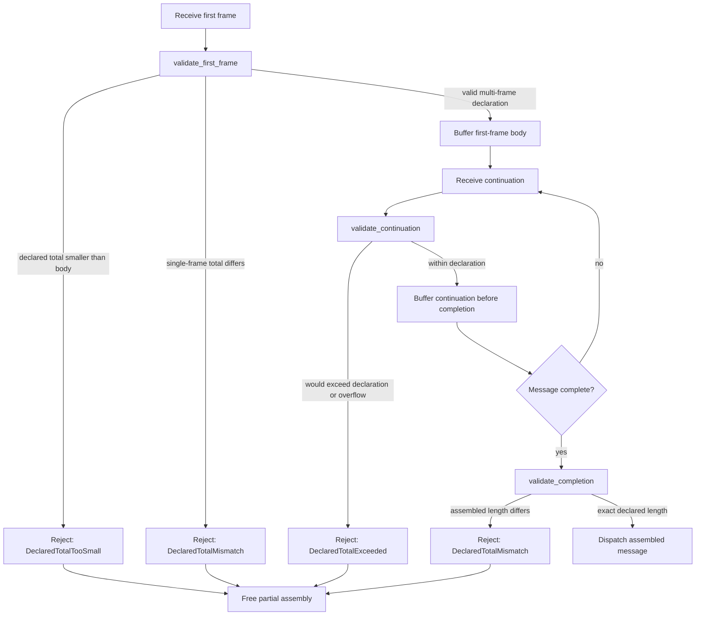

# Architectural decision record (ADR) 015: declared total body length is authoritative

## Status

Accepted.

`FirstFrameHeader::total_body_len` is authoritative: the assembler rejects a
declaration it can already contradict, stops a continuation from overshooting
it, and requires the completed body to match it exactly. The contract is
implemented by issue [#544](https://github.com/leynos/wireframe/issues/544).

## Date

2026-10-18.

## Context and problem statement

`FirstFrameHeader::total_body_len` lets a protocol declare the size of a
logical message on its first frame. `MessageSeries` stores the declaration as
`expected_total`, and `MessageAssemblyState` uses it to reject messages that
cannot fit the configured size limit.

The declaration was only a budget input. The completion path removed the
partial assembly and dispatched its body without comparing the accumulated
length to the declaration, and a single-frame message was returned before any
comparison at all. A peer could therefore declare any total that passed the
size check, send a different number of bytes, and have the body dispatched
unchanged. The name `total_body_len` promised a guarantee the runtime did not
make, which is a validation weakness (CWE-20) and an inconsistent length
interpretation (CWE-130).

The formal verification guide frames the choice between an authoritative
declaration and an advisory hint in its section on
[whether `total_body_len` is authoritative or advisory](formal-verification-methods-in-wireframe.md#2-is-total_body_len-authoritative-or-advisory).

## Decision drivers

- Every caller in this repository that supplies a total already expects it to
  be exact.
- The size limit is only meaningful if the declared value bounds the bytes that
  are actually buffered and dispatched.
- The domain, not the inbound adapter, owns message-assembly invariants.
- An over- or under-declaration must be rejected before an unbounded amount of
  peer-controlled data is retained.

## Options considered

### Option A: authoritative declaration

Reject any message whose assembled body length differs from the declaration.
Enforce before buffering as well as at completion.

### Option B: advisory hint

Rename the field and tolerate mismatch.

### Option C: enforce only at completion

Keep buffering unrestricted and compare once the final frame arrives.

| Topic              | Option A                | Option B      | Option C               |
| ------------------ | ----------------------- | ------------- | ---------------------- |
| Preserves the name | Yes                     | No (renamed)  | Yes                    |
| Bounds buffering   | Yes, before each append | No            | No                     |
| Bypass of limit    | Closed                  | Remains open  | Closed after buffering |
| Caller impact      | Exact totals required   | Silent change | Exact totals required  |

_Table 1: Trade-offs between the considered options._

## Decision outcome

Option A is adopted. `total_body_len` is a protocol commitment. Four
enforcement points apply, all in domain code:

| Stage                   | Rejected condition                            | Error                   |
| ----------------------- | --------------------------------------------- | ----------------------- |
| First frame             | `total_body_len < body_len`                   | `DeclaredTotalTooSmall` |
| First frame, final      | `total_body_len != body_len`                  | `DeclaredTotalMismatch` |
| Continuation            | accumulated body would exceed the declaration | `DeclaredTotalExceeded` |
| Completing continuation | accumulated body differs from the declaration | `DeclaredTotalMismatch` |

_Table 2: Declared-total enforcement points._

- The first-frame check runs before the size-limit check. A declaration that
  the first frame already contradicts is rejected as malformed rather than
  measured against a limit that cannot make it valid.
- A continuation is checked before its bytes are buffered, so an oversized
  frame is never retained, even briefly.
- A rejected continuation or completion removes the partial assembly. The
  failure is reported through `MessageAssemblyError`, which the inbound adapter
  maps to `io::ErrorKind::InvalidData` through its existing failure tracker.
- Protocols that leave `total_body_len` as `None` are unaffected; they retain
  the previous behaviour with no equality requirement.

For screen readers: the following flow chart traces a first frame through its
declaration check, a continuation through its admission check, and a completed
message through the final comparison, showing where each rejection frees the
partial assembly.

_Figure 1: Declared-total enforcement from the first frame to dispatch._

The checks live in `src/message_assembler/validation.rs`, next to the state
machine that applies them. `PartialAssembly` owns the completion check so the
buffered length and the declaration are read together.

## Consequences

### Positive

- The dispatched body length always equals the peer's declaration.
- An under-declared message can no longer bypass an application-configured size
  limit.
- Failures are typed per enforcement point, so diagnostics distinguish an
  unsatisfiable first frame from a completion mismatch.

### Negative

- A protocol that declared an approximate total will now see its messages
  rejected. No protocol in this repository does so.
- `MessageAssemblyError` gains three variants. The enum is not
  `#[non_exhaustive]`, so downstream exhaustive matches need updating.

## Rejected shortcuts

- Do not rename `total_body_len` to make the current behaviour sound: the
  validation weakness would remain.
- Do not enforce only in the inbound adapter: another adapter would still see
  the unsafe domain contract.
- Do not compare only at completion: a peer could force the runtime to buffer
  an arbitrarily large body first.
- Do not return the mismatched body with a warning: dispatch is the security
  boundary.

## Migration plan

1. Supply an exact `total_body_len`, or leave it as `None` to opt out of the
   equality requirement.
2. Update exhaustive matches on `MessageAssemblyError` with the new variants.
3. Update behavioural expectations that asserted a mismatched body was
   dispatched.

## Verification

- Unit tests cover under-declared single-frame totals, over-declared
  single-frame totals, an over-declared continuation, a final frame short of
  the declaration, exact equality, and the `None` opt-out.
- Behavioural tests in `tests/features/message_assembly.feature` exercise the
  same paths through the public API.
- `make check-fmt`, `make lint`, and `make test` pass.

## References

- [Issue #544](https://github.com/leynos/wireframe/issues/544)
- [ADR 002: streaming requests and shared message assembly](adr-002-streaming-requests-and-shared-message-assembly.md)
- [Formal verification methods in Wireframe](formal-verification-methods-in-wireframe.md)
