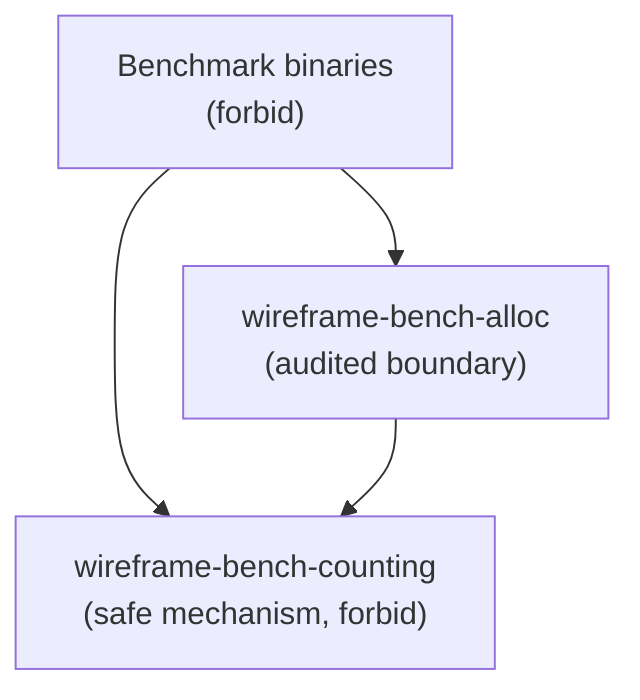

# Architectural decision record (ADR) 015: a single audited unsafe boundary for the counting allocator

## Status

Proposed.

First proposed on 2026-10-31 in issue
[#804](https://github.com/leynos/wireframe/issues/804).

## Date

2026-10-31.

## Context and problem statement

The workspace denied unsafe code crate by crate, and two benchmark targets
needed the same thing: a global allocator that counts allocations so the
runtime-ownership baselines can report what a hot path costs. Each target
therefore carried its own copy of a `CountingAllocator` — the same unit struct,
the same two static counters, and the same four delegating `GlobalAlloc`
methods. The copies were kept in step by hand, and each one needed its own lint
allowance, so the census that answers "where is unsafe code?" had to filter out
noise the workspace had itself created.

Raising the prohibition to `#![forbid(unsafe_code)]` in every target root makes
the census trivially answerable, but only if the allocator has somewhere to
live. Cargo does not let a member override an inherited `[workspace.lints]`
entry, so a workspace-level `forbid` cannot be relaxed by the one target that
genuinely needs an unsafe trait implementation. The unsafe code has to be
outside every safe root, and the compiler has to prove that it cannot come back.

## Traceability

Primary code surfaces:

- `crates/wireframe-bench-alloc/` — the audited boundary crate;
- `crates/wireframe-bench-counting/` — the safe counting mechanism;
- `benches/codec_performance_alloc.rs` and
  `benches/runtime_ownership_baselines_alloc/`;
- `tests/workspace_unsafe_boundary.rs` — the textual contract;
- `scripts/check-unsafe-boundary.sh` — the compiler probes;
- `docs/rust-boundary-verification.md` — what the checks do and do not
  establish.

Related decisions:

- [ADR 011: runtime ownership and task-lifetime boundaries](adr-011-runtime-ownership-and-task-lifetime-boundaries.md),
  which owns the benchmarks these targets measure.

## Decision drivers

- No `#[allow]` anywhere in the workspace; an expectation must carry a reason
  and be scoped to the code that needs it.
- One definition of the counting allocator, shared by every benchmark target.
- A new target root must fail closed: forgetting the prohibition must not
  silently permit unsafe code.
- The prohibition must be demonstrably effective, not merely textual.
- The audited surface must stay small enough to review in one sitting and to
  interpret under Miri.
- The published `wireframe` crate must not acquire a `publish = false`
  dependency.

## Options considered

### Option A: keep per-target copies with lint allowances

Each benchmark target keeps its own allocator and its own allowance. This
preserves the status quo, but the duplicated unsafe bodies can drift, the
allowances are exactly the census noise the issue is about, and no
workspace-wide `forbid` is possible.

### Option B: a workspace-level `forbid` alone

Set `unsafe_code = "forbid"` in `[workspace.lints]` and hope the allocator can
be written safely. `GlobalAlloc` is an unsafe trait with unsafe methods that
call unsafe `System` APIs, so no safe formulation exists; Cargo also refuses a
member override, so the targets could not compile at all.

### Option C: a deny floor, per-root forbid, and one audited crate (preferred)

Set `unsafe_code = "deny"` in `[workspace.lints]` as a floor, raise it to
`forbid` in every safe target root, and move the allocator into a small
dedicated crate that carries a scoped `#[expect(unsafe_code, reason = ...)]`.
The safe counting mechanism moves to a second crate that forbids unsafe code
like any other root.

| Topic                        | Option A: copies | Option B: workspace forbid | Option C: floor and boundary |
| ---------------------------- | ---------------- | -------------------------- | ---------------------------- |
| Builds at all                | Yes              | No                         | Yes                          |
| One allocator definition     | No               | n/a                        | Yes                          |
| `#[allow]` anywhere          | Two              | None, but nothing compiles | None                         |
| New root fails closed        | No               | Yes                        | Yes                          |
| Audited surface bounded      | No               | n/a                        | One crate                    |
| Publishable dependency graph | Yes              | n/a                        | Yes                          |

_Table 1: Trade-offs for isolating the counting allocator._

## Decision outcome

Adopt Option C.

### 1. The workspace sets a deny floor, not a ceiling

`[workspace.lints.rust]` sets `unsafe_code = "deny"`. This is a floor: a target
root that forgets its own prohibition still rejects unsafe code rather than
silently accepting it. Cargo cannot let a member weaken an inherited lint, so
the only way for the audited crate to hold unsafe code is a scoped `#[expect]`
under the inherited `deny`; a crate-level `forbid` would overrule that
expectation with `E0453`.

### 2. Every safe target root forbids unsafe code

Each safe `lib`, `bin`, `test`, `bench`, and `example` root carries
`#![forbid(unsafe_code)]` in its header, including the standalone
`tests/feature_gate` package that does not inherit workspace lints. Because
`forbid` cannot be overruled, no `#[allow]` or `#[expect]` can reintroduce
unsafe code in a safe root even if one is added by accident.

### 3. One audited crate holds the unsafe implementation

`crates/wireframe-bench-alloc` owns `CountingAllocator` and its `GlobalAlloc`
implementation. It carries `#![deny(unsafe_op_in_unsafe_fn)]` so each method
body must mark its own unsafe operations, and each delegation to `System`
carries a `SAFETY` comment stating the layout and provenance obligation it
inherits from the caller. A single scoped `#[expect(unsafe_code, reason)]`
covers the trait implementation; a second, separately justified expectation
covers the unit tests that call the four unsafe methods directly.

### 4. The safe mechanism lives beside it

`crates/wireframe-bench-counting` owns the counter, the enable gate, and the
scoped measurement helper. It forbids unsafe code like every other safe root.
Splitting the mechanism out is what keeps the audited crate down to one unit
struct and four delegating bodies, which is the surface the Miri run has to
cover.

The previous home, `wireframe_testing::benchmark_alloc_support`, is removed
rather than re-exported. A `publish = false` dependency in a published crate's
dependency graph would break publishing, and the module is absent from the
published archive; both benchmark targets depended on it only as a convenience.

_Figure 1: A benchmark binary installs the allocator from the audited crate and
measures through the safe crate._

### 5. The boundary is enforced, not documented

Three independent checks keep the boundary from eroding:

- `tests/workspace_unsafe_boundary.rs` discovers every target root from
  `cargo metadata`, fails when one omits the prohibition, fails when unsafe
  syntax appears outside the audited package, and fails when workspace
  membership changes without an inventory decision.
- `make unsafe-boundary` compiles deliberate unsafe probes on the pinned
  toolchain and requires the `unsafe_code` lint itself to reject them, with
  controls that prove the probes are not failing for unrelated reasons. One
  probe records the `E0453` behaviour that forced the deny floor.
- `make boundary-miri` interprets the audited crate's tests under Miri on a
  separately pinned toolchain.

`docs/rust-boundary-verification.md` records the scope, exclusions, and bounds
of each, including what Miri cannot establish.

## Consequences

### Positive

- The unsafe census has exactly one row.
- A target root that forgets the prohibition is still safe, and a target root
  that tries to weaken it does not compile.
- The allocator is defined once, so the two benchmark targets cannot drift.
- The audited surface is small enough to review and to interpret under Miri.
- No `#[allow]` remains in the workspace; every expectation states why.

### Negative

- Two small internal crates join the workspace, and both are `publish = false`.
- A toolchain bump can leave the Miri pin behind until a compatible nightly is
  installed; the pins are deliberately separate and the target reports which
  toolchain it used.
- Benchmarks that install a global allocator must be serialized, because the
  counter is process-global.

## Rejected shortcuts

- Do not keep a duplicated allocator behind `#[allow(unsafe_code)]`; that is the
  condition the issue exists to remove.
- Do not set a workspace-level `forbid` and relax it per target; Cargo does not
  allow the override.
- Do not re-export the mechanism from `wireframe_testing`; the crate is
  published.
- Do not move the unsafe code into a `build.rs` or a procedural macro to avoid
  the lint; that hides the obligation rather than auditing it.
- Do not treat the textual contract as proof that the lint works; compile the
  probes.

## Verification

- `cargo metadata` shows both new crates as members and the audited package as
  the only one with unsafe syntax.
- `make unsafe-boundary` rejects every unsafe construct and accepts both
  controls.
- `make boundary-miri` passes for the audited crate on its pinned toolchain.
- `RUSTFLAGS="-D warnings" cargo clippy --workspace --all-targets --all-features`
  reports zero findings with no `#[allow]` anywhere.
- `make bench-codec` and `make bench-runtime-ownership` run and report non-zero
  allocation counts.

## References

- [Issue #804](https://github.com/leynos/wireframe/issues/804)
- [Rust reference: lint levels](https://doc.rust-lang.org/reference/attributes/diagnostics.html#lint-check-attributes)
- [The `unsafe_code` lint](https://doc.rust-lang.org/rustc/lints/listing/allowed-by-default.html#unsafe-code)
- [The `GlobalAlloc` trait](https://doc.rust-lang.org/std/alloc/trait.GlobalAlloc.html)
- [`leynos/cuprum` commit 33bff5d](https://github.com/leynos/cuprum/commit/33bff5dbc68eac170848d5ef317c377a3198342c),
  which established the audited-boundary pattern this ADR follows.
