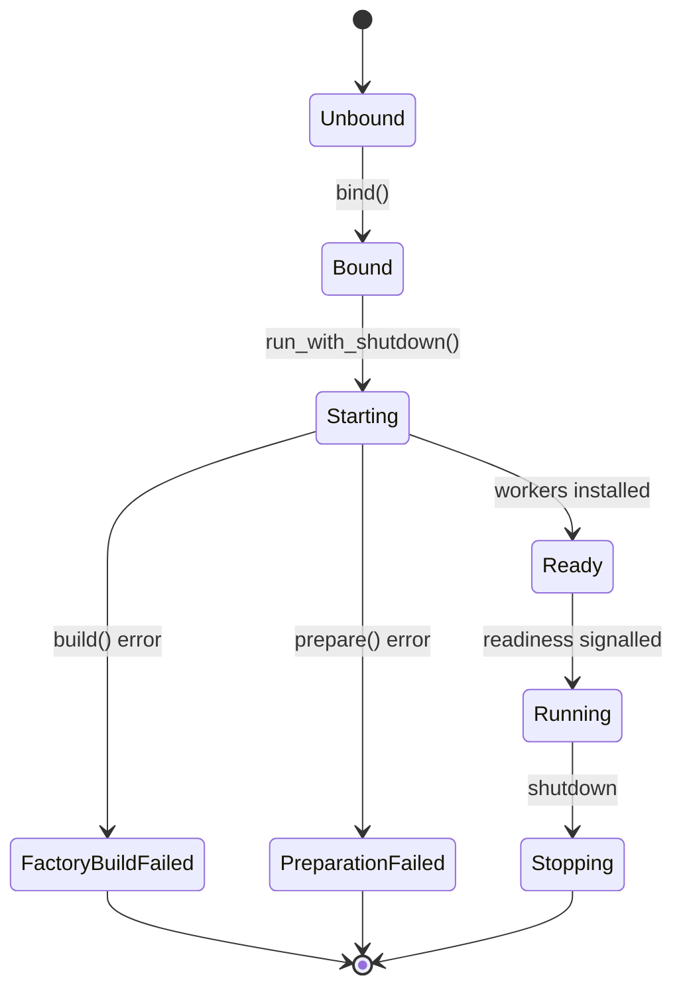

# Architectural decision record (ADR) 012: prepared application templates and connection-local runtimes

## Status

Proposed.

The `PreparedApp` transition and server-startup preparation described here are
implemented by [#641](https://github.com/leynos/wireframe/issues/641) and
[#642](https://github.com/leynos/wireframe/issues/642). [#643](https://github.com/leynos/wireframe/issues/643)
implements the connection-local inbound runtime — framed codec state, inbound
pipeline, fragment reassembly, message-assembly state, the deserialization
failure counter, resolved budgets, the read timeout, and connection setup state
— together with the centralized lifecycle finalization described in section 5.
[#644](https://github.com/leynos/wireframe/issues/644) implements the protocol
ownership and hook-dispatch consolidation in section 6. Other ownership listed
under `ConnectionRuntime` in section 1, including outbound connection-actor
state, peer metadata, and the teardown guard, remains sequenced work. The
broader ownership decision remains proposed while that work continues.

First proposed on 2026-08-08 in issue
[#637](https://github.com/leynos/wireframe/issues/637); imported and refined on
2026-08-23 following design review.

## Date

2026-08-23.

## Context and problem statement

Before preparation became explicit, `WireframeApp` represented three different
lifecycle phases:

1. a mutable builder that collects routes, middleware, lifecycle callbacks,
   protocol hooks, serializer, codec configuration, message assembly, and
   application data;
2. an immutable application template read by every connection;
3. a value historically constructed afresh by `AppFactory::build` inside each
   connection task.

Those roles have incompatible ownership requirements.

The builder must own mutable registration collections. The immutable template
should build middleware chains once and be shared by independent connection
tasks. The connection runtime should own stream state, lifecycle state, codec
state, message assembly, fragmentation state, and other values that exist for
exactly one connection.

Before the implementation slices tracked by
[#641](https://github.com/leynos/wireframe/issues/641) and
[#642](https://github.com/leynos/wireframe/issues/642), this hybrid created
several observable problems:

- route chains were built lazily from a fresh app for each connection;
- the route table was stored as
  `OnceCell<Arc<HashMap<u32, HandlerService<E>>>>` and cloned into connection
  handling even though the app remained alive for the whole connection;
- the generic server and examples used different application-sharing topologies:
  the latter runtime bootstrap shared one `Arc<WireframeApp>` across
  connections and bypassed `AppFactory` entirely;
- documentation variously described an app per worker and an app per
  connection; the rustdoc for `WireframeServer` states that each worker
  "receives its own `WireframeApp`", while the code built one per accepted
  connection;
- application-owned callbacks and protocol objects acquired nested `Arc`
  layers because the shared template itself is not explicit;
- factory failures happened after a connection had already been accepted and
  were logged rather than reported as startup failure; `ServerError` then had
  only `Bind` and `Accept` variants;
- lifecycle teardown and protocol-hook correctness had to be threaded through
  a type that also carries builder-only state.

## Traceability

This ADR governs the application half of Epic
[#635](https://github.com/leynos/wireframe/issues/635) and implements ADR 011's
shared-root rule.

Primary code surfaces:

- `src/app/builder/core.rs`;
- `src/app/builder/routing.rs`;
- `src/app/builder/lifecycle.rs`;
- `src/app/builder/protocol.rs`;
- `src/app/inbound_handler/mod.rs`;
- `src/app/connection_runtime/`;
- `src/app/prepared_app.rs`;
- `src/server/mod.rs`;
- `src/server/runtime/mod.rs`;
- `src/server/runtime/accept.rs`;
- `src/server/connection_spawner.rs`;
- `examples/ping_pong.rs` and `examples/packet_enum.rs`.

Related issues and decisions:

- Epic [#635](https://github.com/leynos/wireframe/issues/635);
- ADR 011 proposal [#636](https://github.com/leynos/wireframe/issues/636);
- [ADR 010](adr-0010-transport-frame-boundary-for-the-zero-copy-migration.md),
  whose packet/transport-frame boundary remains unchanged;
- [#547](https://github.com/leynos/wireframe/issues/547), normal app
  responses bypass configured protocol hooks (delivered);
- [#549](https://github.com/leynos/wireframe/issues/549), returned
  stream-processing errors reach a registered teardown hook; completed together
  with panic and cancellation finalization by
  [#643](https://github.com/leynos/wireframe/issues/643);
- [#598](https://github.com/leynos/wireframe/issues/598), public protocol
  and message-assembler accessors lack direct coverage;
- [#538](https://github.com/leynos/wireframe/issues/538), zero-copy
  serializer output migration, which remains a separate concern.

Implementation of this ADR is sequenced through:

- [#641](https://github.com/leynos/wireframe/issues/641), `PreparedApp` and
  one-time route/middleware preparation (implemented);
- [#642](https://github.com/leynos/wireframe/issues/642), preparing the
  application before server readiness (implemented);
- [#643](https://github.com/leynos/wireframe/issues/643), the
  connection-local runtime and centralized lifecycle finalization (implemented);
- [#644](https://github.com/leynos/wireframe/issues/644), consolidated
  protocol ownership and hook dispatch (implemented);
- [#648](https://github.com/leynos/wireframe/issues/648), collapse of
  nested application-owned sharing beneath `PreparedApp`.

## Decision drivers

- Prepare immutable routing and middleware state once, before serving
  traffic.
- Make readiness mean that application preparation has succeeded.
- Give each connection explicit ownership of connection-local state.
- Preserve one clear shared ownership root for independent connection
  tasks.
- Surface application construction errors deterministically.
- Avoid arbitrary per-worker state duplication on a multithreaded executor
  where accept-loop tasks are not thread-affine.
- Keep the migration reviewable and avoid coupling it to ADR 010 or the
  zero-copy public API migration.

## Options considered

### Option A: retain a fresh `WireframeApp` per connection

Continue invoking `AppFactory::build` in the connection task and optimize
individual fields in place.

This preserves current runtime behaviour but repeats application construction,
leaves startup readiness underspecified, and keeps the builder/template/runtime
roles entangled.

### Option B: prepare one application per accept-loop worker

Invoke the factory once per configured worker and share that prepared app among
connections accepted by the worker.

This reduces per-connection construction, but accept-loop tasks are not pinned
to executor threads. Per-worker application state therefore partitions state by
an implementation detail rather than by a meaningful ownership boundary, and it
duplicates route/middleware preparation `workers` times. The per-worker model
suits actix-web, whose workers are single-threaded runtimes with thread-affine
state; Wireframe's accept loops run on a shared multithreaded runtime, so the
analogy does not transfer.

### Option C: prepare one application template per server and create one runtime per connection (preferred)

Invoke the application factory once during server startup, consume the
resulting builder into an immutable prepared template, and share one
`Arc<PreparedApp>` among independent connection tasks. Create connection-local
runtime state after accept.

This aligns preparation, readiness, sharing, and connection ownership. It
matches the shape used across the ecosystem: tower's `MakeService` builds one
factory whose cheap per-connection services derive from shared configuration,
hyper 1.x constructs a per-connection service value in the accept loop while
routing/configuration state stays shared, and axum's `Router` is the closest
structural precedent — a prepared, cheaply cloneable artefact built once and
handed to every connection.

### Option D: expose both per-server and per-connection application strategies immediately

Add explicit strategy types or constructors and preserve both models as
first-class APIs.

This offers flexibility but doubles the lifecycle surface before the project
has evidence that per-connection application construction is needed.
Per-connection resources can already be created through the connection setup
hook.

### Option E: prepare lazily on the first connection

Wrap `PreparedApp` in an async `OnceCell` and prepare it inside the first
accepted connection, keeping the existing factory API and synchronous startup
untouched.

This is the natural incremental step from the current
`OnceCell<Arc<HashMap<...>>>` code and the smallest possible migration, with an
identical steady-state sharing topology. It is rejected because it forfeits the
readiness guarantee and deterministic startup failure: preparation errors
surface on the first client's connection instead of at boot, and the first
connection pays the preparation latency. Both directly contradict the readiness
and deterministic-error decision drivers.

| Topic                       | Option A: per connection | Option B: per worker | Option C: per server | Option D: both APIs | Option E: lazy first use |
| --------------------------- | ------------------------ | -------------------- | -------------------- | ------------------- | ------------------------ |
| Preparation repeated        | Per connection           | Per worker           | Once                 | Depends on choice   | Once                     |
| Readiness meaning           | Undefined                | Partial              | Precise              | Ambiguous           | Undefined                |
| Ownership boundary fidelity | Weak                     | Accidental           | Strong               | Mixed               | Strong                   |
| Public API surface          | Unchanged                | New                  | Small change         | Doubled             | Unchanged                |
| Migration size              | None                     | Medium               | Medium               | Large               | Small                    |

_Table 1: Trade-offs for application preparation frequency._

## Decision outcome

Adopt Option C.

### 1. Separate the lifecycle phases

Wireframe will distinguish the following concepts, whether initially public or
crate-private:

For screen readers: The following diagram shows the three lifecycle phases — the
`WireframeApp` builder is consumed by `prepare().await` into a `PreparedApp`
template; each independent connection task then receives its own clone of the
shared `Arc<PreparedApp>` and constructs its own connection-local
`ConnectionRuntime`. The `PreparedApp` remains shared; only the
`ConnectionRuntime` is per-connection.

```text
WireframeApp builder
        │
        │ prepare().await
        ▼
PreparedApp
        │ per connection: clone Arc<PreparedApp>,
        │ construct connection-local runtime
        ▼
ConnectionRuntime
```

_Figure 1: Application lifecycle phases from builder to connection runtime._

For screen readers: The following state diagram shows the server moving from
its unbound builder state through factory evaluation and application
preparation, then only signalling readiness after workers are installed. It
also shows factory and preparation failures ending before readiness.



_Figure 2: Server startup, readiness, failure, and shutdown states._

The split follows one uniform template-versus-instance rule: `PreparedApp` owns
immutable definitions, configuration, and factories; `ConnectionRuntime` owns
the per-connection mutable instances derived from them. Where the same domain
appears in both lists below — protocol hooks, message assembly, fragmentation —
the prepared side holds the definition and the runtime side holds the
per-connection invocation or reassembly state, so each concrete responsibility
has exactly one owner.

`prepare()` consumes the builder by value and returns `PreparedApp`, making
post-preparation route registration unrepresentable rather than a runtime
error. This mirrors the sealed `Unbound`/`Bound` typestate that
`WireframeServer` already uses. A reusable template is expressed as
`Arc<PreparedApp>`, so no separately cloneable builder snapshot is needed.

#### `WireframeApp`

`WireframeApp` remains the fluent registration/builder surface. It owns mutable
route and middleware registrations and is not used directly to process a stream
after preparation.

The builder deliberately keeps the `WireframeApp` name for compatibility even
though `PreparedApp` becomes the actual application; Phase 5 should consider a
`WireframeAppBuilder` alias so the vocabulary drift is acknowledged rather than
silent.

#### `PreparedApp`

`PreparedApp` is immutable after construction. It owns by value or `Box`:

- the prepared route table and completed middleware chains;
- serializer and codec templates/configuration;
- application data;
- lifecycle callback definitions;
- protocol and message-assembler definitions;
- immutable fragmentation, memory-budget, timeout, and push configuration.

The server owns one `Arc<PreparedApp>` and clones it once per independent
connection task. Values that cannot escape independently should not add another
`Arc` layer merely because the prepared root is shared.

#### `ConnectionRuntime`

`ConnectionRuntime` owns values whose lifetime is exactly one connection:

- accepted/rewound stream and framed codec state;
- connection setup state `C`;
- `ConnectionContext` and protocol-hook invocation state;
- inbound frame pipeline, deserialization failure count, fragment
  reassembly, and message-assembly instance state;
- outbound connection actor state, connection-local `Fragmenter`, queues,
  and cancellation observations;
- peer metadata and teardown guard.

Connection-local resources are created through setup/runtime construction, not
by rebuilding the entire application.

### 2. Prepare before readiness

`run_with_shutdown`:

1. evaluate `AppFactory` once;
2. prepare routes and middleware chains;
3. construct the shared `PreparedApp` root;
4. spawn accept loops;
5. send the readiness signal through the existing `ready_tx` oneshot
   channel.

Application build or preparation errors are returned as the distinct
`ServerError::FactoryBuild` and `ServerError::Prepare` variants, with
source-error chaining, so orchestration and rollback automation can distinguish
preparation failure from `Bind` failure. On failure, `run_with_shutdown`
returns the typed error and the readiness channel is observably closed rather
than silently dropped, so a readiness waiter learns of the failure promptly
instead of hanging.

Preparation runs arbitrary user middleware transforms, so it must be
observable. The implementation records preparation outcomes and duration in the
application-preparation metrics, while a failed transform prevents readiness
from being signalled.

No connection is accepted by a server whose application template failed to
prepare. This guarantee should be structural, not merely tested: the
accept-loop spawn takes the `Arc<PreparedApp>` by value, so an accept loop
cannot exist before preparation has succeeded.

### 3. Treat `AppFactory` as a startup factory

`WireframeServer::new(factory)` evaluates the factory once per server run
rather than once per connection, prepares the resulting application before
readiness, and shares the immutable root across all connection tasks. The
`WireframeServer::from_app` constructor supplies an already-built application
to the same preparation path. No separately named per-connection factory is
needed: connection-specific state belongs in lifecycle setup state `C`.

The disposition list must also cover the adjacent public surface the split
invalidates:

- `WireframeApp::handle_connection_result` and `handle_connection` are `pub`
  and embodied the builder/template/runtime hybrid being dissolved; they are
  deprecated on `WireframeApp` and re-homed on the `PreparedApp`/
  `ConnectionRuntime` path, with removal acceptable pre-1.0 alongside a
  migration note;
- the `AppFactory` trait's `Clone` bound and its rustdoc contract ("build an
  application instance for a new connection") become vestigial under per-server
  evaluation. Its rustdoc now describes one server run, and the
  `WireframeServer` rustdoc no longer makes a per-worker claim.

The final public API disposition must be recorded before this ADR is accepted.

### 4. Build route chains exactly once

Middleware transformation may remain asynchronous, so `prepare()` may be async.
The resulting route map is owned directly by `PreparedApp`; no inner
`Arc<HashMap<...>>` or per-connection `OnceCell` clone is required.

### 5. Make lifecycle cleanup structural

Once setup succeeds and a teardown hook is registered, teardown must run
exactly once on every terminal path, including decode, protocol, transport,
cancellation, and panic-recovery paths where execution can safely continue.

The connection-local runtime implements this with two collaborating values.
`ConnectionRuntime` stages the accepted transport and the immutable
`InboundConfig`, and builds framing state only when `run` is driven; the framed
stream, pipeline, message assembly, decode-failure count, effective budgets,
and read timeout are locals of that one connection task.
`ConnectionFinalizer<C>` owns the setup value in one of three states:
`NotSetUp`, `Armed(C)`, or `Finalized`. Only `arm` from `NotSetUp` records
setup output, and `take_for_teardown` replaces the state with `Finalized`
before returning the value. Teardown therefore consumes the setup value at most
once even if finalization is requested after the state has already been taken,
and a teardown-callback panic cannot re-trigger it. Finalization is an explicit
async method; no `Drop` implementation performs I/O or awaits teardown.

Construction is deliberately staged. `ConnectionRuntime::new` only stores the
transport and configuration, so it cannot clone the connection codec or reserve
the maximum frame buffer while a setup hook is still pending, and a custom
codec is never initialized before setup establishes its state. Setup completes
first; `run` then builds framing state and drives the shared frame-processing
loop.

`ConnectionRuntime::run` keeps the processing result rather than propagating it
with `?`, awaits finalization, and only then returns the result or re-raises a
panic. Initialization and processing share one future inside
`AssertUnwindSafe(..).catch_unwind()`, while the finalizer is destructured out
of the runtime and stays outside the caught future. The assertion is sound
because handlers never observe `C`, and the framing state is a local that is
dropped during unwinding and never reused. A panic during initialization is
therefore finalized and re-raised like any processing panic. Setup and teardown
panics remain intentionally outside this recovery point.

Because the framing state is a local of the caught future, the framed stream is
dropped when processing returns or unwinds, before `run` awaits teardown. The
transport is therefore released before a teardown callback runs, so a callback
that waits for the peer to observe closure cannot deadlock against a transport
the runtime still owns. Regression tests pin both orderings in
`src/app/connection_runtime/ordering_tests.rs`.

Cooperative cancellation comes from the per-connection shutdown token in the
processing context and is observed only at the read boundary: it is the biased
first branch of the `select!` around the timed frame read. Cancellation
therefore ends the connection between frames, never mid-decode or mid-write,
and finalizes through the same path, including delivery of an exact non-`Clone`
setup value. The server supplies a per-connection child token of its worker
shutdown signal through `PreparedApp::handle_connection_with_shutdown`, and
[ADR 014](adr-0014-server-shutdown-ownership-and-terminal-observation.md)'s
2026-11-14 addendum bounds that token to work that cannot otherwise make
progress: a connection whose peer is reading still drains across `stop()`,
while a write or response wait that cannot proceed is abandoned rather than
pinning the drain. Compatibility entry points supply a fresh token that is
never cancelled and are not part of the public lifecycle promise.

The prepared byte-stream entry points carry no peer address or connection
identifier, so the runtime owns none; envelope correlation identifiers remain
per-frame state on the decoded envelope.

The returned-error path, and with it
[#549](https://github.com/leynos/wireframe/issues/549), is covered by the same
finalization step.

A read-interval expiry is not a terminal outcome. When the timed
`framed.next()` wait elapses, the runtime purges expired fragment and assembly
state and keeps waiting; it does not close an idle connection. This preserves
the corrected `MAX_READ_TIMEOUT_MS` rustdoc from
[#870](https://github.com/leynos/wireframe/issues/870). The deprecated
`WireframeApp::handle_connection*` compatibility entrypoints likewise keep
`since = "0.4.0"`, the release that deprecates them.

The guard mechanism must be panic-aware. Teardown callbacks are async, so a
`Drop`-based guard cannot run them during unwind. The terminal paths are
classified explicitly, and each classification carries its own test:

- **Handler panic, recovered in-task.** Recovery happens inside the connection
  task, at the `ConnectionRuntime::run` boundary, before the moved runtime
  becomes inaccessible, because a spawner observing a task join error no longer
  holds the runtime and cannot run its teardown. The runtime finalizes, then
  re-raises the panic so the connection-task supervisor still counts and logs
  it. Teardown runs exactly once on that path. Any panic not recovered in-task
  falls into the abandoned-unwind classification below and is an accepted,
  documented gap.
- **Teardown-callback panic, isolated.** The finalizer transitions to
  `Finalized` before invoking teardown, so a panic inside a teardown callback
  cannot re-trigger it, fire teardown twice, or poison later connections. The
  panic propagates to the supervisor for that connection only.
- **Abandoned unwind.** The accepted gaps are:
  - the connection future is dropped or aborted while it is still running, so
    the runtime never resumes and cannot await teardown;
  - setup panics or never completes, in which case no setup state was armed and
    teardown is skipped;
  - teardown itself panics, which is not retried for that connection.
- **`panic = "abort"` builds.** An aborting panic terminates the process
  immediately: there is no unwind, no join error, and nothing recoverable, so
  the recovered classification is inapplicable and teardown cannot run. The
  process-level abort is the accepted outcome.

### 6. Apply protocol hooks consistently

The prepared protocol definition and connection-local hook context must cover
normal app responses as well as actor-driven push/streaming output. This
coordinates with [#547](https://github.com/leynos/wireframe/issues/547) while
preserving ADR 010's packet-oriented hook decision.

`PreparedApp` builds a fresh `ProtocolHooks` value for each connection from the
prepared protocol and passes it, together with a new `ConnectionContext`, to
the connection's `FramePipeline`. The pipeline runs `before_send` on every
serialized and codec-wrapped handler-response frame, including each fragment of
a fragmented response, immediately before the transport write. Hooks are never
shared between connections. Because the hook may change the frame, it is
responsible for keeping it within the codec's `max_frame_length`; growing it
past that limit fails the send and ends the connection. Every protocol callback
other than setup is dispatched by that same pipeline owner: push and streaming
frames pass through its transport sink, and the error, terminator, and
completion hooks follow a handler response. The direct response helpers bypass
`before_send` by design.

[#547](https://github.com/leynos/wireframe/issues/547) delivered the
handler-response dispatch.
[#644](https://github.com/leynos/wireframe/issues/644) then consolidated
ownership: `ProtocolHooks` is an enum whose `Protocol` form wraps a
`ProtocolDispatch`, and that dispatch erases a possibly-`?Sized` protocol
behind a single `Arc` instead of the six per-operation forwarding closures the
old representation built. A protocol-backed connection therefore holds exactly
one strong reference once setup has completed — during setup the caller's
reference is still alive alongside the pipeline's — and `on_connection_setup`
runs at most once per hooks value. The frame pipeline holds a crate-private
`ConnectionProtocol` pairing that hooks value with the connection's single
`ConnectionContext`; it is the only hook owner on the prepared path, so the
connection actor built there is constructed with inert hooks and an empty
context. The actor's own `ConnectionProtocol` field therefore holds no copy of
the connection's context and no protocol reference; it receives only the
connection identifier and peer address it logs with. The pipeline's context is
the only one the prepared path dispatches against, and setup receives that same
value before it is installed. An actor driven directly through `with_hooks` is
the single owner instead. That pairing is the input the ownership collapse under
[#648](https://github.com/leynos/wireframe/issues/648) needs: the actor and
pipeline can be folded into one runtime without revisiting hook semantics.
Every packet-oriented outbound path now runs `before_send` exactly once per
emitted packet — handler responses, push frames, streamed responses,
multi-packet channel frames, and stream-end terminators — and no
transport-frame hook is introduced, so the
[ADR 010](adr-0010-transport-frame-boundary-for-the-zero-copy-migration.md)
packet boundary is unchanged. Section 8 records that boundary against #644's
"before serialization" wording and the prepared path's lifecycle contract.

### 7. Unify examples with the production runtime

Examples should stop maintaining a separate `Arc<WireframeApp>` bootstrap
topology. They should exercise the same preparation and server runtime used by
library consumers, unless an example deliberately demonstrates a lower-level
API.

### 8. Hook boundary and prepared lifecycle addendum — 2026-11-18

This addendum settles two questions section 6 left implicit and supersedes the
"before serialization" wording in
[#644](https://github.com/leynos/wireframe/issues/644)'s dispatch requirement.
Section 6 otherwise stands unchanged.

`before_send` observes the packet as the connection will write it: the
serializer has produced the payload and `FrameCodec::wrap_payload` has wrapped
it into `F::Frame`. The hook therefore runs after the application packet
(`Envelope`) has been serialized, not before it. Two constraints force that
boundary:

- the hook's signature is
  `before_send(&self, frame: &mut Self::Frame, ctx: &mut ConnectionContext)`,
  so it cannot see the `Envelope`; a pre-serialization hook would need a
  differently shaped callback and a public API break;
- [ADR 010](adr-0010-transport-frame-boundary-for-the-zero-copy-migration.md)
  fixes the packet boundary at the codec frame, and changing that boundary is
  an explicit non-goal of #644.

"Before serialization" is therefore read as "before the packet is serialized
onto the transport", that is, immediately before the codec driver writes the
frame. A protocol-supplied frame such as a stream terminator is already a
complete codec frame, so the hook runs on it unchanged before emission.
`prepared_response_runs_before_send_once_after_serialization` and
`prepared_stream_runs_before_send_once_per_frame_and_terminator` pin the
boundary through a prepared connection, and
`push_and_streamed_frames_run_before_send_once` pins it for an actor-driven one.

The same addendum records the prepared path's lifecycle contract. A prepared
connection dispatches `before_send`, `handle_error`, `stream_end_frame`, and
`on_command_end` through its hook owner, dispatches `on_connection_setup`
exactly once per connection, and never dispatches `on_eof`. Setup runs from
`build_connection_actor`, after the connection's `PushHandle` is published in
the `SessionRegistry` and before the actor starts, so a protocol can address
its own connection; the reference used for that call is not retained.
Application-level initialization and cleanup for a prepared connection remain
the `on_connection_setup` and `on_connection_teardown` lifecycle hooks, which
the runtime finalizer drives once per connection. The protocol's own
end-of-file callback remains available only to callers that drive a
`ConnectionActor` directly.
`prepared_connection_dispatches_setup_once_and_no_eof_hook` pins that contract
through a prepared connection, including a mid-frame end-of-file.

### 9. Nested ownership collapse addendum — 2026-11-20

Issue [#648](https://github.com/leynos/wireframe/issues/648) completes Phase 4
and records the resulting ownership. It does not revise sections 1-8; where a
statement above implies a different representation, this addendum supersedes it.

- **Serializer.** `PreparedApp` owns `Box<S>` and lends `&S` to each connection.
  The connection boundary requires `Send + Sync + 'static` only: neither
  `Clone` nor `Default` is needed, and a `!Unpin` serializer is accepted.
- **Lifecycle callbacks.** Setup and teardown are
  `Box<ConnectionSetup<C>>` and `Box<ConnectionTeardown<C>>`, borrowed as
  `&dyn Fn` for the connection's lifetime. They are never cloned per connection.
- **Message assembler.** `PreparedApp` owns `Option<Box<dyn MessageAssembler>>`
  and lends `Option<&dyn MessageAssembler>`. Both the builder and prepared
  accessors therefore return a borrow, which is the disposition recorded for
  [#598](https://github.com/leynos/wireframe/issues/598) in the pending 0.4.0
  breaking release. No supported caller clones an assembler out of the
  application; the only independent ownership is the caller's own value before
  `with_message_assembler` consumes it.
- **Handler.** The public `Handler` and `ResponseHandler` aliases remain
  `Arc<dyn Fn>`, because a caller may legitimately retain a clone. Preparation
  _moves_ the existing `Arc` out of the consumed builder instead of cloning it,
  so two route ids registered with the same handler share one allocation and a
  prepared root leaves no extra strong reference behind.
- **Protocol.** The `Arc` stays. `PreparedApp::protocol` hands out a cloneable
  handle, and section 6's
  [#644](https://github.com/leynos/wireframe/issues/644) pairing already gives
  every connection exactly one strong reference through `ProtocolHooks`.
  Removing it would break a public accessor to satisfy a field-list aesthetic.
- **Application data.** ADR 017 removed `AppDataStore` and the shared-state
  slot, so there is no per-application store whose shared-value semantics need
  preserving, and no nested `Arc` left to collapse there.
- **Drop timing.** Application-owned values are released when the last
  `Arc<PreparedApp>` drops. A connection future borrows the template and holds
  no independent reference to any of these values, so dropping a connection
  releases only its own state.

Verification lives in `tests/prepared_app/ownership.rs`: a live connection and
a lingering root clone keep every probe alive; the final root drop releases
each probe exactly once; a protocol handle outlives the root that produced it;
one handler allocation serves two route ids; and two connections interleave
fragments through one assembler and one serializer. Trybuild fixtures pin the
relaxed serializer bounds and the borrowed accessor types. The developers'
guide carries the resulting inventory table under "Application-owned values
beneath `PreparedApp`".

## Consequences

### Positive

- Route and middleware preparation no longer repeats per connection.
- Readiness acquires a precise meaning.
- One `Arc<PreparedApp>` reflects one real shared ownership boundary.
- Connection-local invariants become visible in a dedicated type.
- Startup failures become deterministic and observable.
- Lifecycle and protocol-hook fixes gain one structural home.
- The generic server and examples share one topology.

### Negative

- Existing factory side effects or per-connection assumptions may change
  behaviour.
- `prepare()` introduces an explicit asynchronous startup phase.
- `ServerError` grows application-build/preparation variants.
- More internal types and transition code increase short-term refactor
  size.
- Tests that called `WireframeApp::handle_connection_result` directly may
  need a preparation helper or lower-level harness.

## Rejected shortcuts

- Keeping `WireframeApp` as all three phases and only changing
  `OnceCell<Arc<_>>` to `OnceCell<_>`.
- Building one template per worker without thread affinity or a
  worker-local-state requirement.
- Making the whole builder `Clone` and cloning it into every connection.
- Moving connection-local mutable state into the shared prepared root
  behind locks.

## Migration plan

### Phase 1: introduce internal preparation types

Add `PreparedApp` and `ConnectionRuntime` internally, with compatibility
wrappers for current entry points
([#641](https://github.com/leynos/wireframe/issues/641)).

This phase must also ship the test-harness replacement, because roughly fifteen
test files and fixtures drive `WireframeApp::handle_connection_result` over
duplex streams and Phase 1 restructures the type they depend on. Deliver a
`wireframe_testing`/testkit drive helper (builder, then `prepare().await`, then
a connection runtime over a duplex stream) alongside
[#641](https://github.com/leynos/wireframe/issues/641), and migrate existing
tests through one mechanical, documented substitution.

Compatibility wrappers in this plan are internal scaffolding, not API: they are
removed before this ADR flips to Accepted, verified at
[#649](https://github.com/leynos/wireframe/issues/649) closure.

### Phase 2: move route and middleware preparation

Consume handler and middleware registrations during preparation and remove
per-connection route initialization
([#641](https://github.com/leynos/wireframe/issues/641)).

### Phase 3: switch server startup (implemented by [#642](https://github.com/leynos/wireframe/issues/642))

Evaluate and prepare the app before spawning accept loops and readiness
notification. Thread one prepared root into connection tasks
([#642](https://github.com/leynos/wireframe/issues/642)).

### Phase 4: collapse nested ownership

Replace application-owned `Arc` callback/assembler layers with direct or boxed
ownership where they cannot escape independently
([#648](https://github.com/leynos/wireframe/issues/648)). Consolidate protocol
ownership under [#644](https://github.com/leynos/wireframe/issues/644)
(implemented): each connection now holds one strong protocol reference once
setup has completed, and one hook context, and the remaining collapse under
[#648](https://github.com/leynos/wireframe/issues/648) can build on that
`ConnectionProtocol` pairing.

### Phase 5: settle public API and documentation

Document factory evaluation semantics, update examples, and expose only the
preparation/runtime APIs that downstream users genuinely need. The concrete
documentation obligations, delivered under
[#649](https://github.com/leynos/wireframe/issues/649), are:

- `docs/users-guide.md`: readiness semantics and factory evaluation
  frequency;
- `docs/developers-guide.md`: the ownership section, reproducing the
  builder/template/runtime diagram from this ADR;
- a versioned migration guide if `WireframeServer::new(factory)` semantics
  change observably, following the existing
  `docs/v0-2-0-to-v0-3-0-migration-guide.md` pattern;
- the `WireframeAppBuilder` alias decision noted in section 1.

## Verification

- A counter-based test proves the app factory and middleware transforms run
  once per server run, not once per connection.
- Multiple simultaneous connections share the same prepared route table
  without rebuilding it.
- Readiness is not signalled before preparation completes.
- Factory/preparation failure prevents acceptance and returns a typed
  server error.
- When both hooks are registered, setup and teardown run exactly once across
  the terminal paths the matrix drives: clean close, decode error, protocol
  error, message-assembly failure, transport read error, transport write error,
  and handler panic. The matrix in `tests/prepared_app/lifecycle_matrix.rs`
  moves a non-`Clone` setup value through each outcome and checks that teardown
  received that exact value once; setup failure and a setup that never
  completes run teardown zero times.
- Cooperative cancellation also finalizes exactly once. The matrix does not
  drive it, because `PreparedApp::handle_connection_result` supplies no token.
  `cancellation_finalizes_the_exact_non_clone_setup_value` in
  `src/app/connection_runtime/ordering_tests.rs` covers cancellation with the
  exact non-`Clone` setup value, while
  `cancellation_before_any_frame_runs_teardown_once` and
  `cancellation_during_pending_read_runs_teardown_once` in
  `src/app/connection_runtime/tests.rs` cover the two read-boundary positions.
- Protocol `before_send` applies to ordinary responses and actor-driven
  outputs according to ADR 010.
- Existing handler ordering, codec, fragmentation, message assembly,
  memory-budget, and shutdown tests continue to pass.
- Connection-startup benchmarks compare the old and prepared paths.
- A readiness waiter observes preparation failure promptly; preparation
  failure is distinguishable from bind failure.
- A handler panic recovered in-task still runs teardown exactly once. The
  connection-task supervision test asserts one teardown, one panic metric, one
  panic log, and a second connection served normally afterwards.
- A panic inside a teardown callback does not run teardown twice or poison
  later connections.
- Each abandoned-unwind path enumerated in section 5 is recorded with a test
  where reachable, or an explicit accepted-gap note.
- A `proptest` over arbitrary arm/finalize sequences proves the finalizer
  invokes teardown at most once and only after setup state is armed.
- Preparation outcomes and duration are recorded in application-preparation
  metrics.
- The finalizer's at-most-once invariant is covered by `proptest`. Broader
  bounded-model coverage of preparation-once and readiness ordering, using
  `proptest`, `loom`, or the bounded checkers described in
  [formal-verification-methods-in-wireframe.md](../formal-verification-methods-in-wireframe.md),
  remains outstanding, mirroring ADR 013's state-machine verification.

## Outstanding decisions before acceptance

- Whether `PreparedApp` and `ConnectionRuntime` remain internal or gain
  public advanced APIs.
- The exact public migration for `WireframeServer::new(factory)`, including
  the `handle_connection_result`/`handle_connection` and `AppFactory` bound
  dispositions from section 3.
- How testkit helpers expose preparation without making tests depend on
  private internals, given the Phase 1 drive-helper deliverable.

The question of whether preparation consumes the builder irreversibly is
resolved in section 1: `prepare()` consumes the builder, and reuse is expressed
through `Arc<PreparedApp>`.

## References

- Epic [#635](https://github.com/leynos/wireframe/issues/635)
- ADR 011 proposal [#636](https://github.com/leynos/wireframe/issues/636)
- [ADR 010: transport-frame boundary for the zero-copy migration](adr-0010-transport-frame-boundary-for-the-zero-copy-migration.md)
- [#538](https://github.com/leynos/wireframe/issues/538)
- [#547](https://github.com/leynos/wireframe/issues/547)
- [#549](https://github.com/leynos/wireframe/issues/549)
- [#598](https://github.com/leynos/wireframe/issues/598)
- [#648](https://github.com/leynos/wireframe/issues/648)
- [tower `MakeService`](https://docs.rs/tower/latest/tower/trait.MakeService.html)
- [hyper 1.x server guide](https://hyper.rs/guides/1/server/hello-world/)
- [actix-web server model](https://actix.rs/docs/server/)
- [axum `Router`](https://docs.rs/axum/latest/axum/struct.Router.html)

## Addendum: 2026-11-16 — handler responses and push output route through the connection actor

Issue [#875](https://github.com/leynos/wireframe/issues/875) completes the
routing section 6 anticipated. This addendum supersedes the final sentence of
that section — "The remaining protocol hooks stay on the `ConnectionActor` push
and streaming paths; the direct response helpers bypass `before_send` by
design." — and the original text is left unchanged.

Every accepted connection now owns an untracked `ConnectionActor`, built by
`build_connection_actor` in `src/app/inbound_handler/actor.rs` and driven by
`process_stream`. Each handler response, including the streamed and
multi-packet forms, is installed on that actor rather than written by the
inbound handler, and the actor's sink borrows the connection's `FramePipeline`.
The pipeline order for a handler response is therefore unchanged —
fragmentation, serialization, `FrameCodec::wrap_payload`, `before_send`,
transport write — and now applies uniformly to `Single`, `Vec`, streamed, and
multi-packet output. Push output does not join that pipeline: a push is already
encoded when it is enqueued, so it takes only `before_send` and the transport
write. Fragmentation never runs for a push, because a frame larger than the
codec's ceiling is refused at enqueue as `PushError::FrameTooLarge`.

The hooks divide as follows:

- `handle_error` is forwarded to the actor, which invokes it when a driven
  response reports a protocol error.
- `stream_end_frame` and `on_command_end` run in the inbound handler once the
  actor has finished driving the response, so one response is terminated and
  completed exactly once and the actor receives neither hook.
- `before_send` stays with `FramePipeline` and consequently observes queued
  pushes as well as response frames. The actor installs no `before_send` hook
  of its own.
- `on_connection_setup` runs once per connection from
  `build_connection_actor`, after the connection's `PushHandle` is published in
  the `SessionRegistry` and before the actor starts. `on_eof` is never invoked
  on the prepared path, so a protocol must not rely on it for cleanup or
  diagnostics.
- The `WireframeApp` direct response helpers still bypass `before_send`,
  because they write to a caller-supplied stream outside a prepared connection.

Queued pushes reach the same sink. The inbound loop takes frames from the
connection's high- and low-priority lanes and writes each one under the stop
token and the idle grace, through `write_before_bound` in
`src/connection/writes.rs`. The [developers' guide][push-path] names the
module-level owner of each boundary and the enqueue-time frame budget.

[push-path]: ../developers-guide.md#server-push-path

## Addendum: 2026-11-20 — one hook owner per connection on every prepared path

Issue [#644](https://github.com/leynos/wireframe/issues/644) finishes the
ownership collapse section 6 describes, and supersedes two bullets of the
2026-11-16 addendum: "`handle_error` is forwarded to the actor, which invokes
it when a driven response reports a protocol error." and "`stream_end_frame` and
`on_command_end` run in the inbound handler once the actor has finished
driving the response, so one response is terminated and completed exactly once
and the actor receives neither hook." — those bullets name the dispatch site as
it stood before this change, and the text is left unchanged.

The connection's `FramePipeline` is the only hook owner for a prepared
connection. `forward_response` dispatches the protocol error through the
pipeline, then asks the same owner for the stream terminator and runs the
completion hook, so every callback that follows a frame shares one context and
one strong reference to the installed protocol. The actor built for a prepared
connection uses a named prepared constructor that installs the actor's no-hook
mode: the actor holds no `ConnectionProtocol` at all, so its dispatch points
are compiled out and it keeps neither a protocol reference nor any copy of the
connection's context. An actor driven directly through `with_hooks` owns its
own value instead.

Two further units make the remaining differences explicit. Terminator
correlation is a named policy (`TerminatorCorrelation`): the directly driven
actor stamps the request correlation onto its envelope terminator, while the
prepared path preserves the complete codec frame it is given. The completion
order a prepared response owes — protocol error, terminator, completion hook —
is derived by `CompletionSequence` and executed by `complete_response`, so the
ordering is a named unit rather than the call order of the response helper.

`on_connection_setup` is the one callback that does not run through the
pipeline's dispatch methods: it runs once per connection from
`build_connection_actor`, after the connection's `PushHandle` is published in
the `SessionRegistry` and before the actor starts, because the push handle and
registry entry come into existence there. It receives the connection's one hook
context, carrying the identifier the actor just published and the peer address,
and that same value is then installed in the pipeline, so any state setup
leaves in the context is what every other callback observes. The actor itself
keeps no hook context: it receives only the identifier and peer address it logs
with, its hooks never dispatch, and the reference used for the setup call is
not retained, so a live connection still holds exactly one strong protocol
reference. `on_eof` remains unreached on the prepared path.

## Addendum: 2026-11-20 — end-of-file dispatch on prepared connections

Issue [#879](https://github.com/leynos/wireframe/issues/879) completes the
prepared path's hook set, and supersedes three statements left in place above:
the 2026-11-16 addendum's bullet "`on_connection_setup` runs once per
connection … `on_eof` is never invoked on the prepared path, so a protocol must
not rely on it for cleanup or diagnostics."; the same addendum's summary
sentence that a prepared connection "never dispatches `on_eof`", together with
the test it named, `prepared_connection_dispatches_setup_once_and_no_eof_hook`;
and this file's closing sentence, "`on_eof` remains unreached on the prepared
path." Those statements describe the boundary before this change, and their
text is left unchanged.

A prepared connection now builds its framing as separate `FramedRead` and
`FramedWrite` halves, so the reader's leftover buffer is reachable when the
read fails. `report_truncation` in `src/app/inbound_handler/framing.rs`
classifies the error through `eof_condition` and calls `on_eof` only for
`EofError::MidHeader` and `EofError::MidFrame`, with every byte the reader
still held for the abandoned frame, length prefix included. A clean close at a
frame boundary, a decode failure, and a transport error reach no hook: none of
them describes a frame the peer abandoned. A custom decoder opts in by returning
`CodecError::Eof` from `decode_eof` and leaving the incomplete bytes buffered.

`prepared_connection_runs_setup_then_reports_truncation` replaces the test
named above and pins the extended contract through a prepared connection.
`tests/server_protocol_hooks` proves every hook's firing and order through a
real `WireframeServer`: a streamed response, a clean close, a protocol error, a
push queued during a stream, and a truncated frame in three shapes.

Two consequences follow. `handle_error` runs for a protocol error reported by a
driven response; an inbound frame the decoder rejects is a decode failure and
reaches no protocol callback, because no response exists to report. And a frame
a push policy discards is now counted by `wireframe_push_drops_total`, labelled
by policy and by whether a dead-letter queue was absent, full, or closed, so a
loss that its producer was told had succeeded stays observable.
