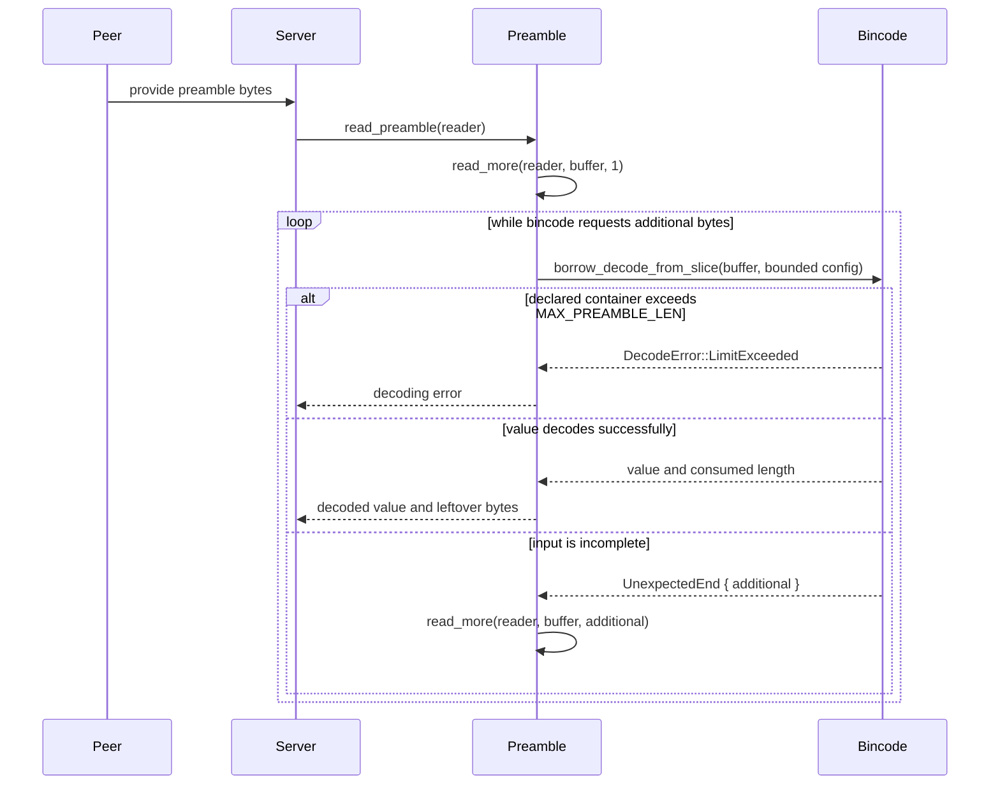
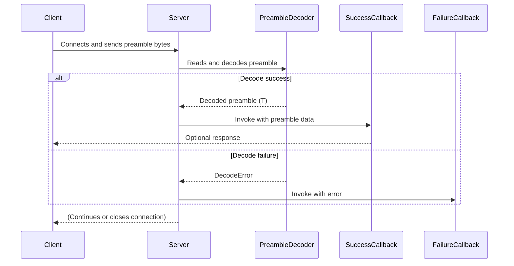
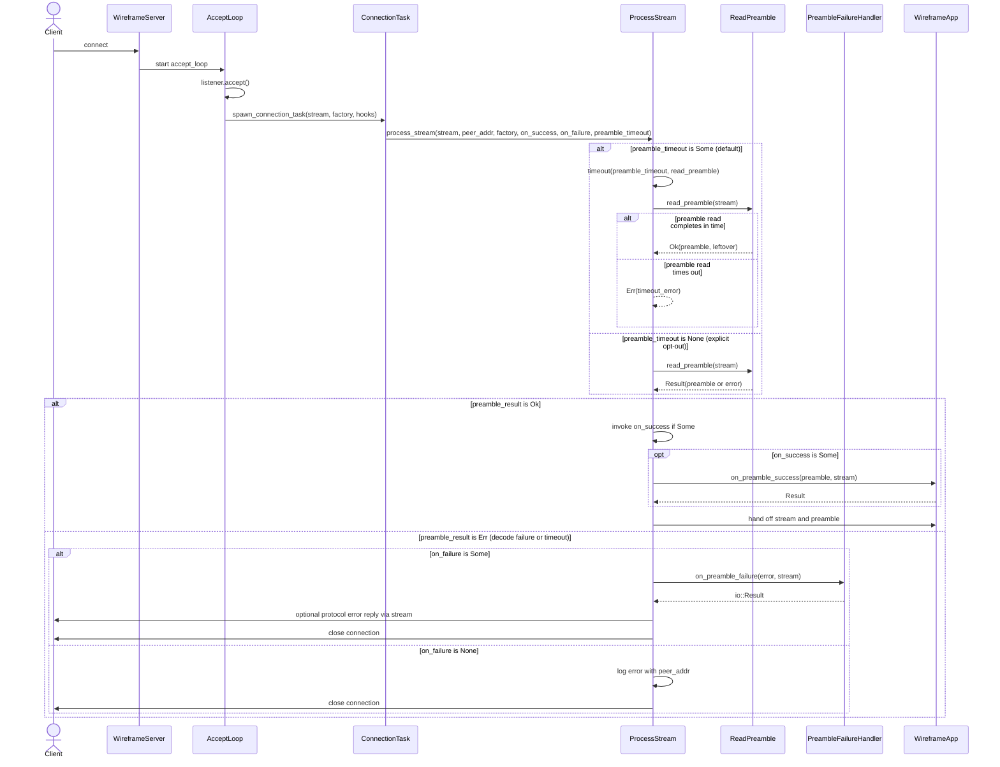

# Connection Preamble Validation

`wireframe` supports an optional connection preamble that is read as soon as a
client connects. The server decodes the preamble with
[`read_preamble`](../src/preamble.rs) and can invoke user-supplied callbacks on
success or failure. The helper uses `bincode` to decode any type implementing
`bincode::BorrowDecode` and reads exactly the number of bytes required.
Decoding is bounded by `MAX_PREAMBLE_LEN` (1 KiB), including bincode's
accounted allocation for declared container lengths. The existing read-growth
guard enforces the same ceiling. Any bytes read beyond the decoded value are
returned as leftovers for normal frame processing.

The limit protects owned containers such as `Vec<u8>` and follows bincode's
resource accounting. Protocols must validate any additional resource bounds for
their chosen preamble type; see the
[allocation-limit caveat](users-guide.md#packets-payloads-and-serialization).

For screen readers: The peer provides preamble bytes to the server, which calls
the preamble reader. The reader first reads one byte. Whenever bincode reports
`UnexpectedEnd { additional }`, it reads exactly that many more bytes and
retries, within the `MAX_PREAMBLE_LEN` limit. It returns either a decode error
or the decoded value and leftover bytes to the server.

The flow is summarized below:

The success callback receives the decoded preamble and a mutable `TcpStream`.
It may write a handshake response before the connection is passed to
`WireframeApp`. The failure callback is also asynchronous and receives the
mutable stream so it can emit an error reply before the connection closes.
Servers apply `DEFAULT_PREAMBLE_TIMEOUT` (10 seconds) to the read by default;
call `preamble_timeout` for a different deadline or `disable_preamble_timeout`
to opt out. The timeout follows the failure callback path and covers only the
read, not the callbacks or application handling. In the tests, a
`HotlinePreamble` struct illustrates the pattern, but any preamble type may be
used. Register callbacks via `on_preamble_decode_success` and
`on_preamble_decode_failure` on `WireframeServer`.

## Call Order

`WireframeServer::with_preamble::<T>()` must be called **before** registering
callbacks with `on_preamble_decode_success` or `on_preamble_decode_failure`.
The method converts the server to use a custom preamble type, dropping any
callbacks configured on the default `()` preamble. Registering callbacks after
calling `with_preamble::<T>()` ensures they are retained.

## Preamble processing flow with timeout handling

Sequence diagram showing how the accept loop, connection task, preamble
decoding, timeout handling, and callbacks coordinate before handing the
connection to the application:

