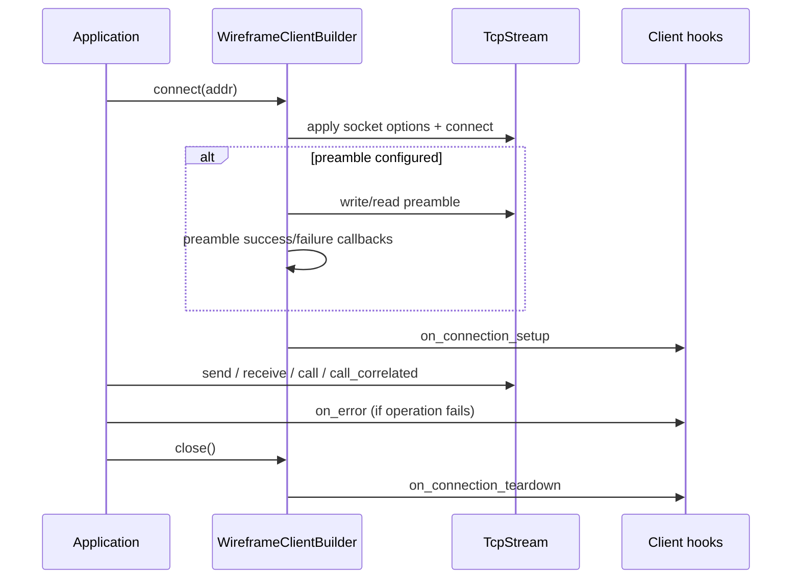

# Wireframe library guide

Wireframe is a Rust library for building asynchronous binary protocol servers
with pluggable routing, middleware, and connection utilities.[^1] The guide
below walks through the components that exist today and explains how they work
together when assembling an application.

## API discovery and imports

Wireframe uses progressive discovery for public APIs:

- `wireframe::` root is intentionally small and stable, exposing canonical
  `Result` and `WireframeError`.
- `wireframe::<module>::...` is the default path for specialized APIs.
- `wireframe::prelude::*` is an optional convenience import for common
  workflows.

## Minimum supported Rust version

Both `wireframe` and its `wireframe_testing` companion crate declare
`rust-version = "1.95"`. Cargo reads that declaration in two ways:

- **Compatibility check.** A toolchain older than Rust 1.95 refuses to compile
  either crate, reporting that the package requires Rust 1.95 or newer. Use
  `cargo +1.95` to select the minimum toolchain when the default is newer.
- **Version selection.** The consuming workspace chooses the resolver: it gets
  resolver v3 from `resolver = "3"` in its workspace manifest, or from edition
  2024 at its workspace root, and neither crate can impose that choice on its
  consumers. Under resolver v3, Cargo prefers dependency versions compatible
  with the `rust-version` of the package it is resolving for, so this
  repository's own graph prefers versions that build on Rust 1.95. Cargo falls
  back to a version needing a newer Rust only when no compatible candidate
  exists; an existing lock file also takes part, so the preference applies when
  dependencies are resolved afresh. Such a fallback then fails to build on Rust
  1.95, although a newer toolchain compiles it.

The [MSRV workflow](developers-guide.md#development-builds) checks that floor
on every pull request, every push to `main` and weekly, so neither a change in
this repository nor a dependency release can raise it unnoticed.

## Conceptual model and vocabulary

Wireframe uses layer-specific terms. Keep these boundaries explicit so
transport concerns do not leak into routing or domain logic.

| Layer                 | Canonical term | Meaning                                                                                                                   |
| --------------------- | -------------- | ------------------------------------------------------------------------------------------------------------------------- |
| Transport             | Frame          | The wire unit produced and consumed by `FrameCodec`.                                                                      |
| Routing envelope      | Envelope       | The routable wrapper that carries `id`, optional `correlation_id`, and payload bytes (`Packet` is the trait abstraction). |
| Domain payload        | Message        | The typed value encoded into and decoded from payload bytes.                                                              |
| Transport subdivision | Fragment       | A bounded slice of large payload bytes plus fragmentation metadata.                                                       |

Vocabulary rules:

- Use `frame` for wire-format codec units only.
- Use `envelope` for routable wrappers and instances; use `packet` when
  discussing the `Packet` trait abstraction or `PacketParts`.
- Use `message` for typed application payloads implementing
  `wireframe::message::EncodeWith`/`wireframe::message::DecodeWith` (or
  `wireframe::message::Message` for bincode-compatible types).
- Use `fragment` only for transport-level split/reassembly units.

For invariants and naming rules used across internal modules, see the
[developers' guide](developers-guide.md).

## Quick start: building an application

A `WireframeApp` collects route handlers and middleware. Each handler is stored
as an `Arc` pointing to an async function that receives a packet reference and
returns `()`. For manually accepted streams, consume the builder with
`prepare().await` after registration to construct immutable middleware chains
once and obtain a `PreparedApp`. The transition returns
`Result<PreparedApp, PrepareError>`; a preparation failure therefore produces
no partially usable runtime.[^2]

<!-- tested-example: users-guide-001 -->
```rust,ignore
use std::sync::Arc;
use wireframe::app::{Envelope, Handler, WireframeApp};

async fn ping(_env: &Envelope) {}

fn build_app() -> wireframe::Result<WireframeApp> {
    let handler: Handler<Envelope> = Arc::new(|env: &Envelope| {
        let _ = env; // inspect payload here
        Box::pin(ping(env))
    });

    WireframeApp::new()?
        .route(1, handler)?
        .wrap(wireframe::middleware::from_fn(|req, next| async move {
            let mut response = next.call(req).await?;
            response.frame_mut().extend_from_slice(b" pong");
            Ok(response)
        }))
}
```

The snippet below wires the builder into a Tokio runtime, decodes inbound
payloads, and emits a serialized response. It showcases the typical `main`
function for a microservice that listens on localhost and responds to a `Ping`
message with a `Pong` payload.[^2][^10][^15]

<!-- tested-example: users-guide-002 -->
```rust,ignore
use std::{net::SocketAddr, sync::Arc};

use wireframe::{
    app::{Envelope, Handler, WireframeApp},
    middleware,
    message::Message,
    server::{ServerError, WireframeServer},
};

#[derive(bincode::Encode, bincode::BorrowDecode, Debug)]
struct Ping {
    body: String,
}

#[derive(bincode::Encode, bincode::BorrowDecode, Debug, PartialEq)]
struct Pong {
    body: String,
}

async fn ping(env: &Envelope) {
    log::info!("received correlation id: {:?}", env.clone().into_parts().correlation_id());
}

fn build_app() -> wireframe::Result<WireframeApp> {
    let handler: Handler<Envelope> = Arc::new(|env: &Envelope| Box::pin(ping(env)));

    WireframeApp::new()?
        .route(1, handler)?
        .wrap(middleware::from_fn(|req, next| async move {
            let ping = Ping::from_bytes(req.frame()).map(|(msg, _)| msg).ok();
            let mut response = next.call(req).await?;

            if let Some(ping) = ping {
                let payload = Pong {
                    body: format!("pong {}", ping.body),
                }
                .to_bytes()
                .expect("encode Pong message");
                response.frame_mut().clear();
                response.frame_mut().extend_from_slice(&payload);
            }

            Ok(response)
        }))
}

fn app_factory() -> WireframeApp {
    build_app().expect("configure Wireframe application")
}

#[tokio::main]
async fn main() -> Result<(), ServerError> {
    let addr: SocketAddr = "127.0.0.1:4000".parse().expect("valid socket address");
    let server = WireframeServer::new(app_factory).bind(addr)?;
    server.run().await
}
```

Route identifiers must be unique; the builder returns
`wireframe::WireframeError::DuplicateRoute` when a handler is registered twice,
keeping the dispatch table unambiguous.[^2][^5] The crate-level
`wireframe::Result<T>` alias always resolves to this canonical
`wireframe::WireframeError` surface, so setup-time and streaming failures share
one error contract.[^5] New applications default to the bundled bincode
serializer, a length-delimited codec capped at 1024 bytes per frame, and a 100
ms read timeout. Clamp the length-delimited limit with `buffer_capacity`
(length-delimited only), swap codecs with `with_codec`, and override the
serializer with `with_serializer` when a different encoding strategy is
required.[^3][^4] Use `memory_budgets(...)` to set explicit per-connection
buffering caps for inbound assembly paths. Custom protocols implement
`FrameCodec` to describe their framing rules. Changing frame budgets with
`buffer_capacity` or swapping codecs with `with_codec` clears fragmentation
settings, so call `enable_fragmentation()` (or `fragmentation(Some(cfg))`)
again when transport fragmentation is required.

`WireframeApp::codec`, `fragmentation`, and `memory_budgets` can be called from
`const fn` code. `Envelope::new` and `PacketParts::new` are also const
constructors, which lets downstream libraries compose these values in their own
compile-time helpers.

`WireframeError` defaults to `WireframeError<NoProtocolError>`. The marker
means an API does not carry protocol-defined error payloads, while still
allowing the default `wireframe::Result<T>` to implement `std::error::Error`
and work with `Box<dyn Error>` or other standard error wrappers. When a
protocol does have its own typed failures, name the parameter explicitly, for
example `WireframeError<MyProtocolError>`. Code that previously relied on the
default accepting `WireframeError::Protocol(())` should annotate that case as
`WireframeError<()>` instead.

The default error type works with standard error wrappers and source-chain
inspection:

<!-- tested-example: users-guide-003 -->
```rust,ignore
use std::error::Error;
use wireframe::WireframeError;

fn boxed_route_error() -> Box<dyn Error> {
    Box::new(WireframeError::DuplicateRoute(7))
}

fn inspect_transport_source(error: &WireframeError) -> Option<&dyn Error> {
    error.source()
}
```

For a manually accepted stream, prepare the application once and then call
`PreparedApp::handle_connection_result(stream)` (or the logging
`PreparedApp::handle_connection(stream)` wrapper) for every connection. The
prepared application reuses its middleware chains, wraps each transport in the
configured frame codec (length-delimited by default), enforces per-frame read
timeouts, and writes responses. The deprecated
`WireframeApp::handle_connection` methods rebuild route chains for
compatibility and should not be used in new code.

<!-- tested-example: users-guide-004 -->
```rust,no_run
use tokio::io::duplex;
use wireframe::app::{PreparedApp, WireframeApp};

# async fn example() -> Result<(), Box<dyn std::error::Error>> {
let prepared: PreparedApp = WireframeApp::new()?.prepare().await?;
let (client, server) = duplex(64);
drop(client);
prepared.handle_connection_result(server).await?;
# Ok(())
# }
```

`WireframeServer` evaluates its startup factory once per server run, prepares
the resulting application once, and shares one immutable prepared root across
all connections. Use `WireframeServer::from_app(app)` when the application is
already built. Connection-specific state belongs in lifecycle setup state `C`
through `on_connection_setup`, not in a rebuilt application graph.
Serialization helpers `send_response` and `send_response_framed` (or
`send_response_framed_with_codec` for custom codecs) return typed `SendError`
variants when encoding or I/O fails, and the connection closes after ten
consecutive deserialization errors.[^6][^7] Each `SendError` variant's
`Display` output starts with a fixed prefix: `serialization error:` for
`Serialize`, `I/O error:` for `Io`, and `codec error:` for `Codec`. Those
prefixes are stable and form the public diagnostic contract that callers may
match on; the source error text after them is not part of that contract.

### Custom frame codecs

Custom protocols supply a `FrameCodec` implementation to describe their framing
rules. The codec owns the Tokio `Decoder` and `Encoder` types, while Wireframe
uses the trait surface to map frames to payload bytes and correlation data.

A codec implementation must:

- Define a `Frame` type and paired decoder/encoder implementations that return
  `std::io::Error` on failure.
- Return only the logical payload bytes from `frame_payload` so metadata parsing
  and deserialization run against the right buffer.
- Wrap outbound payloads with `wrap_payload(&self, Bytes)`, adding any protocol
  headers or metadata required by the wire format.
- Provide `correlation_id` when the protocol stores it outside the payload;
  Wireframe only uses this hook when the deserialized envelope is missing a
  correlation identifier.
- Report `max_frame_length`, which clamps inbound frames and determines the
  budget used by `enable_fragmentation`.

Install a custom codec with `with_codec`. The builder disables fragmentation
when codecs or the length-delimited frame budget change, so explicitly call
`enable_fragmentation()` (or `fragmentation(Some(cfg))`) afterwards when
transport fragmentation is required. Wireframe clones the codec per connection,
so stateful codecs should ensure `Clone` produces an independent state (for
example, reset sequence counters) when per-connection isolation is required.
When a framed stream is already available, use
`send_response_framed_with_codec`, so responses pass through
`FrameCodec::wrap_payload`.

Assume `MyCodec` implements `FrameCodec`:

<!-- tested-example: users-guide-005 -->
```rust,ignore
use std::sync::Arc;

use wireframe::app::{Envelope, Handler, WireframeApp};

struct MyCodec;

let handler: Handler<Envelope> = Arc::new(|_: &Envelope| Box::pin(async {}));

let app = WireframeApp::new()?
    .with_codec(MyCodec)
    .route(1, handler)?;
```

See `examples/hotline_codec.rs` and `examples/mysql_codec.rs` for complete
implementations.

#### Codec accessor

Retrieve the configured codec from a `WireframeApp` instance:

<!-- tested-example: users-guide-006 -->
```rust,ignore
use wireframe::app::WireframeApp;
use wireframe::codec::examples::HotlineFrameCodec;

let codec = HotlineFrameCodec::new(4096);
let app = WireframeApp::new()?.with_codec(codec);
let codec_ref = app.codec(); // &HotlineFrameCodec
```

#### Testing custom codecs with `wireframe_testing`

The `wireframe_testing` crate provides codec-aware driver functions that handle
frame encoding and decoding transparently:

<!-- tested-example: users-guide-007 -->
```rust,ignore
use wireframe::app::WireframeApp;
use wireframe::codec::examples::HotlineFrameCodec;
use wireframe_testing::{drive_with_codec_payloads, drive_with_codec_frames};

let codec = HotlineFrameCodec::new(4096);
let payload: Vec<u8> = vec![0x01, 0x02, 0x03];

// Payload-level: returns decoded response payloads as byte vectors.
let app = WireframeApp::new()?.with_codec(codec.clone());
let payloads =
    drive_with_codec_payloads(app, &codec, vec![payload.clone()]).await?;

// Frame-level: returns decoded codec frames for metadata inspection.
let app = WireframeApp::new()?.with_codec(codec.clone());
let frames =
    drive_with_codec_frames(app, &codec, vec![payload]).await?;
```

Available codec-aware driver functions:

- `drive_with_codec_payloads` / `drive_with_codec_payloads_with_capacity` —
  owned app, returns payload bytes.
- `drive_with_codec_payloads_mut` /
  `drive_with_codec_payloads_with_capacity_mut` — mutable app reference,
  returns payload bytes.
- `drive_with_codec_frames` / `drive_with_codec_frames_with_capacity` — owned
  app, returns decoded `F::Frame` values.

Supporting helpers for composing custom test patterns:

- `encode_payloads_with_codec` — encode payloads to wire bytes.
- `decode_frames_with_codec` — decode wire bytes to frames.
- `extract_payloads` — extract payload bytes from decoded frames.

#### Codec test fixtures

The `wireframe_testing` crate provides fixture functions for generating
Hotline-framed wire bytes covering common test scenarios — valid frames,
invalid frames, incomplete (truncated) frames, and frames with correlation
metadata. These fixtures construct raw bytes directly, so they can represent
malformed data that the encoder would reject:

<!-- tested-example: users-guide-008 -->
```rust,no_run
use wireframe::codec::examples::HotlineFrameCodec;
use wireframe_testing::{
    valid_hotline_wire, oversized_hotline_wire,
    truncated_hotline_header, correlated_hotline_wire,
    decode_frames_with_codec,
};

let codec = HotlineFrameCodec::new(4096);

// Valid frame — decodes cleanly.
let wire = valid_hotline_wire(b"hello", 7);
let frames = decode_frames_with_codec(&codec, &wire).unwrap();

// Oversized frame — rejected with "payload too large".
let wire = oversized_hotline_wire(4096);
assert!(decode_frames_with_codec(&codec, &wire).is_err());

// Truncated header — rejected with "bytes remaining on stream".
let wire = truncated_hotline_header();
assert!(decode_frames_with_codec(&codec, &wire).is_err());

// Correlated frames — all share the same transaction ID.
let wire = correlated_hotline_wire(42, &[b"a", b"b"]);
let frames = decode_frames_with_codec(&codec, &wire).unwrap();
```

Available fixture functions:

- `valid_hotline_wire` / `valid_hotline_frame` — well-formed frames.
- `oversized_hotline_wire` — payload exceeds `max_frame_length`.
- `mismatched_total_size_wire` — header with incorrect `total_size`.
- `truncated_hotline_header` / `truncated_hotline_payload` — incomplete data.
- `correlated_hotline_wire` — frames sharing a transaction ID.
- `sequential_hotline_wire` — frames with incrementing transaction IDs.

#### Feeding partial frames and fragments

Real networks rarely deliver a complete codec frame in a single TCP read. The
main crate now exposes these drivers through `wireframe::testkit` behind the
opt-in `testkit` feature, while `wireframe_testing` keeps source-compatible
re-exports for existing callers.

**Chunked-write drivers** encode payloads via a codec, concatenate the wire
bytes, and write them in configurable chunk sizes (including one byte at a
time):

<!-- tested-example: users-guide-009 -->
```rust,ignore
use std::num::NonZeroUsize;
use wireframe::app::WireframeApp;
use wireframe::codec::examples::HotlineFrameCodec;
use wireframe::testkit::drive_with_partial_frames;

let codec = HotlineFrameCodec::new(4096);
let app = WireframeApp::new()?.with_codec(codec.clone());
let chunk = NonZeroUsize::new(1).expect("non-zero");
let payloads =
    drive_with_partial_frames(app, &codec, vec![vec![1, 2, 3]], chunk)
        .await?;
```

Available chunked-write driver functions:

- `drive_with_partial_frames` / `drive_with_partial_frames_with_capacity` —
  owned app, returns payload bytes.
- `drive_with_partial_frames_mut` — mutable app reference, returns payload
  bytes.
- `drive_with_partial_codec_frames` — owned app, returns decoded `F::Frame`
  values.

**Fragment-feeding drivers** accept a raw payload, fragment it with a
`Fragmenter`, encode each fragment into a codec frame, and feed the frames
through the app:

<!-- tested-example: users-guide-010 -->
```rust,ignore
use std::num::NonZeroUsize;
use wireframe::app::WireframeApp;
use wireframe::codec::examples::HotlineFrameCodec;
use wireframe::fragment::Fragmenter;
use wireframe::testkit::drive_with_fragments;

let codec = HotlineFrameCodec::new(4096);
let app = WireframeApp::new()?.with_codec(codec.clone());
let fragmenter = Fragmenter::new(NonZeroUsize::new(20).unwrap());
let payloads =
    drive_with_fragments(app, &codec, &fragmenter, vec![0; 100]).await?;
```

Available fragment-feeding driver functions:

- `drive_with_fragments` / `drive_with_fragments_with_capacity` — owned
  app, returns payload bytes.
- `drive_with_fragments_mut` — mutable app reference, returns payload
  bytes.
- `drive_with_fragment_frames` — owned app, returns decoded `F::Frame`
  values.
- `drive_with_partial_fragments` — fragment AND feed in chunks,
  exercising both fragmentation and partial-frame buffering simultaneously.

#### Driving raw frames with `wireframe_testing`

The `wireframe_testing` crate re-exports its length-delimited drivers from the
crate root. Each driver has a plain form that takes an owned `WireframeApp`, a
`_mut` form that borrows the application so it can be reused across calls, and a
`_with_capacity` form that sets the duplex buffer size. These drivers write
the supplied bytes verbatim, so callers must pass already framed bytes; the
default `LengthDelimitedFrameCodec` expects a four-byte big-endian length
prefix:

<!-- tested-example: users-guide-011 -->
```rust,no_run
use wireframe::app::WireframeApp;
use wireframe_testing::{
    drive_with_frame_with_capacity_mut,
    drive_with_frames_with_capacity_mut,
};

# #[tokio::main]
# async fn main() -> Result<(), Box<dyn std::error::Error>> {
let mut app: WireframeApp = WireframeApp::new()?;

// One frame carrying a three-byte payload, reusing `app`.
let frame = vec![0, 0, 0, 3, 1, 2, 3];
let one = drive_with_frame_with_capacity_mut(&mut app, frame, 256).await?;

// Two single-byte frames through a 64-byte buffer, still reusing `app`.
let frames = vec![vec![0, 0, 0, 1, 1], vec![0, 0, 0, 1, 2]];
let many = drive_with_frames_with_capacity_mut(&mut app, frames, 64).await?;
# Ok(())
# }
```

`drive_with_frame_with_capacity_mut` and `drive_with_frames_with_capacity_mut`
are available from the crate root alongside the other `_mut` drivers, so tests
do not need the `wireframe_testing::helpers::drive` path.

#### Asserting reassembly outcomes

The `wireframe::testkit::reassembly` module provides non-panicking assertion
helpers for both transport fragment reassembly and protocol message assembly.
The API is built around lightweight snapshot structs, so the same helper can be
used from `rstest` tests and `rstest-bdd` step definitions. Existing
`wireframe_testing::reassembly` imports remain valid as compatibility
re-exports.

<!-- tested-example: users-guide-012 -->
```rust,no_run
use wireframe::message_assembler::MessageKey;
use wireframe::testkit::{
    MessageAssemblySnapshot,
    TestResult,
    assert_message_assembly_completed_for_key,
};

# fn check(snapshot: MessageAssemblySnapshot<'_>) -> TestResult {
assert_message_assembly_completed_for_key(snapshot, MessageKey(7), b"done")?;
# Ok(())
# }
```

Available message-assembly assertion helpers:

- `assert_message_assembly_incomplete` — verify the latest assembly is still
  awaiting more frames.
- `assert_message_assembly_completed` — verify the latest assembly completed
  with a specific body.
- `assert_message_assembly_completed_for_key` — verify the most recent
  completed message for a specific `MessageKey`.
- `assert_message_assembly_error` — verify structured failures such as
  sequence mismatch, duplicate first frame, and budget errors.
- `assert_message_assembly_buffered_count` /
  `assert_message_assembly_total_buffered_bytes` — verify cleanup and memory
  accounting side effects.
- `assert_message_assembly_evicted` — verify timeout-based eviction.

Available fragment-reassembly assertion helpers:

- `assert_fragment_reassembly_absent` — verify no full message has been
  reconstructed yet.
- `assert_fragment_reassembly_completed_len` — verify reconstructed payload
  length.
- `assert_fragment_reassembly_error` — verify reassembly errors including
  `MessageTooLarge` (with or without specific message ID), `IndexMismatch`
  (out-of-order fragments), `MessageMismatch` (fragments from wrong logical
  message), `SeriesComplete` (duplicate or late fragments after completion), and
  `IndexOverflow` (fragment index exceeding limits).
- `assert_fragment_reassembly_buffered_messages` — verify buffered partial
  message count.
- `assert_fragment_reassembly_evicted` — verify timeout-based eviction.

#### Test observability

The `wireframe_testing` crate provides an `ObservabilityHandle` that combines
log capture with metrics recording in a single fixture. This is useful for
asserting that codec errors, recovery policies, and other instrumentation
behave correctly under test.

<!-- tested-example: users-guide-013 -->
```rust,no_run
use wireframe_testing::ObservabilityHandle;

let mut obs = ObservabilityHandle::new();
obs.clear();

// Record metrics via a thread-local recorder.
metrics::with_local_recorder(obs.recorder(), || {
    wireframe::metrics::inc_codec_error("framing", "drop");
});

// Take a snapshot and query the captured counter.
obs.snapshot();
assert_eq!(
    obs.counter(
        wireframe::metrics::CODEC_ERRORS,
        &[("error_type", "framing"), ("recovery_policy", "drop")],
    ),
    1
);
```

The handle serializes access to the global logger via a mutex, so tests using
it should run serially (`--test-threads=1` for the affected binary). Metrics
are captured per-thread via `metrics::with_local_recorder`, so metric-emitting
code must run on the same thread as the handle. For async tests, use
`#[tokio::test(flavor = "current_thread")]` or
`tokio::runtime::Runtime::new()?.block_on(...)`.

Available assertion helpers:

- `counter(name, labels)` / `counter_without_labels(name)` — query counter
  values from the most recent snapshot.
- `codec_error_counter(error_type, recovery_policy)` — convenience for the
  `wireframe_codec_errors_total` metric.
- `assert_counter(name, labels, expected)` — assert a counter matches.
- `assert_no_metric(name)` — assert no metric with the given name exists.
- `assert_codec_error_counter(error_type, recovery_policy, expected)` — assert
  a codec error counter matches.
- `assert_log_contains(substring)` — assert any captured log contains a
  substring.
- `assert_log_at_level(level, substring)` — assert a log at a specific level
  contains a substring.

#### Simulating slow readers and writers

Back-pressure tests often need more than partial-frame delivery. The
`wireframe_testing` crate also provides slow-I/O helpers that pace the client
write side, the client read side, or both directions at once.

Use `SlowIoPacing` to define a chunk size and inter-chunk delay, then apply it
through `SlowIoConfig`:

Enable the feature in `Cargo.toml` when importing from the main crate:

<!-- tested-example: users-guide-014 -->
```toml
wireframe = { version = "0.3.0", features = ["testkit"] }
```

<!-- tested-example: users-guide-015 -->
```rust,ignore
use std::{num::NonZeroUsize, time::Duration};
use wireframe::{
    app::{Envelope, WireframeApp},
    codec::examples::HotlineFrameCodec,
    serializer::{BincodeSerializer, Serializer},
};
use wireframe::testkit::{
    SlowIoConfig, SlowIoPacing, drive_with_slow_codec_payloads,
};

let codec = HotlineFrameCodec::new(4096);
let app = WireframeApp::new()?.with_codec(codec.clone());
let config = SlowIoConfig::new()
    .with_writer_pacing(SlowIoPacing::new(
        NonZeroUsize::new(8).expect("non-zero"),
        Duration::from_millis(5),
    ))
    .with_reader_pacing(SlowIoPacing::new(
        NonZeroUsize::new(32).expect("non-zero"),
        Duration::from_millis(5),
    ))
    .with_capacity(64);

let request = BincodeSerializer.serialize(&Envelope::new(
    1,
    Some(7),
    vec![1, 2, 3],
))?;
let payloads = drive_with_slow_codec_payloads(app, &codec, vec![request], config)
    .await?;

```

Available slow-I/O helper functions:

- `drive_with_slow_frames` — pre-framed bytes, returns raw output bytes.
- `drive_with_slow_payloads` — default length-delimited payloads, returns raw
  output bytes.
- `drive_with_slow_codec_payloads` — codec-aware payloads, returns decoded
  payload byte vectors.
- `drive_with_slow_codec_frames` — codec-aware frames, returns decoded
  `F::Frame` values.

These helpers are designed for deterministic tests under paused Tokio time.
Small duplex capacities should be used together with reader pacing when the
app's outbound writes must hit back-pressure quickly.

#### In-process server/client pair harness

The `wireframe_testing::client_pair` module provides a harness for starting a
real `WireframeServer` and a connected `WireframeClient` inside one test
process. Unlike the `drive_with_*` helpers, which exercise server-side
behaviour over in-memory `tokio::io::duplex` streams, the pair harness
communicates over a real loopback TCP socket so compatibility assertions
exercise the full client/server network path.

Use the pair harness when a downstream crate needs to verify that its protocol
implementation works end-to-end through a real Wireframe server. A shared
`echo_app_factory` provides a ready-made app factory with invocation counting:

<!-- tested-example: users-guide-016 -->
```rust,no_run
use std::sync::Arc;
use std::sync::atomic::AtomicUsize;
use wireframe_testing::{
    TestResult,
    echo_app_factory,
    spawn_wireframe_pair,
};

async fn example() -> TestResult<()> {
    let counter = Arc::new(AtomicUsize::new(0));
    let mut pair = spawn_wireframe_pair(
        echo_app_factory(&counter),
        |builder| builder.max_frame_length(2048),
    )
    .await?;

    // pair.client_mut()? returns &mut WireframeClient for
    // request/response operations. Streaming responses borrow the
    // client exclusively, keeping that constraint visible.
    let addr = pair.local_addr();

    pair.shutdown().await?;
    Ok(())
}
```

`spawn_wireframe_pair_default` is a convenience wrapper that connects with
default client settings when no builder customization is needed. If the client
connection fails, the server task is torn down automatically so no orphaned
tasks leak into subsequent tests.

The harness depends on the `wireframe_testing` dev-dependency crate. It does
not require the main-crate `testkit` feature unless the test also uses
`wireframe::testkit` helpers directly.

#### Zero-copy payload extraction

For performance-critical codecs, use `Bytes` instead of `Vec<u8>` for payload
storage and override `frame_payload_bytes` to avoid allocation:

<!-- tested-example: users-guide-017 -->
```rust,ignore
use bytes::Bytes;
use wireframe::codec::FrameCodec;

pub struct MyFrame {
    pub metadata: u32,
    pub payload: Bytes,  // Use Bytes, not Vec<u8>
}

impl FrameCodec for MyCodec {
    type Frame = MyFrame;
    // ... other associated types ...

    fn frame_payload(frame: &Self::Frame) -> &[u8] {
        &frame.payload
    }

    fn frame_payload_bytes(frame: &Self::Frame) -> Bytes {
        frame.payload.clone()  // Cheap: atomic reference count increment
    }

    fn wrap_payload(&self, payload: Bytes) -> Self::Frame {
        MyFrame {
            metadata: 0,
            payload,  // Store directly, no copy
        }
    }

    // ... other methods ...
}
```

In the decoder, use `BytesMut::freeze()` instead of `.to_vec()`:

<!-- tested-example: users-guide-018 -->
```rust,ignore
use bytes::BytesMut;
use tokio_util::codec::Decoder;

fn decode(&mut self, src: &mut BytesMut) -> Result<Option<Self::Item>, Self::Error> {
    // ... parse header ...
    let payload = src.split_to(payload_len).freeze();  // Zero-copy
    Ok(Some(MyFrame { metadata, payload }))
}
```

The default `frame_payload_bytes` implementation copies from the
`frame_payload()` slice, ensuring backward compatibility for codecs that use
`Vec<u8>` payloads.

### Codec error handling

The codec layer provides a structured error taxonomy via `CodecError` that
enables recovery policies, structured logging, and proper EOF handling.

**Error categories:**

- `FramingError` - Wire-level frame boundary issues (oversized frames, invalid
  length encoding, incomplete headers, checksum mismatches, empty frames).
- `ProtocolError` - Semantic violations after frame extraction (unknown message
  types, invalid versions).
- `io::Error` - Transport layer failures (connection resets, timeouts).
- `EofError` - End-of-stream conditions with clean/mid-frame/mid-header
  variants.

**Recovery policies:**

Each error type has a default recovery policy:

| Error Type                     | Default Policy |
| ------------------------------ | -------------- |
| `FramingError::OversizedFrame` | Drop           |
| `FramingError::EmptyFrame`     | Drop           |
| Other `FramingError`           | Disconnect     |
| All `ProtocolError`            | Drop           |
| All `io::Error`                | Disconnect     |
| `EofError::CleanClose`         | Disconnect     |
| Other `EofError`               | Disconnect     |

Override recovery policies with a custom `RecoveryPolicyHook`:

<!-- tested-example: users-guide-019 -->
```rust
use wireframe::codec::{
    CodecError, CodecErrorContext, RecoveryPolicy, RecoveryPolicyHook,
};

struct StrictRecovery;

impl RecoveryPolicyHook for StrictRecovery {
    fn recovery_policy(&self, _error: &CodecError, _ctx: &CodecErrorContext) -> RecoveryPolicy {
        // Disconnect on any codec error
        RecoveryPolicy::Disconnect
    }
}
```

`CodecErrorContext` provides connection metadata for policy decisions:

<!-- tested-example: users-guide-020 -->
```rust
use wireframe::codec::CodecErrorContext;

let ctx = CodecErrorContext::new()
    .with_connection_id(42)
    .with_correlation_id(123)
    .with_codec_state("seq=5");
```

**Protocol hooks for EOF:**

The `WireframeProtocol` trait includes an `on_eof` hook for handling EOF
conditions during frame decoding:

<!-- tested-example: users-guide-021 -->
```rust,ignore
use wireframe::{
    codec::EofError,
    hooks::{ConnectionContext, WireframeProtocol},
};

impl WireframeProtocol for MyProtocol {
    type Frame = Vec<u8>;
    type ProtocolError = String;

    fn on_eof(&self, error: &EofError, partial_data: &[u8], _ctx: &mut ConnectionContext) {
        match error {
            EofError::CleanClose => tracing::info!("connection closed cleanly"),
            EofError::MidFrame { bytes_received, expected } => {
                tracing::warn!(
                    received = bytes_received,
                    expected = expected,
                    partial_len = partial_data.len(),
                    "connection closed mid-frame"
                );
            }
            EofError::MidHeader { bytes_received, header_size } => {
                tracing::warn!(
                    received = bytes_received,
                    header_size = header_size,
                    "connection closed mid-header"
                );
            }
        }
    }
}
```

**Metrics:**

When the `metrics` feature is enabled, codec errors increment the
`wireframe_codec_errors_total` counter with `error_type` and `recovery_policy`
labels:

<!-- tested-example: users-guide-022 -->
```text
wireframe_codec_errors_total{error_type="framing",recovery_policy="drop"} 5
wireframe_codec_errors_total{error_type="eof",recovery_policy="disconnect"} 2
```

## Packets, payloads, and serialization

A [serializer-output migration plan][serializer-output-plan] proposes
`PayloadBytes` for a future breaking release. It is not implemented: current
serializer implementations still return `Vec<u8>`. The planned finite
conversion helpers preserve vector-based encoding algorithms while requiring an
explicit return-type change. Decode APIs and client hook signatures remain
unchanged in that migration.

Packets drive routing. Implement the `Packet` trait (or use the bundled
`Envelope`) to expose a message identifier, optional correlation id, and raw
payload. `PacketParts` rebuilds packets after middleware has finished editing
frames, and `inherit_correlation` patches mismatched response identifiers while
logging the discrepancy.[^8] Serializers plug into the `Serializer` trait;
`WireframeApp` defaults to `BincodeSerializer` but can run any implementation
that meets the trait bounds.[^4]

When `FrameMetadata::parse` succeeds, the framework extracts identifiers from
metadata without deserializing the payload. If parsing fails, it falls back to
full deserialization.[^9][^6] Serializer integration now uses adapter traits:
`EncodeWith<S>` for encoding and `DecodeWith<S>` for decoding. Existing bincode
message types remain compatible through `Message`, which still provides
`to_bytes` and `from_bytes` helpers.[^10]

The bundled bincode decoders, including the optional `serializer-serde` bridge,
apply a fixed `MAX_FRAME_LENGTH` decode limit of 16 MiB. This bounds bincode's
accounted decoding and allocation work for peer-provided container lengths; it
is not a runtime frame-size limit. A lower configured frame limit still
controls accepted frame sizes, while reassembled messages use the same 16 MiB
decode limit even when their configured reassembly limit is larger. Encoding is
unchanged. Inbound `Envelope` frames must contain exactly one decoded value;
trailing bytes are rejected. Metadata prefix parsing may still leave payload
bytes for full deserialization.

The allocation limit relies on bincode's resource accounting and is not a
general allocator quota for every container layout or custom decoder. Protocols
with additional resource requirements need their own validation before
processing peer input.

### Migration from `Message`-only bounds

If existing code previously relied on `M: Message` for client/server API calls,
no change is required for bincode-compatible types.

- Existing `#[derive(bincode::Encode, bincode::BorrowDecode)]` payloads still
  work in `send`, `receive`, `call`, and `send_response`.
- Serializer implementations should update method signatures to use
  `EncodeWith<Self>` and `DecodeWith<Self>` bounds.
- Custom serializers that rely on legacy `Message`-derived payload encoding
  should also implement `wireframe::serializer::MessageCompatibilitySerializer`.
- Metadata-aware serializers can implement
  `Serializer::deserialize_with_context` to inspect `DeserializeContext`.
- `Serializer` is not object-safe (`Self: Sized` on serializer entry points), so
  using `dyn Serializer` directly is unsupported unless concrete wrappers are
  provided. For migration, keep concrete serializer types in `EncodeWith` /
  `DecodeWith` bounds, retain
  `wireframe::serializer::MessageCompatibilitySerializer` for legacy
  `Message`-based payloads, and use `SerdeMessage` with `SerdeSerializerBridge`
  for Serde-only payloads. When runtime-polymorphic serializer behaviour is
  required, wrap concrete serializer implementations in adapter wrappers that
  expose object-safe APIs and delegate to
  `Serializer::deserialize_with_context` as needed.

Optional Serde bridge support is available behind the feature
`serializer-serde`. Wrap values with `SerdeMessage<T>` (or
`into_serde_message()`) and implement `SerdeSerializerBridge` on the serializer
to reduce per-type adapter boilerplate. This explicit wrapper is required
because blanket Serde adapters would overlap with the default `T: Message`
adapter implementations.

### Fragmentation metadata

`wireframe::fragment` exposes small, copy-friendly structs to describe the
transport-level fragmentation state.[^41]

- `MessageId` uniquely identifies the logical message a fragment belongs to.
- `FragmentIndex` records the fragment's zero-based order.
- `FragmentHeader` bundles the identifier, index, and a boolean that signals
  whether the fragment is the last one in the sequence.
- `FragmentSeries` tracks the next expected fragment index and reports
  mismatches via structured errors.

Protocol implementers can emit a `FragmentHeader` for every physical frame and
feed the header back into `FragmentSeries` to guarantee ordering before a fully
reassembled message is surfaced to handlers. Behavioural tests can reuse the
same types to assert that new codecs obey the transport invariants without
spinning up a full server.[^42][^43]

The standalone `Fragmenter` helper now slices oversized payloads into capped
fragments while stamping the shared `MessageId` and sequential `FragmentIndex`.
Each call returns a `FragmentBatch` that reports whether the message required
fragmentation and yields individual `FragmentFrame` values for serialization or
logging. This keeps transport experiments lightweight while the full adapter
layer evolves. The helper is fallible—`FragmentationError` surfaces encoding
failures or index overflows—so production code should bubble the error up or
log it rather than unwrapping.

`FragmentBatch::is_empty()` is available alongside `len()` for collection-style
checks. `Fragmenter` always returns a non-empty batch: an empty input has one
final fragment with an empty payload. Fragment metadata constructors and
accessors are `const`, and const function bodies can call the accessors on
`FragmentFrame`, `FragmentParts`, and `ReassembledMessage`. Those types own
`Vec<u8>` values, so their accessors cannot generally be evaluated from const
items. `FragmentBatch` is also produced at runtime, though its accessors are
const-callable from functions that receive a batch reference.

<!-- tested-example: users-guide-023 -->
```rust,no_run
use std::num::NonZeroUsize;
use wireframe::fragment::Fragmenter;

let fragmenter = Fragmenter::new(NonZeroUsize::new(512).unwrap());
let payload = [0_u8; 1400];
let batch = fragmenter.fragment_bytes(&payload).expect("fragment");
assert_eq!(batch.len(), 3);

for fragment in batch.fragments() {
    tracing::info!(
        msg_id = fragment.header().message_id().get(),
        index = fragment.header().fragment_index().get(),
        final = fragment.header().is_last_fragment(),
        payload_len = fragment.payload().len(),
    );
}
```

A companion `Reassembler` mirrors the helper on the inbound path. It buffers
fragments per `MessageId`, rejects out-of-order fragments, and enforces a
maximum assembled size while exposing `purge_expired` to clear stale partial
messages after a configurable timeout. When the final fragment arrives, it
returns a `ReassembledMessage` that can be decoded into the original type.

<!-- tested-example: users-guide-024 -->
```rust
use std::{num::NonZeroUsize, time::Duration};
use wireframe::fragment::{
    FragmentHeader,
    FragmentIndex,
    MessageId,
    Reassembler,
};

let mut reassembler =
    Reassembler::new(
        NonZeroUsize::new(512).expect("non-zero capacity"),
        Duration::from_secs(30),
        None,
        None,
    );

let header = FragmentHeader::new(MessageId::new(9), FragmentIndex::zero(), true);
let complete = reassembler
    .push(header, [0_u8; 12])
    .expect("fragments accepted")
    .expect("single fragment completes the message");

// Decode when ready:
// let message: MyType = complete.decode().expect("decode");
```

### Request parts and streaming bodies

`wireframe::request` exposes `RequestParts` to separate routing metadata from
streaming request payloads.[^45]

- `RequestParts::id()` returns the message identifier for routing.
- `RequestParts::correlation_id()` returns the optional correlation identifier.
- `RequestParts::metadata()` returns protocol-defined header bytes.

This type pairs with `RequestBodyStream` for incremental consumption of large
request payloads. Register the route with `WireframeApp::streaming_route` and
the connection runtime owns the body channel: it creates the byte-accounted
sender, delivers each arriving chunk as it is decoded, and hands the receiving
end to the handler together with `RequestParts`.

A streaming route delivers at most one body at a time per connection. Messages
that complete while a body is live are held and answered afterwards, in arrival
order. Once the first frame completes the whole message, the handler still
receives a single-chunk body, so a handler never needs a separate whole-payload
path. Streaming routes are also outside the middleware chain: middleware
inspects a whole payload, whereas a streaming handler owns the body
incrementally.

<!-- tested-example: users-guide-025 -->
```rust
use wireframe::request::RequestParts;

let parts = RequestParts::new(42, Some(123), vec![0x01, 0x02]);
assert_eq!(parts.id(), 42);
assert_eq!(parts.correlation_id(), Some(123));
assert_eq!(parts.metadata(), &[0x01, 0x02]);
```

Unlike `PacketParts` (which carries the raw payload for envelope
reconstruction), `RequestParts` carries only protocol-defined metadata required
to interpret the streaming body. The body itself is consumed through a separate
stream, enabling back-pressure and incremental processing.[^46] When
`MessageAssembler` is configured, assembly completes after any transport
fragment reassembly, so callers that build this request shape work from
protocol-level metadata rather than lower-level fragment state.

### Message assembler hook

Wireframe exposes a protocol-facing `MessageAssembler` hook that parses
per-frame headers into `FrameHeader::First` and `FrameHeader::Continuation`
values. It returns a `ParsedFrameHeader` that includes the header length so the
remaining bytes can be treated as the body chunk.

Register an assembler with `WireframeApp::with_message_assembler`:

<!-- tested-example: users-guide-026 -->
```rust,no_run
use wireframe::{
    app::WireframeApp,
    message_assembler::{
        FrameHeader,
        FirstFrameHeader,
        MessageAssembler,
        MessageKey,
        ParsedFrameHeader,
    },
    serializer::BincodeSerializer,
};

struct DemoAssembler;

impl MessageAssembler for DemoAssembler {
    fn parse_frame_header(
        &self,
        _payload: &[u8],
    ) -> Result<ParsedFrameHeader, std::io::Error> {
        Ok(ParsedFrameHeader::new(
            FrameHeader::First(FirstFrameHeader {
                message_key: MessageKey(1),
                metadata_len: 0,
                body_len: 0,
                total_body_len: None,
                is_last: true,
            }),
            0,
        ))
    }
}

let _app = WireframeApp::<BincodeSerializer>::new()
    .expect("builder")
    .with_message_assembler(DemoAssembler);
```

When configured, this hook now runs on the inbound connection path after
transport fragmentation reassembly and before handler dispatch. Incomplete
assemblies remain buffered per message key until completion or timeout eviction.

The assembler's output drives the handler-facing request shape. Every assembled
message continues through the buffered request path. The runtime creates no
streaming body, so assembled results never surface as `RequestParts` plus a
body stream at handler dispatch.

Message-assembly parsing and continuity failures are treated as inbound
deserialization failures and follow the existing failure threshold policy.

`WireframeApp::message_assembler` returns the configured hook as an
`Option<&Arc<dyn MessageAssembler>>` if direct access is required.

### Per-connection memory budgets

`MemoryBudgets` configures explicit per-connection byte caps for inbound
buffering and assembly:

- bytes buffered per message;
- bytes buffered per connection; and
- bytes buffered across in-flight assemblies.

Configure budgets through the app builder:

<!-- tested-example: users-guide-027 -->
```rust,no_run
use std::num::NonZeroUsize;
use wireframe::{app::{BudgetBytes, MemoryBudgets, WireframeApp}, serializer::BincodeSerializer};

let budgets = MemoryBudgets::new(
    BudgetBytes::new(NonZeroUsize::new(16 * 1024).expect("non-zero")),
    BudgetBytes::new(NonZeroUsize::new(64 * 1024).expect("non-zero")),
    BudgetBytes::new(NonZeroUsize::new(48 * 1024).expect("non-zero")),
);

let _app = WireframeApp::<BincodeSerializer>::new()
    .expect("builder creation should not fail")
    .memory_budgets(budgets)
    .read_timeout_ms(250);
```

When budgets are configured, the message assembly subsystem enforces them at
frame acceptance time. Frames that would cause the total buffered bytes to
exceed the per-connection or in-flight budget are rejected, the offending
partial assembly is freed, and the failure is surfaced through the existing
deserialization-failure policy (`InvalidData`). The effective per-message limit
is the minimum of the fragmentation `max_message_size` and the configured
`bytes_per_message`. Single-frame messages that complete immediately are never
counted against aggregate budgets, since they do not buffer.

If `memory_budgets(...)` is not configured explicitly, Wireframe derives the
same three fields from `buffer_capacity`, so the protection model remains
active even on the default path.

Retained fragment bytes and message-assembly bytes are combined for read pacing
and hard-cap decisions, including when message assembly is disabled.

Wireframe provides a three-tier protection model for inbound memory budgets:

1. **Per-frame enforcement** — frames that would cause total buffered bytes to
   exceed the per-connection or in-flight budget are rejected, the offending
   partial assembly is freed, and the failure is surfaced through the existing
   deserialization-failure policy (`InvalidData`).
2. **Soft-limit read pacing** — when combined buffered bytes reach the
   soft-pressure threshold (80% of the smaller aggregate cap from
   `bytes_per_connection` and `bytes_in_flight`), the inbound connection loop
   briefly pauses socket reads before polling the next frame. This propagates
   back-pressure to senders while allowing progress on in-flight assemblies.
3. **Hard-cap connection abort** — if total buffered bytes strictly exceed the
   aggregate cap (100% of the smaller of `bytes_per_connection` and
   `bytes_in_flight`), the connection is terminated immediately with
   `InvalidData`. The combined total can exceed this cap even when each
   individual assembly layer remains within its own limits.

#### Derived budget defaults

When `memory_budgets(...)` is not called on the builder, Wireframe derives
sensible defaults automatically from `buffer_capacity` (the codec's
`max_frame_length()`). The derived values use the same multiplier pattern as
fragmentation defaults:

| Budget field           | Multiplier          | Default (1024-byte frame) |
| ---------------------- | ------------------- | ------------------------- |
| `bytes_per_message`    | `frame_budget × 16` | 16 KiB                    |
| `bytes_per_connection` | `frame_budget × 64` | 64 KiB                    |
| `bytes_in_flight`      | `frame_budget × 64` | 64 KiB                    |

All three protection tiers (per-frame enforcement, soft-limit read pacing, and
hard-cap connection abort) are active with derived defaults. Changing
`buffer_capacity` adjusts derived budgets proportionally. Calling
`.memory_budgets(...)` overrides the derived defaults entirely.

#### Message key multiplexing (8.2.3)

The `MessageAssemblyState` type manages multiple concurrent message assemblies
keyed by `MessageKey`. This enables interleaved frame streams where frames from
different logical messages arrive on the same connection:

<!-- tested-example: users-guide-028 -->
```rust,ignore
use std::{num::NonZeroUsize, time::Duration};
use wireframe::message_assembler::{
    ContinuationFrameHeader,
    EnvelopeId,
    EnvelopeRouting,
    FirstFrameHeader,
    FirstFrameInput,
    FrameSequence,
    MessageAssemblyState,
    MessageKey,
};

let mut state = MessageAssemblyState::new(
    NonZeroUsize::new(1_048_576).expect("non-zero size"), // 1 mebibyte (MiB) max message
    Duration::from_secs(30),                               // 30s timeout for partial assemblies
);

// First frame for message key=1
let first1 = FirstFrameHeader {
    message_key: MessageKey(1),
    metadata_len: 0,
    body_len: 5,
    total_body_len: Some(15),
    is_last: false,
};
let routing1 = EnvelopeRouting { envelope_id: EnvelopeId(1), correlation_id: None };
let input1 = FirstFrameInput::new(&first1, routing1, vec![], b"hello")
    .expect("header lengths match");
state.accept_first_frame(input1)?;

// First frame for message key=2 (interleaved)
let first2 = FirstFrameHeader {
    message_key: MessageKey(2),
    metadata_len: 0,
    body_len: 5,
    total_body_len: None,
    is_last: false,
};
let routing2 = EnvelopeRouting { envelope_id: EnvelopeId(2), correlation_id: None };
let input2 = FirstFrameInput::new(&first2, routing2, vec![], b"world")
    .expect("header lengths match");
state.accept_first_frame(input2)?;

// Continuation for key=1 completes its message
let cont1 = ContinuationFrameHeader {
    message_key: MessageKey(1),
    sequence: Some(FrameSequence(1)),
    body_len: 10,
    is_last: true,
};
let msg1 = state.accept_continuation_frame(&cont1, b" completed")?
    .expect("message 1 should complete");
assert_eq!(msg1.body(), b"hello completed");
```

#### Continuity validation (8.2.4)

The `MessageSeries` type validates frame ordering when protocols supply
sequence numbers via `ContinuationFrameHeader::sequence`. It detects:

- **Out-of-order frames**: sequence gaps produce
  `MessageSeriesError::SequenceMismatch`
- **Duplicate frames**: already-processed sequences produce
  `MessageSeriesError::DuplicateFrame`
- **Frames after completion**: produce `MessageSeriesError::SeriesComplete`

For protocols that do not supply sequence numbers, the series accepts frames in
any order (ordering validation is skipped).

<!-- tested-example: users-guide-029 -->
```rust
use wireframe::message_assembler::{
    ContinuationFrameHeader,
    FirstFrameHeader,
    FrameSequence,
    MessageKey,
    MessageSeries,
    MessageSeriesError,
    MessageSeriesStatus,
};

let first = FirstFrameHeader {
    message_key: MessageKey(1),
    metadata_len: 0,
    body_len: 10,
    total_body_len: None,
    is_last: false,
};
let mut series = MessageSeries::from_first_frame(&first);

// Accept continuation with sequence 1
let cont1 = ContinuationFrameHeader {
    message_key: MessageKey(1),
    sequence: Some(FrameSequence(1)),
    body_len: 5,
    is_last: false,
};
assert_eq!(series.accept_continuation(&cont1), Ok(MessageSeriesStatus::Incomplete));

// Attempting sequence 3 (gap) fails
let cont3 = ContinuationFrameHeader {
    message_key: MessageKey(1),
    sequence: Some(FrameSequence(3)), // Expected 2
    body_len: 5,
    is_last: false,
};
assert!(matches!(
    series.accept_continuation(&cont3),
    Err(MessageSeriesError::SequenceMismatch { .. })
));

// Accept sequence 2, then try sequence 1 again (duplicate)
let cont2 = ContinuationFrameHeader {
    message_key: MessageKey(1),
    sequence: Some(FrameSequence(2)),
    body_len: 5,
    is_last: false,
};
assert_eq!(series.accept_continuation(&cont2), Ok(MessageSeriesStatus::Incomplete));

let dup = ContinuationFrameHeader {
    message_key: MessageKey(1),
    sequence: Some(FrameSequence(1)), // Already seen
    body_len: 5,
    is_last: false,
};
assert!(matches!(
    series.accept_continuation(&dup),
    Err(MessageSeriesError::DuplicateFrame { .. })
));

// Complete the series, then try to add more (SeriesComplete)
let final_cont = ContinuationFrameHeader {
    message_key: MessageKey(1),
    sequence: Some(FrameSequence(3)),
    body_len: 5,
    is_last: true,
};
assert_eq!(series.accept_continuation(&final_cont), Ok(MessageSeriesStatus::Complete));

let extra = ContinuationFrameHeader {
    message_key: MessageKey(1),
    sequence: Some(FrameSequence(4)),
    body_len: 5,
    is_last: false,
};
assert!(matches!(
    series.accept_continuation(&extra),
    Err(MessageSeriesError::SeriesComplete)
));
```

#### Declared total body length

`FirstFrameHeader::total_body_len` is an authoritative declaration, not a hint.
When a protocol supplies it, the assembler enforces it at every boundary:

- a first frame that carries more body bytes than it declares is rejected with
  `MessageAssemblyError::DeclaredTotalTooSmall`, because its declaration can
  never be satisfied;
- a single-frame message whose body differs from its declaration is rejected
  with `MessageAssemblyError::DeclaredTotalMismatch`;
- a continuation that would push the accumulated body past the declaration is
  rejected with `MessageAssemblyError::DeclaredTotalExceeded` before its bytes
  are buffered; and
- the frame that completes the message must bring the accumulated body to
  exactly the declared total, or `MessageAssemblyError::DeclaredTotalMismatch`
  is returned.

A rejected continuation or a completion mismatch also removes its partial
assembly, so a mismatched message never remains buffered and is never
dispatched. A rejected first frame is refused before any assembly exists, so
there is nothing to remove. Protocols that leave `total_body_len` as `None` opt
out of the equality requirement and keep the previous behaviour.

The declaration is also used for the size-limit check, so an exact total is the
cheapest way to fail early on an oversized message. The decision is recorded in
[ADR 015](adrs/adr-0015-declared-total-body-length-is-authoritative.md).

### Streaming request body consumption

A route registered with `WireframeApp::streaming_route` receives `RequestParts`
and a `RequestBodyStream` while the message's frames are still arriving.
Buffered routes registered with `WireframeApp::route` are unchanged: their
payload is reassembled before the handler runs, and their reply is the
reassembled request payload unless middleware replaces it.

<!-- tested-example: users-guide-030 -->
```rust,no_run
use std::sync::Arc;

use bytes::Bytes;
use futures::StreamExt;
use wireframe::app::StreamingHandler;
use wireframe::request::{RequestBodyStream, RequestParts};

fn upload_handler() -> StreamingHandler {
    Arc::new(|parts: RequestParts, mut body: RequestBodyStream| {
        Box::pin(async move {
            while let Some(chunk) = body.next().await {
                match chunk {
                    Ok(bytes) => log::debug!("request {}: {} bytes", parts.id(), bytes.len()),
                    Err(error) => {
                        log::error!("request {} failed: {error}", parts.id());
                        // A body that stopped early was never acknowledged.
                        return None;
                    }
                }
            }
            // Returning `None` sends no reply frame.
            Some(Bytes::from_static(b"accepted"))
        })
    })
}
```

The example acknowledges a request only once its body ends cleanly. A body
error means the message never arrived whole, so it returns no reply rather than
reporting success for an incomplete upload.

Register it with `app.streaming_route(42, upload_handler())?`. The route
identifier must be unused by both buffered and streaming routes; reusing one
fails with `WireframeError::DuplicateRoute`.

`RequestParts` carries the route identifier, the correlation identifier, and
any protocol metadata the handler needs to interpret the body. A message whose
first frame completes it still reaches a streaming handler, as a body that
yields exactly one chunk, so a handler never has to distinguish the two shapes.

#### Replies, middleware, and ordering

A streaming handler returns `Option<Bytes>`. The zero-copy container is the
public payload type for new handler hand-offs (see
[ADR 008](adrs/adr-0008-zero-copy-public-byte-container.md)), while the
middleware and envelope reply path still carries `Vec<u8>` until the staged
migration in
[ADR 009](adrs/adr-0009-rollout-strategy-for-the-vec-u8-to-zero-copy-migration.md)
lands. The payload becomes an ordinary response envelope carrying the
request's route and correlation identifiers and passes through the outbound
codec pipeline, so it is framed exactly like a buffered reply. Returning `None`
sends no frame.

Middleware does not run for streaming routes. Middleware transforms a whole
payload, while a streaming handler owns its body incrementally and may never
materialize it. Apply authentication or logging inside the handler, or keep the
route buffered.

A connection delivers at most one streaming body at a time. Complete messages
that arrive while a body is live are parked, and they are dispatched in
completion order once the body ends. A parked message for a streaming route is
delivered with its assembled body as a single chunk. Replies are written when
each exchange finishes, so a parked message's reply always follows the reply of
the body that was live before it.

Parking is bounded at 64 messages per connection. The 64th message is accepted,
and a message that completes while 64 are already parked is rejected with an
`InvalidData` error that ends the connection. The bound exists because the
byte-based budget cannot see a queue of small or empty payloads grow, and a
peer that pipelines behind a body it never finishes must not be able to
accumulate work indefinitely.

#### Limits and lifecycle

The per-message cap and the declared total body length are enforced on each
continuation before its bytes reach the handler. Continuity errors such as a
duplicate or a gap keep the partial assembly, so a retransmission can still
complete the message. A terminal breach removes the partial and fails the body:

- a continuation that would exceed the per-message cap;
- a continuation that would exceed the declared total;
- a final frame whose accumulated body differs from the declared total.

The handler observes exactly one termination of its body:

| Event                                    | Body outcome                        |
| ---------------------------------------- | ----------------------------------- |
| Assembly expiry                          | `TimedOut`                          |
| Chunk admission stalled for 30 s         | `TimedOut`                          |
| Connection end of stream                 | `UnexpectedEof`                     |
| Inbound decode failure                   | the decoder's error kind            |
| Per-message cap or declared-total breach | `InvalidData`                       |
| Handler drops the body                   | remaining frames validated, dropped |
| Aggregate hard cap breached              | connection closed, handler dropped  |

Dropping the body stream switches the message to discard mode: later frames are
still validated for continuity and size, so framing is preserved, but nothing
is delivered. This is how a handler rejects a request early without
desynchronizing the connection.

Body chunks queued for a handler are charged against the connection's
`bytes_per_connection` and `bytes_in_flight` budgets, so a slow consumer cannot
grow an unbounded queue. A chunk larger than the remaining budget is still
admitted to an empty queue; otherwise the producer would wait for room that
only the consumer could create while the consumer had nothing to take. The
hard-cap policy observes the queued bytes immediately afterwards, so the
exception cannot hide an overrun.

When the queue and the budget are both full, the connection stops reading until
the handler consumes a chunk. The peer therefore blocks in `write` instead of
the server accepting frames it cannot pass on, so a slow handler slows its own
upload rather than growing server memory without limit.

A handler that never reads its body cannot keep its connection forever. Once a
chunk has waited thirty seconds without being admitted, the body is failed with
`TimedOut` and the connection resumes reading, so a frame already waiting
behind the stalled chunk is still served. The wait is accumulated across reads
and cleared as soon as a chunk is admitted, so a handler that pauses for a slow
downstream call keeps its upload: its chunk is admitted as soon as it reads
again.

`RequestBodyReader` adapts the stream to `AsyncRead`, allowing protocol crates
to reuse existing parsers:

<!-- tested-example: users-guide-031 -->
```rust,no_run
use tokio::io::AsyncReadExt;
use wireframe::request::{RequestBodyReader, RequestBodyStream, RequestParts};

async fn read_upload(parts: RequestParts, body: RequestBodyStream) {
    let mut reader = RequestBodyReader::new(body);
    let mut buffer = Vec::new();
    match reader.read_to_end(&mut buffer).await {
        Ok(_) => log::info!("received {} bytes for request {}", buffer.len(), parts.id()),
        Err(error) => log::error!("request {} failed: {error}", parts.id()),
    }
}
```

`RequestBodyReader` implements `AsyncRead`, allowing protocol crates to reuse
existing parsers. For raw stream access, use `RequestBodyStream` directly with
`StreamExt` methods:

<!-- tested-example: users-guide-032 -->
```rust,no_run
use bytes::Bytes;
use futures::StreamExt;
use wireframe::request::{RequestBodyStream, RequestParts};

async fn read_chunks(parts: RequestParts, mut body: RequestBodyStream) {
    let _ = parts.id();
    while let Some(result) = body.next().await {
        match result {
            Ok(chunk) => log::debug!("received {} bytes", chunk.len()),
            Err(e) => log::error!("stream error: {e}"),
        }
    }
}
```

Code outside the connection runtime that owns both ends can still pair them with
`body_channel`. Capacity is set when the channel is created:

<!-- tested-example: users-guide-033 -->
```rust
use wireframe::request::body_channel;

// Capacity for 8 chunks.
let (tx, rx) = body_channel(8);
// tx: producer sends chunks
// rx: consumer reads the stream
```

See [ADR 0002][adr-0002-ref] for the original primitives,
[ADR 018](adrs/adr-0018-streaming-request-body-dispatch.md) for streaming
dispatch, and [ADR 017](adrs/adr-0017-remove-route-extractors-and-app-data.md)
for the decision to remove the extractor wrapper.

## Working with requests and middleware

Every inbound frame becomes a `ServiceRequest`. Middleware can inspect or
mutate the byte buffer through `frame` and `frame_mut`, adjust correlation
identifiers, or wrap the remainder of the pipeline using `Transform`. The
`Next` continuation calls the inner service, returning a `ServiceResponse`
containing the frame that will be serialized back to the client.[^11]

The `middleware::from_fn` helper adapts async functions into middleware
components, enabling payload decoding, invocation of the inner service, and
response editing before the response is serialized. `HandlerService` rebuilds a
packet from the request bytes, invokes the registered handler, and by default
returns the original payload; replies are crafted in middleware (or custom
packet types with interior mutability). Decode typed payloads via the `Message`
helpers, then write the encoded response into
`ServiceResponse::frame_mut()`.[^10][^12]

<!-- tested-example: users-guide-034 -->
```rust
use std::convert::Infallible;

use wireframe::{
    app::Envelope,
    message::Message,
    middleware::{from_fn, HandlerService, Next, ServiceRequest, ServiceResponse},
};

#[derive(bincode::Encode, bincode::BorrowDecode)]
struct Ping(u8);

#[derive(bincode::Encode, bincode::BorrowDecode)]
struct Pong(u8);

async fn decode_and_respond(
    mut req: ServiceRequest,
    next: Next<'_, HandlerService<Envelope>>,
) -> Result<ServiceResponse, Infallible> {
    let ping = Ping::from_bytes(req.frame()).map(|(msg, _)| msg).ok();
    let mut response = next.call(req).await?;

    if let Some(Ping(value)) = ping {
        let bytes = Pong(value + 1)
            .to_bytes()
            .expect("encode Pong");
        response.frame_mut().clear();
        response.frame_mut().extend_from_slice(&bytes);
    }

    Ok(response)
}

let middleware = from_fn(decode_and_respond);
```

## Connection lifecycle

`WireframeApp` supports optional setup and teardown callbacks that run once per
connection. Setup can return arbitrary state retained until teardown executes
after the stream finishes processing. When a teardown hook is registered and
setup has produced state, teardown runs exactly once for clean completion,
decode, protocol, or transport errors, and a handler panic caught by the
connection runtime. Setup completes before the connection's framing state is
created, and the transport is released before teardown runs, so a teardown
callback that waits for the peer to observe closure can complete. It does not
run when either hook is absent, when setup fails or never completes, or when
the connection future is dropped or aborted before processing stops. Dropping
the connection future while teardown is awaiting interrupts the callback before
it completes. A teardown callback that panics is invoked once, may not
complete, and is not retried; `panic = "abort"` builds cannot recover a handler
panic.[^2] Preparation moves those callback definitions into the immutable
`PreparedApp`; `PreparedApp::handle_connection` reuses the prepared middleware
chains, applies the inbound read wake-up interval, and records metrics for
inbound frames, serialization failures, and handler errors before logging
warnings.[^6][^7] `PacketParts::inherit_correlation` ensures response packets
carry the correct correlation identifier even when middleware omits it.[^8]

Immediate responses are available through `send_response` and
`send_response_framed` for code that owns the connection stream; both report
serialization or I/O problems via `SendError`.[^6][^5]

<!-- tested-example: users-guide-035 -->
```rust,no_run
use tokio::io::{self, AsyncReadExt, AsyncWriteExt};

use wireframe::{
    app::{SendError, WireframeApp},
    message::Message,
    serializer::BincodeSerializer,
};

#[derive(bincode::Encode, bincode::BorrowDecode, Debug, PartialEq)]
struct Ready(String);

#[tokio::main]
async fn main() -> Result<(), SendError> {
    let app = WireframeApp::<BincodeSerializer>::default();
    let (mut client, mut server) = io::duplex(64);

    let ready = Ready("ready".to_owned());
    app.send_response(&mut server, &ready).await?;
    server.shutdown().await?;

    let mut buffer = Vec::new();
    client.read_to_end(&mut buffer).await?;
    let (decoded, _) = Ready::from_bytes(&buffer).expect("decode Ready frame");
    assert_eq!(decoded, ready);

    Ok(())
}
```

## Message fragmentation

`WireframeApp` keeps transport fragmentation disabled by default. Enable it
explicitly with `enable_fragmentation()` or provide a bespoke
`FragmentationConfig` using `fragmentation(Some(cfg))`. When enabled, payloads
that exceed the frame budget are split into fragments carrying a
`FragmentHeader` (`message_id`, `fragment_index`, `is_last_fragment`) wrapped
with the `FRAG` marker. The connection reassembles fragments before invoking
handlers, so handlers continue to work with complete `Envelope` values.[^6]

Layering order is fixed. Outbound processing runs fragmentation → serializer →
codec wrapping → `before_send`. Inbound processing runs codec decode → fragment
reassembly → deserialization.

Fragmented messages enforce four guards: `max_message_size` caps the total
reassembled payload, `reassembly_timeout` evicts stale partial messages,
`max_concurrent_partials` limits incomplete messages per connection, and
`max_buffered_bytes` caps their aggregate payload bytes. The aggregate caps
close the connection immediately when exceeded. `for_frame_budget` derives both
aggregate limits from the frame budget, with the byte cap at least as large as
`max_message_size`. Customize or disable fragmentation via the builder:

<!-- tested-example: users-guide-036 -->
```rust,ignore
use std::{num::NonZeroUsize, time::Duration};
use wireframe::{
    app::WireframeApp,
    fragment::FragmentationConfig,
};

// Assume `handler` is defined elsewhere; any Handler compatible with WireframeApp works.
let cfg = FragmentationConfig::for_frame_budget(
    1024,
    NonZeroUsize::new(16 * 1024).unwrap(),
    Duration::from_secs(30),
).expect("frame budget too small for fragments");

let app = WireframeApp::new()?
    .fragmentation(Some(cfg))
    .route(42, handler)?;
```

Call `fragmentation(None)` to keep fragmentation disabled after explicit
configuration (for example, when the transport already supports large frames or
fragmentation is delegated to an upstream gateway). A `ConnectionActor` used
for push traffic mirrors the same behaviour through `enable_fragmentation`,
ensuring client-visible frames follow the same format.

On the server side, a unified `FramePipeline` applies fragmentation to every
outbound handler response `Envelope` before serialization and codec wrapping.
Its connection-scoped `FragmentationState` adapter owns both the outbound
fragmenter and the inbound reassembler. Streaming responses and multi-packet
channels are scheduled by the `ConnectionActor`, but their frames are written
through that same `FramePipeline`, so one prepared connection uses one
fragmentation state and one wire format. The actor keeps its own
connection-local `Fragmenter`, configured with `enable_fragmentation`, only for
the standalone push API.

## Protocol hooks

Install a custom protocol with `with_protocol`. `protocol_hooks()` converts the
stored implementation into `ProtocolHooks`.[^2][^7] `WireframeProtocol` exposes
callbacks for connection setup, per-frame mutation, command completion,
protocol errors, and optional end-of-stream frames.[^14]

`before_send` runs on every `WireframeApp` handler response frame. The
application builds a fresh `ProtocolHooks` value for each connection, and the
response pipeline calls `before_send` after serialization and codec wrapping,
immediately before the frame is written to the transport. Every fragment of a
fragmented response passes through the hook individually, and the same
connection-local `ConnectionContext` is used for all frames on that connection.
This gives protocol implementations one place to stamp, encrypt, or observe
ordinary server responses. The hook may grow the frame, but it receives no
implicit space for doing so: whatever it writes must keep the frame within the
codec's `max_frame_length`. The default `LengthDelimitedFrameCodec` rejects a
frame that exceeds that limit with an oversized-frame error, which fails the
send and ends the connection. A custom codec defines its own behaviour for an
oversized frame, so it must enforce `max_frame_length` itself.

The application path also runs the protocol hooks that surround a response. A
completed `Stream` or `MultiPacket` response is terminated by the frame
`stream_end_frame` returns; that frame is a complete codec frame, so the
adapter neither decodes nor restamps it. Any metadata a custom codec keeps
outside the payload therefore survives. `before_send` still runs on the
terminator like any other frame, so a hook that modifies frames changes the
bytes that reach the wire; the adapter itself does not. `on_command_end` runs
only after the final frame has been written, and not at all when the response
is cancelled before its terminator. A protocol error reported by a response
stream is passed to `handle_error`, and the connection then closes without a
terminator, so a request buffered behind the failed stream is not served.
`on_connection_setup` runs once per prepared connection and receives that
connection's `PushHandle`; the end-of-file callback is not invoked on the
prepared server path, and both remain available to callers that drive a
`ConnectionActor` directly. The direct response helpers that write frames
without the `FramePipeline` also bypass `before_send`; use `WireframeApp`
routes when a response must traverse configured protocol hooks.

## Running servers

`WireframeServer::new` retains source compatibility as a startup factory: it is
evaluated once for each `run_with_shutdown` invocation, and its prepared
application root is shared by all workers and connection tasks.
`WireframeServer::from_app` supplies an already-built application with the same
preparation path. The worker count defaults to the host CPU total (never below
one), and the server supports a readiness signal and normalizes accept-loop
backoff settings through `accept_backoff`.[^15][^16] Servers start in an
unbound state; call `bind` or `bind_existing_listener` to transition into the
`Bound` typestate, inspect the bound address, or rebind later.[^17]

`run` awaits Ctrl+C, while `run_with_shutdown` cancels the worker accept loops
and waits for tracked work when the supplied future resolves.[^18] Dropping the
`run_with_shutdown` future, including by aborting its `JoinHandle`, also
cancels the accept loops and eventually releases the listener. This cleanup is
eventual rather than synchronous: the loops must be scheduled to observe the
cancellation. In-flight connection tasks are not cancelled and may continue
until they finish. Each worker runs `accept_loop`, which clones the prepared
application root, rewinds leftover preamble bytes, and hands the stream to it.
Transient accept failures trigger exponential backoff capped by the configured
maximum delay.[^18][^19] Preamble hooks support asynchronous success handlers
and asynchronous failure callbacks that receive the stream, enabling replies or
decode-error logging before the application runs. A success handler that
returns an error fails closed: the error is logged, the connection is closed,
and `WireframeApp` never receives the stream. Write any rejection response
before returning the error; the server writes nothing on the handler's behalf.
The server bounds the read with `DEFAULT_PREAMBLE_TIMEOUT` (10 seconds) by
default; `preamble_timeout` replaces that deadline and
`disable_preamble_timeout` removes it. The deadline covers only the preamble
read, and timeouts use the failure callback path.[^20] A preamble that encodes
to no bytes, such as the default `()`, decodes without reading at all, so an
accepted connection reaches application setup even when its client sends
nothing and waits for the first push.

For an awaitable lifecycle outside the foreground task, call
`WireframeServer::spawn().await`. It returns a cloneable `ServerShutdown`:
`stop()` requests non-blocking, idempotent shutdown. `drained().await` returns
`Ok(())` only after every accept loop has exited and the listener has been
released. `ServerError::AbnormalTermination` reports an unexpected supervisor
exit; it does not by itself prove that the drain completed. Existing in-flight
connections retain the same graceful-drain policy as `run_with_shutdown`.
Dropping the final `ServerShutdown` clone also requests shutdown; retain a
clone and await `drained()` when the terminal outcome matters.

`spawn_connection_task` wraps each accepted stream in `read_preamble` and
`RewindStream`, records connection panics, and logs failures without crashing
worker tasks.[^20][^37][^38] `ServerError` surfaces bind, factory-build, and
application-preparation failures as typed errors so callers can react
appropriately.[^21]

## Metrics

Wireframe's default `metrics` feature emits instrumentation through the
`metrics` facade but does not install a global recorder. The Prometheus
exporter is a development dependency of Wireframe, so applications that want
Prometheus metrics must add `metrics-exporter-prometheus` as a direct
dependency and install its recorder once during startup, before Wireframe
begins emitting metrics:

<!-- tested-example: users-guide-037 -->
```rust,no_run
use std::time::Duration;

use metrics_exporter_prometheus::PrometheusBuilder;

fn main() -> Result<(), Box<dyn std::error::Error>> {
    let prometheus = PrometheusBuilder::new().install_recorder()?;

    // Keep the handle: the upkeep task holds a clone of it.
    let upkeep_handle = prometheus.clone();
    std::thread::spawn(move || {
        loop {
            std::thread::sleep(Duration::from_secs(5));
            upkeep_handle.run_upkeep();
        }
    });

    // Start the application after installing the recorder.
    let _scrape_output = prometheus.render();
    Ok(())
}
```

Keep the returned handle where the application can expose or render the
Prometheus output. Applications choose how to serve or otherwise collect it.

Wireframe depends on the `tracing` facade, which emits events only when the
application installs a subscriber; it does not ship one. `tracing-subscriber`
was previously a runtime dependency of Wireframe and is now a development
dependency, so an application that wants Wireframe's events must add
`tracing-subscriber` itself and install a subscriber once during start-up,
before the application begins emitting. Omit it and the instrumentation still
compiles, but every event is discarded.

`install_recorder` returns a `PrometheusHandle` but does **not** start the
exporter's background upkeep task; only `PrometheusBuilder::build` and
`PrometheusBuilder::install` spawn it. The task drains histogram buckets and
other self-maintaining structures, so without it that storage grows for as long
as no scrape triggers a render. Call `PrometheusHandle::run_upkeep` on a timer
(for example, every five seconds, matching the exporter's own default
interval), or serve metrics through `PrometheusBuilder::build`/`install` and
let the exporter own the task.

## Compile-time configuration

Much of Wireframe's configuration surface is callable in a `const` context, so
a configuration value can be computed by the compiler and checked in a `static`
or `const` item rather than assembled at startup. This matters when a value
must be known before `main` runs — a `static` lookup table, an array length, a
compile-time assertion — and it turns a large class of configuration mistakes
into compile errors.

The `const` surface covers:

- **Codec errors and recovery.** `CodecError::is_clean_close`,
  `CodecError::error_type`, and `CodecError::default_recovery_policy`;
  `EofError::is_clean_close`; and the `RecoveryConfig` builder methods
  `max_consecutive_drops`, `quarantine_duration`, and `log_dropped_frames`.
  `RecoveryConfig` starts from `RecoveryConfig::default()` — a struct literal
  works in a `const` item too, because every field is public.
- **Top-level errors.** `WireframeError::from_io`, `WireframeError::from_codec`,
  and `WireframeError::is_clean_close`.
- **Codec error context.** `CodecErrorContext` with `with_connection_id`,
  `with_peer_address`, and `with_correlation_id`.
- **Codec parameters.** `HotlineFrameCodec::new` and `MysqlFrameCodec::new`.
  Their `max_frame_length` accessor is the non-`const` `FrameCodec` trait
  method, so it stays a runtime read.
- **Message assembly.** `ParsedFrameHeader::new`, `FirstFrameHeader`,
  `FrameHeader`, `MessageKey`, `EnvelopeId`, `CorrelationId`,
  `EnvelopeRouting`, and `AssembledMessage::new`.
- **Requests and middleware.** `RequestParts::new`, plus its `const` accessors
  `id`, `correlation_id`, and `metadata_mut` (`metadata` borrows and is not
  `const`), `FrameContainer`, `FromFn::new`, `Next::new`, and the
  correlation-id setter and getter on `ServiceRequest` and `ServiceResponse`.
- **Connection and queue tuning.** The connection builder's `set_fairness` and
  `enable_fragmentation`, the queue builder's `high_capacity`, `low_capacity`,
  `rate`, `unlimited`, `dlq_log_interval`, and `dlq_log_every_n`, and
  `ClientPool` lease identifiers via `slot_id`.

A representative const context, taken from the committed compile-time fixture,
builds a recovery policy, an error context, and two codec configurations and
asserts on them without any runtime call:

<!-- tested-example: users-guide-038 -->
```rust
use std::{
    net::{Ipv4Addr, SocketAddr, SocketAddrV4},
    time::Duration,
};

use wireframe::codec::{
    examples::HotlineFrameCodec,
    CodecError,
    CodecErrorContext,
    EofError,
    RecoveryConfig,
    RecoveryPolicy,
};

const CLEAN_CLOSE: CodecError = CodecError::Eof(EofError::CleanClose);
const RECOVERY_POLICY: RecoveryPolicy = CLEAN_CLOSE.default_recovery_policy();
const IS_CLEAN_CLOSE: bool = CLEAN_CLOSE.is_clean_close();

// `RecoveryConfig::default()` is not a `const fn`, so a const item spells the
// fields out; the builder methods are `const` and chain from there.
const RECOVERY_CONFIG: RecoveryConfig = RecoveryConfig {
    max_consecutive_drops: 0,
    quarantine_duration: Duration::ZERO,
    log_dropped_frames: false,
}
.max_consecutive_drops(3)
.quarantine_duration(Duration::from_secs(5))
.log_dropped_frames(true);

const ERROR_CONTEXT: CodecErrorContext = CodecErrorContext {
    connection_id: None,
    peer_address: None,
    correlation_id: None,
    codec_state: None,
}
.with_connection_id(7)
.with_peer_address(SocketAddr::V4(SocketAddrV4::new(Ipv4Addr::LOCALHOST, 8080)))
.with_correlation_id(9);

const HOTLINE_CODEC: HotlineFrameCodec = HotlineFrameCodec::new(1024);

const _: () = assert!(matches!(RECOVERY_POLICY, RecoveryPolicy::Disconnect));
const _: () = assert!(IS_CLEAN_CLOSE);
```

Two limits are worth knowing. A `const fn` cannot run a destructor, so it
cannot drop a value whose fields need dropping: `CodecErrorContext` carries
`codec_state: Option<String>`, which means an owned context cannot be dropped
inside a `const fn` at all. Any helper whose semantics require cleanup
therefore stays a runtime call. `CodecErrorContext` and `RecoveryConfig` are
plain data with builder methods rather than types that implement `Drop`. These
items are additive: every listed item was already callable at runtime, so code
written against an earlier release keeps compiling unchanged.

## Client runtime

`WireframeClient` provides a first-class client runtime that mirrors the
server's framing and serialization layers, with a builder that configures the
serializer, codec settings, and socket options before connecting.[^44] Use
`ClientCodecConfig` to align `max_frame_length` with the server's
`buffer_capacity`, and apply `SocketOptions` when TCP tuning is required, such
as `TCP_NODELAY` or buffer size adjustments.

### Client configuration reference

| Surface              | API                                          | Default                                                 | Use when                                                            |
| -------------------- | -------------------------------------------- | ------------------------------------------------------- | ------------------------------------------------------------------- |
| Serializer           | `WireframeClient::builder().serializer(...)` | `BincodeSerializer`                                     | Server and client need a non-default serialization contract.        |
| Frame codec settings | `codec_config(ClientCodecConfig)`            | 4-byte big-endian prefix and 1024-byte max frame length | Server `buffer_capacity` or protocol limits differ from defaults.   |
| Socket tuning        | `socket_options(SocketOptions)`              | OS defaults                                             | Low-latency tuning (`TCP_NODELAY`) or keepalive policy is required. |
| Preamble payload     | `with_preamble(T)`                           | Disabled                                                | Protocol negotiation must happen before framed payload traffic.     |
| Preamble timeout     | `preamble_timeout(Duration)`                 | Disabled unless configured                              | Connection setup should fail fast on stalled preamble exchange.     |
| Setup hook           | `on_connection_setup(...)`                   | Disabled                                                | Per-connection state is needed for metrics or lifecycle coupling.   |
| Teardown hook        | `on_connection_teardown(...)`                | Disabled                                                | Close should flush counters or release stateful resources.          |
| Error hook           | `on_error(...)`                              | Disabled                                                | Transport and decode failures must be routed to observability.      |
| Before-send hook     | `before_send(...)`                           | Disabled                                                | Inspect or mutate serialized bytes before every outgoing frame.     |
| After-receive hook   | `after_receive(...)`                         | Disabled                                                | Inspect or mutate raw bytes after every incoming frame is read.     |
| Tracing config       | `tracing_config(TracingConfig)`              | INFO connect/close, DEBUG data ops, timing off          | Customize tracing span levels and per-command timing.               |
| Pool connect         | `connect_pool(addr, ClientPoolConfig)`       | Disabled                                                | Warm socket reuse or bounded socket fan-out is required.            |
| Pool size            | `ClientPoolConfig::pool_size(n)`             | `4`                                                     | More than one warm physical socket should be maintained.            |
| Per-socket admission | `max_in_flight_per_socket(n)`                | `1`                                                     | More than one caller may queue work against the same warm socket.   |
| Waiter limit         | `ClientPoolConfig::max_waiters(n)`           | `64`                                                    | Bound acquisitions waiting for a pooled lease.                      |
| Idle recycle         | `idle_timeout(Duration)`                     | `600s`                                                  | Idle sockets should be replaced before they become stale.           |

<!-- tested-example: users-guide-039 -->
```rust,ignore
use std::{net::SocketAddr, time::Duration};

use wireframe::{
    app::Envelope,
    client::{ClientCodecConfig, SocketOptions},
    correlation::CorrelatableFrame,
    message::Message,
    WireframeClient,
};

#[derive(bincode::Encode, bincode::BorrowDecode)]
struct Login {
    username: String,
}

#[derive(bincode::Encode, bincode::BorrowDecode, Debug, PartialEq)]
struct LoginAck {
    username: String,
}

let addr: SocketAddr = "127.0.0.1:7878".parse().expect("valid socket address");
let codec = ClientCodecConfig::default().max_frame_length(2048);
let socket = SocketOptions::default()
    .nodelay(true)
    .keepalive(Some(Duration::from_secs(30)));

let mut client = WireframeClient::builder()
    .codec_config(codec)
    .socket_options(socket)
    .connect(addr)
    .await?;

let login = Login {
    username: "guest".to_string(),
};
let request = Envelope::new(1, None, login.to_bytes()?);
let response: Envelope = client.call_correlated(request).await?;
let (ack, _) = LoginAck::from_bytes(response.payload_bytes())?;
assert_eq!(ack.username, "guest");
assert!(response.correlation_id().is_some());
```

For screen readers: the following sequence diagram shows the client lifecycle
for connect, optional preamble exchange, message I/O, error handling, and
teardown.

<!-- tested-example: users-guide-040 -->


Run the client example against the echo server:

<!-- tested-example: users-guide-041 -->
```plaintext
# terminal 1
cargo run --example echo --features examples

# terminal 2
cargo run --example client_echo_login --features examples
```

### Compile-time client configuration

Most client configuration methods are `const fn`, so configuration can be
assembled inside a `const fn` and therefore evaluated by the compiler rather
than at runtime. Types with a const constructor go further:
`SendStreamingOutcome::new` is `const`, so an outcome value can initialize a
`const` item directly, and its `frames_sent` getter can be read the same way.

The const surface covers the builder setters `codec_config`, `socket_options`,
`length_format`, and `tracing_config`; the builder socket shorthands `nodelay`,
`keepalive`, `send_buffer_size`, `recv_buffer_size`, `reuseaddr`, and
`reuseport`; `ClientCodecConfig` members such as `length_format`,
`max_frame_length_value`, and `length_format_value`; the `TracingConfig`
per-operation level and timing setters plus `with_all_levels` and
`with_all_timing`; `SendStreamingConfig::with_chunk_size` and `with_timeout`;
`ClientPoolConfig::fairness_policy`; the read-only getters
`ClientError::should_recycle_connection`, `ResponseStream::correlation_id`,
`is_terminated`, and `frame_count`; and
`SendStreamingOutcome::{new, frames_sent}`. `ClientPoolConfig` requires the
`pool` feature, which is not enabled by default. Each setter takes `self` by
value and returns `Self`, so a configuration chain works unchanged in a
constant context. Setters that clamp their input, such as
`ClientCodecConfig::max_frame_length`, `ClientPoolConfig::pool_size`, and
`ClientPoolConfig::idle_timeout`, remain ordinary functions, as does every
`Default::default` implementation. `reuseport` additionally exists only on Unix
outside Solaris, illumos, and Cygwin, so guard any call to it with the matching
`#[cfg(...)]`.

<!-- tested-example: users-guide-042 -->
```rust
use std::time::Duration;

use wireframe::client::{SocketOptions, TracingConfig, WireframeClientBuilder};

const fn configure(
    builder: WireframeClientBuilder,
    socket_options: SocketOptions,
    tracing: TracingConfig,
) -> WireframeClientBuilder {
    builder
        .socket_options(socket_options)
        .tracing_config(tracing)
        .nodelay(true)
        .keepalive(Some(Duration::from_secs(30)))
        .reuseaddr(true)
}

let builder = configure(
    WireframeClientBuilder::new(),
    SocketOptions::default(),
    TracingConfig::default().with_connect_timing(true),
);
let _ = builder;
```

Opening a connection is not part of this surface: `connect` and `connect_pool`
are `async` methods that perform I/O, so only the builder and its configuration
values are usable in constant contexts, and the chain must be consumed by a
normal `await`ed `connect`. The public contract is enforced by the trybuild
fixture in `tests/ui/client_const_api.rs`, which compiles the same calls inside
`const fn` bodies; run `cargo test --test compile_error` to check it.

### Client pools

Use `connect_pool` when one warm socket is too little, but opening a new TCP
connection for every request is too expensive. `WireframeClientPool` keeps a
bounded set of warm sockets, preserves preamble state on reuse, recycles idle
sockets after the configured timeout, and can schedule blocked logical sessions
fairly through `PoolHandle`.

<!-- tested-example: users-guide-043 -->
```rust,no_run
use std::{net::SocketAddr, time::Duration};

use wireframe::client::{ClientPoolConfig, PoolFairnessPolicy, WireframeClient};

#[derive(bincode::Encode, bincode::Decode)]
struct Ping(u8);

#[derive(bincode::Encode, bincode::Decode, Debug, PartialEq)]
struct Pong(u8);

# #[tokio::main]
# async fn main() -> Result<(), wireframe::client::ClientError> {
let addr: SocketAddr = "127.0.0.1:7878".parse().expect("valid socket address");
let pool = WireframeClient::builder()
    .connect_pool(
        addr,
        ClientPoolConfig::default()
            .pool_size(2)
            .max_in_flight_per_socket(2)
            .idle_timeout(Duration::from_secs(30))
            .fairness_policy(PoolFairnessPolicy::RoundRobin),
    )
    .await?;

let lease = pool.acquire().await?;
let pong: Pong = lease.call(&Ping(1)).await?;
assert_eq!(pong, Pong(1));

pool.close().await;
# Ok(())
# }
```

Closing the pool rejects new acquisitions and completes acquisitions already
waiting through a `PoolHandle` with `ClientError::PoolClosed`. A lease acquired
before close is not revoked: it keeps the pool core and all fixed slot storage
alive so its work can finish safely. Physical pools in every slot, including
their warm sockets, remain alive while a lease or `PoolHandle` retains the
core. Handle `PoolClosed` when an acquisition races with shutdown, then drop
any lease or handle that outlives close.

Pooled leases forward the common request methods instead of exposing a mutable
reference to a long-lived `WireframeClient`. That keeps actual socket I/O
serialized per physical connection while still allowing multiple callers to be
admitted against the same warm slot. Treat `max_in_flight_per_socket` as an
admission budget, not as a guarantee of parallel writes on one TCP stream.

`pool.close().await` hands the pool to teardown and awaits the pool's scheduler
task. New acquisitions made through a `PoolHandle` that outlives the close fail
with `ClientError::PoolClosed` rather than taking capacity from a pool that is
going away.

`max_waiters` bounds pending acquisitions separately from active socket
permits. It defaults to `64`; `max_waiters(0)` is clamped to `1`. Once the
waiter limit is full, a further `acquire()` returns
`ClientError::PoolSaturated { limit }` immediately. Cancelled acquisitions do
not consume queued capacity, and a saturation error does not recycle a socket.
An acquisition through a handle that outlived the pool reports
`ClientError::PoolClosed` after an orderly close, or
`ClientError::SchedulerFailed` if the scheduler task ended abnormally. Neither
error recycles a socket, and neither is retried automatically.

Create a `PoolHandle` when one logical session needs repeated pooled access and
that session should participate in the configured fairness policy over time:

<!-- tested-example: users-guide-044 -->
```rust,no_run
# use std::net::SocketAddr;
use wireframe::client::{ClientPoolConfig, PoolFairnessPolicy, PoolHandle, WireframeClient};

#[derive(bincode::Encode, bincode::Decode)]
struct Ping(u8);

#[derive(bincode::Encode, bincode::Decode, Debug, PartialEq)]
struct Pong(u8);

# #[tokio::main]
# async fn main() -> Result<(), wireframe::client::ClientError> {
let addr: SocketAddr = "127.0.0.1:7878".parse().expect("valid socket address");
let pool = WireframeClient::builder()
    .connect_pool(
        addr,
        ClientPoolConfig::default()
            .pool_size(1)
            .fairness_policy(PoolFairnessPolicy::RoundRobin),
    )
    .await?;

let mut session_a: PoolHandle<_, _, _> = pool.handle();
let mut session_b = pool.handle();

let pong_a: Pong = session_a.call(&Ping(1)).await?;
let pong_b: Pong = session_b.call(&Ping(2)).await?;

assert_eq!(pong_a, Pong(1));
assert_eq!(pong_b, Pong(2));
# Ok(())
# }
```

Use `pool.handle()` instead of repeated `pool.acquire()` when a long-lived
workflow should receive fair turns relative to other workflows. Fairness
policies order blocked handles; they do not create a second queue outside the
pool or bypass its back-pressure. If all permits are busy, the waiting handle
still blocks until capacity returns.

Continue using `PooledClientLease` for explicit split-phase work such as
`send()` followed later by `receive()`. `PoolHandle` does not pin a logical
session to one socket and does not demultiplex arbitrary responses across
shared handles.

After a split-phase send succeeds, the slot stays reserved for that lease until
`receive()` consumes the response. Other leases wait instead of reading from
the same stream. Dropping the lease discards the socket before releasing that
reservation.

Do not call `call()` or `call_correlated()` on that same lease while a
split-phase response is pending. The operation returns a disconnection error
and schedules the socket for discard; the lease's next operation reconnects
before using it.

Preamble callbacks and setup hooks run per physical socket creation. Warm reuse
keeps the existing preamble state; idle recycle closes the old socket and
creates a fresh one, which reruns preamble and setup.

Cancellation before a pooled operation completes discards the socket before it
returns to the pool. The next operation through a `PooledClientLease` or
`PoolHandle` reconnects with a fresh socket, avoiding a late response left by
the cancelled request. This also applies when the receive half of split-phase
`send()` and `receive()` work is dropped in flight. If a lease is dropped after
a successful split-phase send but before its response is received, the pool
discards that socket before another lease can use it. Completed operations
continue to use the configured recyclable-error policy.

Slot selection is round-robin. Consecutive acquisitions start one slot further
around the pool, wrapping at the end, and a slot with no free permit is skipped
in favour of the next one. The starting point therefore spreads load across
sockets instead of always growing the first one warm, while a busy slot never
hides capacity that another slot still has. If every slot is saturated, the
acquisition waits for a permit rather than reusing a slot that is already at its
`max_in_flight_per_socket` limit.

#### Client pool metrics

When the `metrics` feature is enabled, synchronous attempts and completed
asynchronous attempts increment `wireframe_pool_acquisitions_total`. An
asynchronous acquisition cancelled while waiting is excluded. The metric has
two bounded labels, so pool activity cannot create new time series:

- `mode` records which path made the attempt: `immediate` for the synchronous
  fast path, or `permit_race` for asynchronous acquisition, including its
  immediate probe and any subsequent race across slots.
- `outcome` records the result: `granted`, `exhausted`, `shutdown`, or `error`.

`exhausted` only applies to `immediate`; the asynchronous path either gains a
permit (`granted`), reports that a slot failed while the pool was live
(`error`), or is rejected because the pool is shutting down (`shutdown`). The
pool never adds slot identifiers, caller details, or error strings as labels.

The metric is a counter, so alert on its rate rather than its absolute value: a
rising `outcome="exhausted"` rate means acquisitions are arriving faster than
the configured permits can serve them, and a rising `outcome="error"` rate on
the `permit_race` mode means slots are failing instead of granting capacity.

When the asynchronous probe finds every slot busy,
`wireframe_pool_permit_races_started_total` counts the start of a blocked race.
`wireframe_pool_permit_races_total` records one terminal outcome: `granted`,
`shutdown`, `error`, or `cancelled` when the acquisition is dropped before
completion. `wireframe_pool_permit_race_duration_seconds` is a histogram of
blocked-race waits in seconds with those terminal outcome labels. Immediate
probes that find capacity do not start a blocked-race observation.

Compare the rates of starts and terminal outcomes to investigate races that
remain active, and graph duration and cancellation rates to understand
contention. A `shutdown` outcome indicates pool closure; `cancelled` indicates
an acquisition dropped while the pool was still open. These metrics use fixed
labels and do not identify slots or callers.

### Client preamble exchange

The client builder supports an optional preamble exchange before framing
begins. Use `with_preamble` to send a preamble immediately after TCP connect,
and register callbacks for success or failure scenarios.[^47]

<!-- tested-example: users-guide-045 -->
```rust,ignore
use std::{net::SocketAddr, time::Duration};

use futures::FutureExt;
use wireframe::{
    preamble::read_preamble,
    WireframeClient,
};

#[derive(bincode::Encode, bincode::BorrowDecode)]
struct ClientHello {
    version: u16,
}

#[derive(bincode::BorrowDecode)]
struct ServerAck {
    accepted: bool,
}

let addr: SocketAddr = "127.0.0.1:7878".parse().expect("valid socket address");

let client = WireframeClient::builder()
    .with_preamble(ClientHello { version: 1 })
    .preamble_timeout(Duration::from_secs(5))
    .on_preamble_success(|_preamble, stream| {
        async move {
            // Read server acknowledgement
            let (ack, leftover) = read_preamble::<_, ServerAck>(stream)
                .await
                .map_err(|e| std::io::Error::new(std::io::ErrorKind::InvalidData, e.to_string()))?;
            if !ack.accepted {
                return Err(std::io::Error::new(
                    std::io::ErrorKind::ConnectionRefused,
                    "server rejected preamble",
                ));
            }
            Ok(leftover) // Return any leftover bytes for framing layer
        }
        .boxed()
    })
    .on_preamble_failure(|err, _stream| {
        async move {
            eprintln!("Preamble exchange failed: {err}");
            Ok(())
        }
        .boxed()
    })
    .connect(addr)
    .await?;
```

The success callback receives the sent preamble and a mutable reference to the
TCP stream, enabling bidirectional preamble negotiation. Any bytes read beyond
the server's response must be returned as "leftover" bytes so they can be
replayed before the framing layer begins. The failure callback runs when the
preamble exchange fails (timeout, I/O error, or encode error) and can log
diagnostics or send an error response before the connection closes. In the
current implementation, callback read failures surface as
`ClientError::PreambleRead`, timeout expiry surfaces as
`ClientError::PreambleTimeout`, and write-side failures from
`write_preamble(...)` are wrapped by `ClientError::PreambleEncode` because the
helper returns `bincode::EncodeError`.

### Client lifecycle hooks

The client builder supports lifecycle hooks that mirror the server's hook
system, enabling consistent instrumentation across both client and server.[^48]

- **Setup hook** (`on_connection_setup`): Invoked once after the TCP connection
  is established and preamble exchange (if configured) succeeds. Returns
  connection-specific state stored for the connection's lifetime.
- **Teardown hook** (`on_connection_teardown`): Invoked when `close()` is
  called. Receives the state produced by the setup hook for cleanup.
- **Error hook** (`on_error`): Invoked when errors occur during send, receive,
  or call operations. Receives a reference to the error for logging or metrics.

<!-- tested-example: users-guide-046 -->
```rust,ignore
use std::{net::SocketAddr, sync::Arc};
use std::sync::atomic::{AtomicUsize, Ordering};

use wireframe::client::WireframeClient;

struct SessionState {
    request_count: AtomicUsize,
}

let addr: SocketAddr = "127.0.0.1:7878".parse().expect("valid socket address");

let client = WireframeClient::builder()
    .on_connection_setup(|| async {
        SessionState {
            request_count: AtomicUsize::new(0),
        }
    })
    .on_connection_teardown(|state: SessionState| async move {
        println!(
            "Session ended after {} requests",
            state.request_count.load(Ordering::SeqCst)
        );
    })
    .on_error(|err| async move {
        eprintln!("Client error: {err}");
    })
    .connect(addr)
    .await?;

// Use the client...

client.close().await; // Teardown hook invoked here
```

The setup hook runs after connection establishment (and preamble exchange if
configured). The teardown hook only runs if a setup hook was configured and
successfully produced state. The error hook is independent and can be
configured without a setup hook.

### Client request hooks

The client builder supports **request hooks** that fire on every outgoing and
incoming frame, enabling symmetric instrumentation with the server middleware
stack.[^52]

- **Before-send hook** (`before_send`): Invoked after serialization, before
  each frame is written to the transport. Receives a `&mut Vec<u8>` of the
  serialized bytes, allowing inspection or mutation (e.g., prepending an
  authentication token, incrementing a metrics counter).
- **After-receive hook** (`after_receive`): Invoked after each frame is read
  from the transport, before deserialization. Receives a `&mut BytesMut` of the
  raw frame bytes, allowing inspection or mutation before the deserializer
  processes them.

Multiple hooks of the same kind may be registered; they execute in registration
order. Hooks are synchronous `Fn` closures—users who need mutable state should
capture an `Arc<AtomicUsize>` or `Arc<Mutex<_>>` in the closure.

<!-- tested-example: users-guide-047 -->
```rust,ignore
use std::{net::SocketAddr, sync::Arc};
use std::sync::atomic::{AtomicUsize, Ordering};

use wireframe::client::WireframeClient;

let addr: SocketAddr = "127.0.0.1:7878".parse().expect("valid socket address");

let send_counter = Arc::new(AtomicUsize::new(0));
let recv_counter = Arc::new(AtomicUsize::new(0));
let sc = send_counter.clone();
let rc = recv_counter.clone();

let mut client = WireframeClient::builder()
    .before_send(move |_bytes: &mut Vec<u8>| {
        sc.fetch_add(1, Ordering::SeqCst);
    })
    .after_receive(move |_bytes: &mut bytes::BytesMut| {
        rc.fetch_add(1, Ordering::SeqCst);
    })
    .connect(addr)
    .await?;
```

Request hooks fire on all message paths: `send`, `send_envelope`,
`receive_envelope`, `call_correlated`, `call_streaming`, and `ResponseStream`
polling. Clients configured without request hooks behave identically to clients
that have none registered.

### Outbound streaming sends

The client supports sending large request bodies as multiple frames using
`send_streaming`. The caller provides a protocol-defined frame header and an
`AsyncRead` body source; the helper reads chunks, prepends the header to each
chunk, and emits framed packets over the transport.

<!-- tested-example: users-guide-048 -->
```rust,no_run
use std::net::SocketAddr;
use wireframe::client::{SendStreamingConfig, WireframeClient};

# #[tokio::main]
# async fn main() -> Result<(), wireframe::client::ClientError> {
let addr: SocketAddr = "127.0.0.1:7878".parse().expect("valid address");
let mut client = WireframeClient::builder().connect(addr).await?;

let header = [0xCA, 0xFE, 0xBA, 0xBE];
let body = vec![0u8; 4096];
let config = SendStreamingConfig::default()
    .with_chunk_size(512)
    .with_timeout(std::time::Duration::from_secs(5));

let outcome = client.send_streaming(&header, &body[..], config).await?;
println!("sent {} frames", outcome.frames_sent());
# Ok(())
# }
```

`SendStreamingConfig` controls chunking and timeout behaviour:

- `with_chunk_size(usize)` — maximum body bytes per frame. When not set, the
  chunk size is derived as `max_frame_length - header.len()`.
- `with_timeout(Duration)` — timeout for the entire operation. If the timeout
  elapses, `std::io::ErrorKind::TimedOut` is returned and no further frames are
  emitted. Any frames already sent remain sent; callers must assume the
  operation may have been partially successful.

`SendStreamingOutcome` reports the number of frames emitted via
`frames_sent()`. The error hook is invoked on all failure paths, consistent
with other client send methods.[^53]

### Client tracing

The client emits `tracing` spans around every operation. Span levels and
per-command timing are configurable via `TracingConfig`, which is passed to the
builder with `tracing_config()`. When no `tracing` subscriber is installed, all
instrumentation is zero-cost.

Default span levels: `INFO` for lifecycle operations (`connect`, `close`) and
`DEBUG` for data operations (`send`, `receive`, `call`, `call_streaming`).
Per-command timing is disabled by default.

<!-- tested-example: users-guide-049 -->
```rust,ignore
use std::net::SocketAddr;

use tracing::Level;
use wireframe::client::{TracingConfig, WireframeClient};

let addr: SocketAddr = "127.0.0.1:7878".parse().expect("valid socket address");

// Enable timing for connect and call, set all spans to TRACE level.
let config = TracingConfig::default()
    .with_all_levels(Level::TRACE)
    .with_connect_timing(true)
    .with_call_timing(true);

let mut client = WireframeClient::builder()
    .tracing_config(config)
    .connect(addr)
    .await?;
```

When timing is enabled for an operation, a `DEBUG`-level event recording
`elapsed_us` is emitted when the operation completes (on both success and error
paths). Streaming responses emit per-frame `DEBUG` events with
`stream.frames_received` and a termination event with `stream.frames_total`.

Clients configured without `tracing_config()` use the default configuration and
behave identically to the pre-tracing API.

### Client message API with correlation identifiers

The client provides envelope-aware messaging APIs that work with the `Packet`
trait, supporting automatic correlation ID generation and validation. These
methods complement the basic `send`, `receive`, and `call` methods that operate
on raw `Message` types.

**Correlation ID generation**: Each client maintains an atomic counter for
generating unique correlation IDs. The `next_correlation_id` method returns the
next ID, which is useful when managing correlation manually.

**Envelope-aware methods**:

- `send_envelope<P: Packet>(envelope: P)` — Sends an envelope, auto-generating
  a correlation ID if not present. Returns the correlation ID used.
- `receive_envelope<P: Packet>()` — Receives and deserializes the next frame as
  the specified packet type.
- `call_correlated<P: Packet>(request: P)` — Sends a request with auto-
  generated correlation ID, receives the response, and validates that the
  response's correlation ID matches the request. Returns
  `ClientError::CorrelationMismatch` if the IDs differ.

<!-- tested-example: users-guide-050 -->
```rust,no_run
use std::net::SocketAddr;

use wireframe::{
    app::{Envelope, Packet},
    client::{ClientError, WireframeClient},
    correlation::CorrelatableFrame,
};

# async fn example() -> Result<(), ClientError> {
let addr: SocketAddr = "127.0.0.1:7878".parse().expect("valid socket address");
let mut client = WireframeClient::builder()
    .connect(addr)
    .await?;

// Create an envelope without a correlation ID.
let request = Envelope::new(1, None, vec![1, 2, 3]);

// call_correlated auto-generates a correlation ID, sends the request,
// receives the response, and validates the correlation ID matches.
let response: Envelope = client.call_correlated(request).await?;

// The response's correlation ID matches the auto-generated request ID.
assert!(response.correlation_id().is_some());
# Ok(())
# }
```

For more control over correlation, use `send_envelope` and `receive_envelope`
separately:

<!-- tested-example: users-guide-051 -->
```rust,no_run
use wireframe::app::{Envelope, Packet};
use wireframe::correlation::CorrelatableFrame;
# use wireframe::client::{ClientError, WireframeClient};
# async fn example(client: &mut WireframeClient) -> Result<(), ClientError> {

// Auto-generate correlation ID when sending.
let envelope = Envelope::new(1, None, b"payload".to_vec());
let correlation_id = client.send_envelope(envelope).await?;

// Receive the response.
let response: Envelope = client.receive_envelope().await?;

// Manually verify correlation if needed.
assert_eq!(response.correlation_id(), Some(correlation_id));
# Ok(())
# }
```

The `CorrelationMismatch` error provides diagnostic information when validation
fails:

<!-- tested-example: users-guide-052 -->
```rust,ignore
use wireframe::client::ClientError;

match client.call_correlated(request).await {
    Ok(response) => {
        // Handle successful response.
    }
    Err(ClientError::CorrelationMismatch { expected, received }) => {
        eprintln!(
            "Correlation mismatch: expected {:?}, received {:?}",
            expected, received
        );
    }
    Err(e) => {
        // Handle other errors.
    }
}
```

### Client request/response error mapping

Client request/response operations (`receive`, `call`, `receive_envelope`, and
`call_correlated`) map transport and decode failures to `WireframeError`
variants exposed through `ClientError::Wireframe`:

- Transport failures map to `WireframeError::Io`.
- Decode failures map to `WireframeError::Protocol` with
  `ClientProtocolError::Deserialize`.

<!-- tested-example: users-guide-053 -->
```rust,ignore
use wireframe::{
    ClientError,
    ClientProtocolError,
    WireframeError,
};

match client.call(&request).await {
    Ok(response) => {
        // Handle successful response.
    }
    Err(ClientError::Wireframe(WireframeError::Io(err))) => {
        eprintln!("transport failure: {err}");
    }
    Err(ClientError::Wireframe(WireframeError::Protocol(
        ClientProtocolError::Deserialize(err),
    ))) => {
        eprintln!("decode failure: {err}");
    }
    Err(other) => {
        // Handle serialize/preamble/correlation failures.
        eprintln!("other client error: {other}");
    }
}
```

## Push queues and connection actors

Background work interacts with connections through `PushQueues`. The fluent
builder configures high- and low-priority capacities, optional rate limits, and
an optional dead-letter queue with tunable logging cadence for dropped
frames.[^23] Queue construction validates capacities and rate limits, clamping
rates to the supported range.[^24] `PushHandle` exposes async
`push_high_priority` and `push_low_priority` helpers that reserve channel
capacity before they draw a rate permit, while `try_push` shares that same
limiter without waiting: it returns `PushError::RateLimited` when no permit is
available and otherwise implements policy-controlled drops with optional
warnings and dead-letter forwarding.[^26] A refused or rate-limited `try_push`
spends no rate budget and leaves the queue unchanged. When the dead-letter
queue is itself full or closed, the throttled `DLQ dropped frames` warning
reports, as `dropped`, exactly the number of drops since the previous report;
concurrent producers never make it count a drop twice or lose one, and a
producer that finds nothing left to report emits no `dropped=0` line.
`dlq_log_every_n` and `dlq_log_interval` set how often it fires. The warning
names the dead-letter state, priority and policy of the frame that triggered
it, along with its Rust type, but never its contents. Only frames the DLQ
accepted reach its receiver, so an application must consume from that receiver
to inspect or log them; a frame refused because the DLQ was full or closed is
lost, with no copy available. Cloneable handles downgrade to `Weak` references
for registration in a session registry.[^25]

`PushQueues::recv` prefers high-priority frames but eventually drains the
low-priority queue; `close` lets tests release resources when no actor is
running.[^27] The connection actor consumes these queues, an optional streaming
response, and a cancellation token.

### Server connections and push queues

A server connection now has a push path of its own.
`WireframeApp::with_push_queues` stores a `PushQueuesBuilder` template, and
every accepted connection clones it to build its own queues, rate limiter, and
dead-letter routing:

<!-- tested-example: users-guide-065 -->
```rust,no_run
use bytes::Bytes;
use tokio::sync::mpsc;
use wireframe::{app::WireframeApp, push::PushQueues};

# fn main() -> Result<(), Box<dyn std::error::Error>> {
let (dlq_tx, _dlq_rx) = mpsc::channel(16);
let _app: WireframeApp = WireframeApp::new()?.with_push_queues(
    PushQueues::<Bytes>::builder()
        .high_capacity(8)
        .low_capacity(8)
        .rate(Some(64))
        .dlq(Some(dlq_tx)),
);
# Ok(())
# }
```

Each connection therefore has independent capacity and token accounting; one
connection exhausting its queues never delays another. The template is
validated when the application is prepared, so an invalid capacity or rate
fails preparation rather than every connection in turn.

Every connection's `PushHandle` is passed to
`WireframeProtocol::on_connection_setup`, so a protocol can retain it, hand it
to a background task, or publish it. Without an installed protocol there is no
setup callback to observe the handle, so register a protocol — or use the
registry below — when application code needs to push later.
`ConnectionContext::connection_id` returns the identifier the server allocated:
identifiers start at `1`, increase monotonically, and are never reused.

The same context is available to `before_send`, `on_command_end`, and the other
hook callbacks, so protocol code can correlate its work with the registry entry
for that connection.

#### Session registry wiring

`WireframeApp::with_session_registry` supplies an
`Arc<SessionRegistry<F::Frame>>` that every connection registers with. Without
it the application creates its own registry, and `session_registry()` returns
that same `Arc` from the builder or a prepared application, so calling it (and
keeping the clone it returns) before handing the application to the server
gives application code the registry the connections will use. A registry that
is never obtained this way is populated by the connections but unreachable:

<!-- tested-example: users-guide-066 -->
```rust,no_run
use std::sync::Arc;

use bytes::Bytes;
use wireframe::{app::WireframeApp, session::SessionRegistry};

# fn main() -> Result<(), Box<dyn std::error::Error>> {
let registry = Arc::new(SessionRegistry::<Bytes>::new());
let _app: WireframeApp =
    WireframeApp::new()?.with_session_registry(Arc::clone(&registry));

// Later, from any task holding the same registry:
// for (id, handle) in registry.active_handles() {
//     let pushed = handle
//         .push_low_priority(Bytes::from_static(b"tick"))
//         .await;
//     if let Err(error) = pushed {
//         log::warn!("push failed for connection {id}: {error}");
//     }
// }
# Ok(())
# }
```

A connection's entry is inserted before its setup callback runs, so setup can
already address its own connection, and it is removed when the connection's
task ends — after a clean close, after an I/O error, after a panic, and after
task cancellation. Lookups upgrade a weak reference, so an entry whose handle
has been dropped never keeps a connection alive.

#### Pushes, close, and shutdown

Pushed frames are codec frames: they are written to the socket alongside
handler responses, after the protocol `before_send` hook runs, and they
interleave with a streaming or multi-packet response rather than waiting for it
to finish. High-priority pushes are written ahead of low-priority ones, the
queue rate limit applies across both lanes, and a frame a full queue refuses
follows the configured `PushPolicy` and reaches the dead-letter queue when one
is set. A frame whose encoded payload exceeds the connection codec's frame
limit is refused with `PushError::FrameTooLarge` before it is queued, so an
unencodable push is reported to its producer instead of failing the connection
when the encoder sees it. A template that also sets
`PushQueues::builder().max_frame_len` keeps that limit: both checks run, each
with the measure it was configured with, so adding the codec ceiling never
relaxes a template's own bound. That check measures the frame as queued: a
`before_send` hook that enlarges it past the codec's `max_frame_length` is not
re-checked afterwards, and the default codec then fails the connection when it
encodes the frame.

Two kinds of end of connection behave differently:

- On a clean peer close, the connection loop attempts to drain both lanes
  before it stops, writing the high-priority frames first, so frames a producer
  queued while the connection was busy are usually delivered rather than
  discarded. The drain seals both lanes and takes only the frames they already
  hold, so a producer that still holds a capacity reservation is not waited
  for: its push fails with `PushError::Closed` rather than delaying the drain.
  Delivery is an attempt, not a guarantee: every drained write stays bounded,
  so a write that fails, that is still blocked when the server stops, or that
  an unobservable peer accepts nothing for during the 30-second grace ends the
  drain and the frames still queued behind it are not sent.
- On server shutdown the connection does not wait to flush what is still
  buffered: a write that would block is abandoned rather than awaited, so the
  server drain never blocks on a peer that has stopped reading. A handler run
  that has not yet delivered a push batch is the exception: shutdown does not
  close its lanes from inside the run, so a push accepted then is queued for
  the run rather than refused. Delivery is still only attempted: the run's
  write is raced against the stop token, so a write that is blocked when the
  server stops is abandoned, and a handler response that becomes ready first
  ends the run with the push still queued. Once that run has delivered a batch,
  shutdown discards the queued frames and closes the lanes, and a push
  attempted after that fails with `PushError::Closed`. A write the transport
  still accepts completes, and only then is the stop observed, so a frame that
  was queued but not yet written at that point is not guaranteed to arrive.
  This bound is why accepted connections observe the server stop token;
  [ADR 014](adrs/adr-0014-server-shutdown-ownership-and-terminal-observation.md)
  records the decision and its addendum.

`WireframeApp::with_push_dlq` is deprecated since 0.4.0. Its sink receives
serialized payloads, is no longer consulted when connection queues are built,
and logs a warning when configured; configure a `dlq` sender on the
`PushQueuesBuilder` template instead.

### Compile-time queue and session configuration

The queue builder's setters are `const fn`, so an existing builder can be
configured by the compiler. `high_capacity`, `low_capacity`, `rate`,
`unlimited`, `dlq_log_every_n`, and `dlq_log_interval` all take `self` by value
and return `Self`, which means a chain works unchanged inside a `const fn`. The
builder itself is created at runtime, because `PushQueuesBuilder::default` and
`PushQueues::builder` are ordinary functions:

<!-- tested-example: users-guide-054 -->
```rust
use std::time::Duration;

use wireframe::push::PushQueuesBuilder;

const fn configure<F: Send + 'static>(
    builder: PushQueuesBuilder<F>,
) -> PushQueuesBuilder<F> {
    builder
        .high_capacity(8)
        .low_capacity(4)
        .rate(Some(64))
        .dlq_log_interval(Duration::from_secs(5))
}

let builder = configure(PushQueuesBuilder::<Vec<u8>>::default());
let _ = builder;
```

`unlimited` is the const shorthand for `rate(None)`, so a chain can also remove
a rate limit that a previous layer installed. The frame parameter is declared
with only `Send + 'static`, so downstream code stays generic over its own frame
type and never names `FrameLike`. That trait is crate-visible, and its blanket
implementation satisfies the bound for every `Send + 'static` type.

The same const treatment covers `ConnectionId::{new, as_u64}`,
`LengthDelimitedFrameCodec::max_frame_length`,
`WireframeError::{from_io, from_codec}`, and `WireframeError::is_clean_close`. A
`WireframeError` has a destructor that cannot run in a `const fn`, so a const
function may borrow an existing error or return a newly built one, but it can
never drop one. That is why the `from_io` payload arrives as a parameter and
the result is returned by value.

`tests/ui/server_const_api.rs` compiles these calls inside `const` items and
`const fn` bodies, so a method that loses `const` fails the build rather than
silently regressing. The fixture covers the builder setters, both
`ConnectionId` accessors, `max_frame_length`, and the two error constructors;
anything not listed there has no compile-time guard yet.

`FairnessConfig` and `FairnessTracker` limit consecutive high-priority frames
and optionally enforce a time slice. Resetting the tracker after low-priority
work keeps fairness predictable.[^28][^29] `ConnectionActor::run` polls the
shutdown token, push queues, and response stream using a biased `select!` loop,
invokes protocol hooks, records metrics for outbound frames, and returns a
`WireframeError` when the response stream hits an I/O problem.[^30][^33] Active
connection counts are tracked with a guard that increments on creation and
decrements on drop; the `active_connection_count()` helper exposes the current
gauge.[^31] The built-in server creates that guard immediately after `accept()`
succeeds and moves it into the spawned task, so the gauge covers the preamble
handshake, application processing, and teardown, and is released when that task
ends: after a clean close, after a rejected preamble, and after a panic.
Interleaved high- and low-priority push behaviour is validated by the test
suite: the shared rate limiter enforces symmetrical throughput caps across both
queues, and `FairnessConfig` prevents low-priority starvation during sustained
high-priority bursts.

## Session management

`ConnectionId` wraps a `u64` identifier with helpers for construction,
formatting, and retrieval. `SessionRegistry` stores weak references to
`PushHandle` instances keyed by `ConnectionId`, automatically pruning dead
entries during lookups. Helpers insert and remove handles, bulk-prune stale
entries, or return live handle/identifier pairs for background tasks that need
to enumerate active sessions.[^40]

The registry also allocates connection identifiers: the first is `1`, later
ones increase monotonically, and a value the registry allocated is never reused
after a closed connection frees it, so an identifier obtained that way cannot
address a new session. An identifier a live entry occupies is skipped, so an
application's own entry is never displaced by a server connection, and `insert`
refuses to replace a live entry, so a later manual insert cannot take over a
connection's identifier. Server connections claim their identifier and publish
their handle in one step with `allocate_and_publish`, before their protocol
setup callback runs, and deregister when the connection task ends; that claim
is atomic, so a connection is never published under an identifier that already
holds another live handle. An application can still take an identifier over
deliberately, by removing the entry and inserting its own handle in its place:
the connection then simply stops being addressable there, and teardown, which
removes an entry only while it still holds the connection's own handle, leaves
that newcomer in place. `allocate_connection_id` remains available for an
application that needs an identifier of its own. Address a connection by the
identifier it publishes — `ConnectionContext::connection_id` in the setup
callback, or `active_handles` from a background task — rather than by one
chosen by hand. See
[Server connections and push queues](#server-connections-and-push-queues) for
the application-side configuration.

## Streaming responses

The `Response` enum models several reply styles: a single frame, a vector of
frames, a streamed response, a channel-backed multi-packet response, or an
empty reply. `into_stream` converts any variant into a boxed `FrameStream`,
ready to install on a connection actor with `set_response` so streaming output
can be interleaved with push traffic. `WireframeError` distinguishes transport
failures from protocol-level errors emitted by streaming responses.[^34][^35]
[^31]

`Response<F>`, `FrameStream<F>`, and `ConnectionActor<F>` all use
`NoProtocolError` by default. In ordinary no-protocol applications that means
streaming code can name the frame type only, while still returning
`WireframeError<NoProtocolError>` internally. Name the error parameter only
when the stream or actor carries a protocol-specific failure payload.

When constructing imperative streams, the `async-stream` crate integrates
smoothly. The example below yields five frames and converts them into a
`Response::Stream` value:[^36]

<!-- tested-example: users-guide-055 -->
```rust
use async_stream::try_stream;
use wireframe::response::{FrameStream, Response};

#[derive(bincode::Encode, bincode::BorrowDecode, Debug, PartialEq)]
struct Frame(u32);

fn stream_response() -> Response<Frame> {
    let frames: FrameStream<Frame> = Box::pin(try_stream! {
        for value in 0..5 {
            yield Frame(value);
        }
    });
    Response::Stream(frames)
}
```

`Response::MultiPacket` exposes a different surface: callers hand ownership of
the receiving half of a `tokio::sync::mpsc` channel to the connection actor,
retain the sender, and push frames whenever back-pressure allows. The
`Response::with_channel` helper constructs the pair and returns the sender
alongside a `Response::MultiPacket`, making the ergonomic tuple pattern
documented in ADR 0001 trivial to adopt. The library awaits channel capacity
before accepting each frame, so producers can rely on the `send().await` future
to coordinate flow control with the peer.

<!-- tested-example: users-guide-056 -->
```rust
use tokio::spawn;
use wireframe::{app::Envelope, response::Response};

async fn multi_packet() -> (tokio::sync::mpsc::Sender<Envelope>, Response<Envelope>) {
    let (sender, response) = Response::with_channel(16);

    spawn({
        let mut producer = sender.clone();
        async move {
            // Back-pressure: `send` awaits whenever the channel is full.
            for chunk in [b"alpha".as_slice(), b"beta".as_slice()] {
                let frame = Envelope::new(1, None, chunk.to_vec());
                if producer.send(frame).await.is_err() {
                    return; // connection dropped; stop producing
                }
            }

            // Dropping the last sender releases the channel and triggers the
            // terminator. Explicitly drop when the stream should end.
            drop(producer);
        }
    });

    (sender, response)
}
```

The channel carries the same frame type the connection actor sends, so a custom
`Packet` implementation can stand in for `Envelope` once it satisfies the
actor's `Packet` and `CorrelatableFrame` bounds.

Multi-packet responders rely on the protocol hook `stream_end_frame` to emit a
terminator when the producer side of the channel closes naturally. The
connection actor records why the channel ended (`drained`, `disconnected`, or
`shutdown`). On a prepared server connection the adapter obtains the terminator
after the actor has driven the response to completion and writes that frame
through the standard `before_send` instrumentation, so telemetry and
higher-level lifecycle hooks observe a consistent end-of-stream signal. The
adapter neither decodes nor re-wraps that frame, so any codec metadata outside
the payload survives and the adapter does not restamp its correlation
identifier; `before_send` may still rewrite the bytes. A `ConnectionActor`
driven directly through `ProtocolHooks` still stamps the stored
`correlation_id` on the terminator it queues. Dropping all senders closes the
channel; the actor logs the termination reason.

### Response-producing routes

`WireframeApp::route_response` registers a handler that returns a whole
`Response` instead of raw bytes. The handler type is `ResponseHandler<E>`,
re-exported from `wireframe::app`. Route identifiers must stay unique across
`route` and `route_response`; a duplicate is rejected with the same error as
`route`.

<!-- tested-example: users-guide-057 -->
```rust,no_run
use std::sync::Arc;

use bytes::Bytes;
use wireframe::app::{Envelope, ResponseHandler, WireframeApp};
use wireframe::codec::{FrameCodec, LengthDelimitedFrameCodec};
use wireframe::hooks::{ConnectionContext, WireframeProtocol};
use wireframe::response::{FrameStream, Response};
use wireframe::serializer::{BincodeSerializer, Serializer};

/// Marks the end of a response stream with an id-zero envelope.
struct TerminatingProtocol;

impl WireframeProtocol for TerminatingProtocol {
    type Frame = Bytes;
    type ProtocolError = ();

    fn stream_end_frame(&self, _ctx: &mut ConnectionContext) -> Option<Self::Frame> {
        let envelope = Envelope::new(0, None, Vec::new());
        let payload = BincodeSerializer.serialize(&envelope).ok()?;
        Some(LengthDelimitedFrameCodec::new(2048).wrap_payload(Bytes::from(payload)))
    }
}

fn build_app() -> wireframe::Result<WireframeApp> {
    let handler: ResponseHandler<Envelope> = Arc::new(|_request: &Envelope| {
        Box::pin(async {
            let frames: FrameStream<Envelope, ()> = Box::pin(async_stream::try_stream! {
                for part in [b"alpha".as_slice(), b"beta".as_slice()] {
                    yield Envelope::new(1, None, part.to_vec());
                }
            });
            Response::Stream(frames)
        })
    });

    Ok(WireframeApp::new()?
        .route_response(1, handler)?
        .with_protocol(TerminatingProtocol))
}
```

The example builds its stream with `async_stream::try_stream!`. That crate is a
development dependency of this repository, so applications using the pattern
must declare it (`async-stream = "0.3.6"`); any `FrameStream<Envelope, ()>`
works, including one built from a channel.

`with_protocol` supplies the stream terminator. A stream ends on the wire only
when the installed protocol's `stream_end_frame` returns a frame; without such
a protocol the default returns none, the handler's frames stop arriving, and a
`call_streaming` client keeps waiting for a marker that never comes. The
terminator must already be a complete codec frame, because the adapter writes
it without decoding or wrapping it again.

Every prepared server connection owns a private connection actor. When a
response route matches an inbound envelope, the body is installed on that actor
with the request's correlation id, and the actor is driven through the
connection's frame pipeline before the next inbound frame is dispatched:

- `Response::Single`, `Response::Vec`, and `Response::Empty` complete
  immediately. `Single` and `Vec` write their frames and then call
  `on_command_end`; `Empty` writes no frame and no terminator but still calls
  `on_command_end` once.
- `Response::Stream` and `Response::MultiPacket` are polled to completion,
  including the protocol's `stream_end_frame` terminator, before a further
  inbound frame is dispatched. While such a response runs, the read half is
  still polled for exactly one pending frame, so the connection never reads
  ahead arbitrarily and a pipelined request is served next. Responses are
  serial per connection: a long stream delays, but never interleaves with, the
  next request on that connection. The actor also polls the connection's high-
  and low-priority push queues while the stream runs, so an out-of-band push is
  written between stream frames under the same priority and fairness rules as
  elsewhere; see
  [Server connections and push queues](#server-connections-and-push-queues).
- Every application envelope passes through fragmentation, outbound metrics,
  serialization, `wrap_payload`, and `before_send`, in that order, immediately
  before the transport write. A protocol terminator is already a complete codec
  frame, so the adapter writes it without decoding or re-wrapping it: it skips
  fragmentation, serialization, and `wrap_payload`, and keeps the metadata the
  protocol supplied outside the payload. It is not byte-preserved, though:
  `before_send` still runs, so a hook that rewrites frames rewrites this one
  too. It also counts towards the outbound frame and response-send metrics.
- Every data frame for a response inherits the request's correlation id: a
  frame with no id adopts it, and a frame that supplies a different id is
  overwritten and logged as a warning. When the request carries no id, the
  frame keeps its own. Both stream and multi-packet terminators keep the id
  produced by `stream_end_frame`, because the adapter does not restamp them
  (the client matches a terminator before it checks correlation). A
  `before_send` hook can still rewrite that id, as it can rewrite any other
  part of the frame.

Back-pressure is end-to-end. The actor awaits each transport write, so a slow
peer stops further polling of a `Response::Stream`. `Response::MultiPacket`
adds a bounded channel in front of that: `send().await` resolves only when the
channel has capacity, and reports an error once the connection has gone away.
When a write fails, the remaining fragments of that frame are discarded, the
connection ends with an I/O error, and teardown runs once.

A peer disconnect during an idle `Response::Stream` or `Response::MultiPacket`
does not pin the connection. While no further request is pending, the read half
is polled alongside the response: a read error fails the connection, and a
clean close of the peer's sending half lets the response finish, but each idle
wait is then bounded by a 30-second grace so that a producer which never yields
cannot keep the connection task, its gauge guard, teardown, and the server
drain open. A request read during that window is buffered, which stops the read
half being polled; the pending response is then bounded by the same grace, so a
disconnect that arrives afterwards still releases the connection. If the grace
expires, the response is cancelled without a terminator and the connection
closes, so the buffered request is not served: a later response would otherwise
be read as part of the truncated stream. Independent input and output are
tracked by [RFC 0004](rfcs/rfc-0004-duplex-session-driver.md) and roadmap item
21.2.2.

The protocol callbacks that run for application responses are `before_send`,
`on_command_end`, `handle_error`, and `stream_end_frame`. A prepared connection
also invokes the protocol's `on_connection_setup` once, after its session
registry entry is published and before its push path starts, so setup receives
that connection's `PushHandle` and can address any live connection through the
registry. The end-of-file callback is not invoked on this path, so cleanup that
must run belongs in the application's `on_connection_teardown` hook instead.
Teardown is not guaranteed, though: a connection task that is cancelled or
panics may never reach it, so a resource that must be released on those paths
needs runtime-level finalization, such as a `Drop` guard or a value the task
owns and releases when it ends. The application-level setup and teardown hooks
are separate from the protocol and run once per connection, with teardown
running only when setup produced state. Without an installed protocol the
response callbacks are no-ops. The terminator is written without decoding, so a
write failure ends the connection like any other failed response write.

#### Deferred response bodies and middleware

A response route stores its `Response` in a deferred slot on `ServiceResponse`
and leaves the ordinary response bytes empty. Middleware therefore observes an
empty `frame()` for a response route, and editing those bytes does not change
what the actor writes. The deferred body is taken exactly once: cloning a
`ServiceResponse` shares the slot, so the first taker consumes it and later
clones observe none. Equality ignores the deferred body, and `Debug` only
reports whether one is present. Middleware still mutates request bytes and may
short-circuit before the handler runs, exactly as it does for a `route`
handler; a short-circuit returns its own response normally, because no deferred
body has been installed. A fresh `ServiceResponse` built after the handler has
run replaces the deferred body rather than merging with it: only the
middleware's own bytes reach the client, and the frames the handler installed
are discarded.

## Consuming streaming responses on the client

The client library supports consuming `Response::Stream` and
`Response::MultiPacket` server responses through the `call_streaming` and
`receive_streaming` methods on `WireframeClient`. These methods return a
`ResponseStream` that yields typed data frames until the protocol's
end-of-stream terminator arrives. `ResponseStream` holds an exclusive mutable
borrow of `WireframeClient` while it exists, so the client cannot perform other
I/O operations until the stream is dropped or fully consumed (`None` is
observed).

For protocols where every frame is meaningful, a manual `StreamExt::next` loop
remains the clearest option. For multiplexed protocols that interleave data
frames with notices, progress updates, or other control frames, prefer
`StreamingResponseExt::typed_with`. It maps each frame into
`Result<Option<Item>, ClientError>`, yielding `Some(item)` values in order
while silently skipping `None`.

### Terminator detection with `is_stream_terminator`

Protocol implementations must override `Packet::is_stream_terminator` to teach
the client how to recognize the server's end-of-stream marker. The default
implementation returns `false`; protocols override it to match their terminator
format:

<!-- tested-example: users-guide-058 -->
```rust
use wireframe::app::{Packet, PacketParts};
use wireframe::correlation::CorrelatableFrame;

#[derive(bincode::BorrowDecode, bincode::Encode)]
struct MyEnvelope {
    id: u32,
    correlation_id: Option<u64>,
    payload: Vec<u8>,
}

impl CorrelatableFrame for MyEnvelope {
    fn correlation_id(&self) -> Option<u64> { self.correlation_id }
    fn set_correlation_id(&mut self, cid: Option<u64>) {
        self.correlation_id = cid;
    }
}

// Message is auto-implemented via the blanket impl for Encode + BorrowDecode types.

impl Packet for MyEnvelope {
    fn id(&self) -> u32 { self.id }
    fn into_parts(self) -> PacketParts {
        PacketParts::new(self.id, self.correlation_id, self.payload)
    }
    fn from_parts(parts: PacketParts) -> Self {
        Self {
            id: parts.id(),
            correlation_id: parts.correlation_id(),
            payload: parts.into_payload(),
        }
    }
    // An envelope with id == 0 signals end-of-stream.
    fn is_stream_terminator(&self) -> bool { self.id == 0 }
}
```

This mirrors the server's `stream_end_frame` hook symmetrically: the server
*produces* terminators; the client *detects* them.[^49]

### High-level API: `call_streaming`

`call_streaming` sends a request, auto-generates a correlation identifier if
needed, and returns a `ResponseStream`. The stream yields data frames as
`Result<P, ClientError>` and terminates with `None` when the terminator
arrives: because the stream borrows the `WireframeClient` mutably, this call
also prevents other client I/O until the stream is dropped or drained.

<!-- tested-example: users-guide-059 -->
```rust,no_run
use futures::StreamExt;
use std::net::SocketAddr;
use wireframe::{app::Envelope, client::{ClientError, WireframeClient}};

# #[tokio::main]
# async fn main() -> Result<(), ClientError> {
let addr: SocketAddr = "127.0.0.1:9000".parse().expect("valid address");
let mut client = WireframeClient::builder().connect(addr).await?;

let request = Envelope::new(1, None, vec![]);
let mut stream = client.call_streaming::<Envelope>(request).await?;

while let Some(result) = stream.next().await {
    let frame = result?;
    println!("received: {:?}", frame);
}
// Stream terminated — all data frames consumed.
# Ok(())
# }
```

### Helper-based typed consumption with `typed_with`

`StreamingResponseExt::typed_with` adapts a `ResponseStream` into a stream of
domain items. This is useful when only some protocol frames should be exposed
to the caller:

<!-- tested-example: users-guide-060 -->
```rust,no_run
use futures::TryStreamExt;
use std::net::SocketAddr;
use wireframe::{
    app::{Packet, PacketParts},
    client::{ClientError, StreamingResponseExt, WireframeClient},
    correlation::CorrelatableFrame,
};

#[derive(bincode::BorrowDecode, bincode::Encode)]
struct MyEnvelope {
    id: u32,
    correlation_id: Option<u64>,
    payload: Vec<u8>,
}

impl CorrelatableFrame for MyEnvelope {
    fn correlation_id(&self) -> Option<u64> { self.correlation_id }
    fn set_correlation_id(&mut self, cid: Option<u64>) {
        self.correlation_id = cid;
    }
}

impl Packet for MyEnvelope {
    fn id(&self) -> u32 { self.id }
    fn into_parts(self) -> PacketParts {
        PacketParts::new(self.id, self.correlation_id, self.payload)
    }
    fn from_parts(parts: PacketParts) -> Self {
        Self {
            id: parts.id(),
            correlation_id: parts.correlation_id(),
            payload: parts.into_payload(),
        }
    }
    fn is_stream_terminator(&self) -> bool { self.id == 0 }
}

#[derive(Debug, PartialEq, Eq)]
struct Row(Vec<u8>);

# #[tokio::main]
# async fn main() -> Result<(), ClientError> {
let addr: SocketAddr = "127.0.0.1:9000".parse().expect("valid address");
let mut client = WireframeClient::builder().connect(addr).await?;

let request = MyEnvelope {
    id: 1,
    correlation_id: None,
    payload: vec![],
};

let rows: Vec<Row> = client
    .call_streaming::<MyEnvelope>(request)
    .await?
    .typed_with(|frame| match frame.id {
        1 => Ok(Some(Row(frame.payload))),
        2 => Ok(None),
        other => Err(ClientError::from(std::io::Error::new(
            std::io::ErrorKind::InvalidData,
            format!("unexpected frame id {other}"),
        ))),
    })
    .try_collect()
    .await?;

println!("received {} rows", rows.len());
# Ok(())
# }
```

Because the helper wraps `ResponseStream` rather than replacing it, transport
failures and correlation mismatches still surface as `ClientError` values from
the underlying stream. The helper also does not change the exclusive
`&mut WireframeClient` borrow: while the typed stream is alive, other client
I/O remains blocked.

### Low-level API: `receive_streaming`

When the caller has already sent a request via `send_envelope`, the
`receive_streaming` method accepts the known correlation identifier and returns
a `ResponseStream` without re-sending. As with `call_streaming`, that stream
holds an exclusive mutable borrow of `WireframeClient` until dropped or fully
consumed:

<!-- tested-example: users-guide-061 -->
```rust,no_run
use futures::StreamExt;
use std::net::SocketAddr;
use wireframe::{app::Envelope, client::{ClientError, WireframeClient}};

# #[tokio::main]
# async fn main() -> Result<(), ClientError> {
let addr: SocketAddr = "127.0.0.1:9000".parse().expect("valid address");
let mut client = WireframeClient::builder().connect(addr).await?;

let request = Envelope::new(1, None, vec![]);
let cid = client.send_envelope(request).await?;
let mut stream = client.receive_streaming::<Envelope>(cid);

while let Some(result) = stream.next().await {
    let frame = result?;
    println!("received: {:?}", frame);
}
# Ok(())
# }
```

### Back-pressure

Back-pressure propagates naturally through Transmission Control Protocol (TCP)
flow control. If the client reads slowly, the client's TCP receive buffer
fills. As that receive window shrinks, the server's TCP send buffer fills
because bytes cannot be flushed quickly enough. Once the send buffer is full,
write operations suspend, and the server stops polling its response stream or
channel until the client drains data. No explicit flow-control messages are
required.[^50]

Interleaved high- and low-priority push behaviour is validated against this
streaming path as part of roadmap item `16.3.2`. The parity suite confirms
fairness-driven low-priority progress and shared cross-priority rate limiting
without changing the public `WireframeClient` interface.

### Error handling

`ResponseStream` validates the correlation identifier on every frame. If a
frame carries a different identifier, the stream yields
`ClientError::StreamCorrelationMismatch` and terminates. Transport errors and
decode failures are surfaced through `ClientError::Wireframe`.[^51]

### Client troubleshooting

- Codec length mismatch:
  if small requests succeed but larger ones fail once payload size crosses a
  threshold, suspect a frame-budget mismatch between client and server. The
  client usually reports `ClientError::Wireframe(WireframeError::Io(_))`
  because the peer closes the connection after rejecting the oversized frame.
  Check the client `ClientCodecConfig::max_frame_length`, the server
  `buffer_capacity`, and any server-side frame-limit logs together. The fix is
  to align both ends to the same maximum frame length.
- Preamble timeout:
  `ClientError::PreambleTimeout` means the handshake stalled before framed
  traffic began. Reduce ambiguity by setting an explicit
  `preamble_timeout(Duration)` and verify that the server actually reads or
  replies during the preamble phase.
- Preamble read or decode failure:
  `ClientError::PreambleRead(_)` means the success callback could not read or
  decode the server's acknowledgement bytes. This usually indicates the wrong
  preamble type, malformed server bytes, or callback logic that reads the
  response incorrectly. Confirm both sides use the same preamble schema and that
  `on_preamble_success` returns any leftover bytes it consumed.
- Preamble encode or write failure:
  `ClientError::PreambleEncode(_)` means the client failed before handshake
  completion while serializing or writing the preamble. In the current client
  flow, `write_preamble(...)` wraps write-side I/O in `bincode::EncodeError`,
  so there is no separate user-visible `PreambleWrite` branch to match against.
- TLS or wrong-protocol port mismatch:
  pointing a plain `WireframeClient` at a port that expects Transport Layer
  Security (TLS), Hypertext Transfer Protocol (HTTP), or another protocol
  usually surfaces as `ClientError::Wireframe(WireframeError::Io(_))` after the
  first request because the bytes returned are not valid Wireframe frames.
  Verify the host and port, confirm whether a TLS terminator is required, and
  remember that built-in client TLS configuration is still future work.
- Correlation mismatch errors:
  `ClientError::CorrelationMismatch` and
  `ClientError::StreamCorrelationMismatch` mean the response did not preserve
  the request correlation identifier. Verify that the server echoes or stamps
  the expected `correlation_id` for `call_correlated` and streaming responses.
- Streaming API contention:
  `ResponseStream` holds `&mut WireframeClient`; do not issue additional client
  I/O until the stream is drained or dropped.
- Transport disconnects:
  treat `ClientError::Wireframe(WireframeError::Io(_))` as a network-level or
  peer-closure failure and apply a reconnect or retry policy at the call site.

## Versioning and graceful deprecation

Phase out older message versions without breaking clients:

- Accept versions N and N-1 on ingress; rewrite legacy payloads in middleware so
  downstream handlers see the current schema.[^10][^12]
- Emit version N on egress so clients observe a single schema.
- Publish metrics and logs describing legacy usage to support operator
  dashboards.[^33][^8]
- Remove adapters once the sunset window ends.

<!-- tested-example: users-guide-062 -->
```rust,ignore
use std::sync::Arc;
use wireframe::{
    app::{Envelope, Handler, WireframeApp},
    middleware,
    message::Message,
    Result,
};

#[derive(bincode::Encode, bincode::BorrowDecode)]
struct MsgV1 {
    id: u64,
    name: String,
}

#[derive(bincode::Encode, bincode::BorrowDecode)]
struct MsgV2 {
    id: u64,
    display_name: String,
}

impl From<MsgV1> for MsgV2 {
    fn from(v1: MsgV1) -> Self {
        Self {
            id: v1.id,
            display_name: v1.name,
        }
    }
}

async fn handle_v2(_env: &Envelope) {}

fn build_app() -> Result<WireframeApp> {
    let handler: Handler<Envelope> = Arc::new(|env: &Envelope| Box::pin(handle_v2(env)));

    WireframeApp::new()?
        .route(42, handler)?
        .wrap(middleware::from_fn(|mut req, next| async move {
            if let Ok((legacy, _)) = MsgV1::from_bytes(req.frame()) {
                let upgraded = MsgV2::from(legacy);
                let bytes = upgraded.to_bytes().expect("encode MsgV2");
                req.frame_mut().clear();
                req.frame_mut().extend_from_slice(&bytes);
            }

            let mut response = next.call(req).await?;
            if let Ok((legacy, _)) = MsgV1::from_bytes(response.frame()) {
                let upgraded = MsgV2::from(legacy);
                let bytes = upgraded.to_bytes().expect("encode MsgV2");
                response.frame_mut().clear();
                response.frame_mut().extend_from_slice(&bytes);
            }

            Ok(response)
        }))
}
```

## Metrics and observability

When the optional `metrics` feature is enabled, Wireframe updates the
`wireframe_connections_active` gauge, frame counters tagged by direction, error
counters tagged by kind, and a counter for panicking connection tasks. All
helpers become no-ops when the feature is disabled so instrumentation can stay
in place.[^33] `PreparedApp::handle_connection`, the connection actor, and the
panic wrapper call these helpers to maintain consistent telemetry.[^6][^7][^31]
[^20]

Prepared application lifecycle metrics are also emitted when the `metrics`
feature is enabled:

- `wireframe_application_preparations_total` counts each preparation attempt.
  Its bounded `outcome` label is `"success"` when an immutable `PreparedApp` is
  produced and `"failure"` when preparation returns an error.
- `wireframe_application_preparation_duration_seconds` records the duration of
  each preparation attempt, using the same `outcome` label values.
- `wireframe_prepared_connection_uses_total` counts each connection handled by
  `PreparedApp::handle_connection_result` or its logging wrapper. It has no
  labels.

These metrics are emitted around preparation and prepared-application
connection handling, so repeated connections show reuse of the already-built
route services without repeating middleware transforms. All three helpers are
no-ops when the `metrics` feature is disabled.

Outbound application responses also record
`wireframe_app_response_sends_total`, which counts each frame written by the
response pipeline after serialization, codec wrapping, and `before_send`. Its
bounded `outcome` label is `"success"`, `"serialization_failure"`,
`"codec_rejected"` when the codec refuses the frame (for example after a hook
grows it past `max_frame_length`), or `"transport_failure"`. The label set is
fixed, so application data never becomes a metric label. The helper is a no-op
when the `metrics` feature is disabled. A failed response send also logs a
warning carrying a stable `stage` (`serialize` or `write`) and a `category`
that matches the outcome label, so log records and metric series can be
correlated.

### Streaming request bodies

Streaming request bodies record their own signals when the `metrics` feature is
enabled, so an operator can tell a body that was delivered from one that was
rejected or abandoned.

`wireframe_streaming_body_outcomes_total` counts each body outcome with a fixed
`outcome` label:

- `"delivered"` — the final chunk, or a whole pre-filled body, reached its
  handler.
- `"terminal"` — the handler was told its body failed, so it can answer with a
  truncated-body error instead of waiting for chunks that will never arrive.
- `"abandoned"` — the body, or a chunk of it, was dropped before it completed:
  the handler replied early, the handler dropped its stream before the final
  chunk, the message's remaining frames were discarded, or the hard memory cap
  ended the exchange.
- `"admission_timeout"` — a chunk was still waiting for byte admission when a
  bounded wait expired. One body contributes one observation per expired wait,
  so a steadily rising value marks a body that cannot make progress.
- `"delivery_timeout"` — a terminal failure could not be handed to the handler
  within the bounded wait, usually because the handler stopped reading.
- `"no_handler"` — a frame arrived for a streaming route with no registered
  handler.

Two gauges report the work the process holds for its bodies. Both are totals
across every connection, so concurrent connections add to the same series
instead of overwriting one another:

- `wireframe_streaming_body_bytes_queued` — body bytes queued for handlers,
  including a chunk that has reserved its bytes but is still waiting for
  channel capacity. The value covers every connection, so it is a pressure
  signal for the process rather than evidence that one connection reached its
  own budget. A total that keeps rising while traffic is steady points at
  bodies whose handlers are not keeping up, but handlers are not the only
  holders of admitted bytes: admission also counts partially assembled
  messages, fragmentation buffers and parked messages, so treat the gauge as a
  pressure signal rather than a diagnosis. Each connection whose handler stops
  reading eventually stops reading its socket, which is the back-pressure this
  design relies on. The gauge cannot name the connection, so identify the body
  from the per-message diagnostics below.
- `wireframe_streaming_bodies_parked` — completed messages waiting behind live
  bodies. The value covers every connection, so it counts the process's parked
  work; `MAX_PARKED_MESSAGES` (64) is the per-connection limit. The 64th
  message is accepted, and a message that completes while 64 are already parked
  ends that connection rather than being absorbed. A connection that ends with
  messages still parked releases them, so the gauge cannot count work nobody
  will dispatch.

The dispatch modules log one structured event per body decision. Each event
carries an `operation` field (`stream_start`, `chunk_delivery`,
`prefilled_body`, or `terminal_body`), the `message_id` or `key` of the
message, and an `error_category` drawn from the `outcome` label vocabulary plus
`closed`, `receiver_gone`, `abandoned_body`, and `reply_abandoned`. Payload
bytes are never logged. Five events are warnings: each marks a message the
connection could not serve.

- `pre-filled request body was not admitted within the read timeout`
  (`prefilled_body`, `admission_timeout`) — an assembled body did not fit the
  connection budget in time, and is failed terminally so the handler learns the
  upload was incomplete.
- `timed out delivering the request body failure`
  (`terminal_body`, `delivery_timeout`) — the handler's channel would not
  accept the terminal error, so a truncated body may reach it as a clean end of
  stream.
- `no streaming handler for message id` and
  `streaming failure for a message with no live handler` (`stream_start` /
  `terminal_body`, `no_handler`) — the route is unregistered, or the handler
  released the slot before the failure was decoded.
- `streaming handler exceeded the connection wait; its reply is abandoned`
  (`terminal_body`, `reply_abandoned`) — the handler outlived the connection's
  wait for its reply. The reply is not sent, and the warning is the only
  evidence that the handler did not simply choose to stay silent.

To diagnose a stalled upload, read `wireframe_streaming_body_bytes_queued`
first: a total that stays high while `admission_timeout` climbs marks sustained
pressure, but it does not settle which bytes are holding admission back.
Admission is measured against a budget that also counts partially assembled
messages, fragmentation buffers and parked messages, so handlers that are not
keeping up are one possible holder among several. That reading is a pressure
signal rather than proof that one connection is over its own budget, because
several slowly draining connections can hold the total up between them. If the
byte gauge stays low and `wireframe_streaming_bodies_parked` climbs instead,
peers are pipelining behind bodies that have not completed yet, which is not
evidence that those bodies never will. Neither gauge identifies which
connection is responsible: the events above carry the route's `message_id`,
which every request to that route shares, and the request's `correlation_id`,
which the client chooses and may reuse, so together they identify the message
rather than the connection. A rejected assembly shows as a `prefilled_body`
warning with the `admission_timeout` category and a matching counter increment.

Queued server pushes have their own counters.
`wireframe_push_writes_abandoned_total` counts push frames dropped before
delivery, with a bounded `reason` label of `"idle_grace_expired"` when the peer
could not be observed and accepted nothing within the idle grace, or
`"shutdown"` when the server stopped while the write was still pending.
`wireframe_push_rate_limited_total` counts pushes refused because the
connection's rate limiter had no permit; that counter has no labels, and it is
the only aggregate record of a refusal when the producer discards the
`PushError::RateLimited` it receives. Only the exhausted grace emits a warning,
so a shutdown with queued output does not flood the log.

## Benchmark allocation counting

The `wireframe_testing::benchmark_alloc_support` module provides the counting
mechanism for benchmark binaries in this repository, and for downstream users
who keep allocation budgets. It re-exports `stats_alloc`'s
`INSTRUMENTED_SYSTEM` and `StatsAlloc` alongside `std::alloc::System`, so a
benchmark binary opts in by installing the instrumenting allocator:

<!-- tested-example: users-guide-063 -->
```rust
use std::alloc::System;
use wireframe_testing::benchmark_alloc_support::{INSTRUMENTED_SYSTEM, StatsAlloc};

#[global_allocator]
static GLOBAL_ALLOCATOR: &StatsAlloc<System> = &INSTRUMENTED_SYSTEM;
```

Counting only moves once that allocator is installed, because Rust permits one
`#[global_allocator]` per binary and a library cannot install it for you.

Measure with `count_allocations`, which opens a window, resets the counter,
runs the closure, samples the closing total, and closes the window before
returning:

<!-- tested-example: users-guide-064 -->
```rust
use wireframe_testing::benchmark_alloc_support::count_allocations;

let count = count_allocations(|| {
    let buffer: Vec<u8> = vec![0; 1024];
    std::hint::black_box(buffer.len());
    Ok(())
})?;
std::hint::black_box(count);
# Ok::<(), String>(())
```

The window closes on the error path too, so a failed measurement cannot leave
counting enabled for the rest of the process. `count_allocations_or_panic`
wraps the same helper for benchmark binaries that treat a failed measurement as
fatal.

The recorded value counts both fresh allocations and reallocations: a buffer
that grows in place is still a buffer that asked the allocator for memory. It
also includes allocations made by the benchmark harness, the async runtime, and
anything else running during the window, not only the code under test. Compare
values across runs of the same binary rather than treating them as absolute
costs.

`allocation_count` reads the current count without opening a window,
`reset_allocation_count` clears it, and `is_allocation_counting_enabled`
reports whether a window is open.

This module replaces the `CountingAllocator` type that earlier releases
exported. Install `INSTRUMENTED_SYSTEM` as shown above instead; see the
[v0.3.0 to v0.4.0 migration guide](v0-3-0-to-v0-4-0-migration-guide.md) for the
change.

## Mutation testing

Wireframe's test suite is continuously assessed with mutation testing: small
semantic faults (mutants) are injected into the source, and the suite must
catch each one. Surviving mutants indicate code a test exercises without truly
asserting on. Runs happen through the shared reusable workflow
`leynos/shared-actions/.github/workflows/mutation-cargo.yml`, pinned by commit
SHA, and are informational only — they never gate pull requests, so a red
mutation run does not block contributions or releases. The design rationale is
recorded in [ADR-007](adrs/adr-0007-mutation-testing-with-cargo-mutants.md).

Two run modes exist. Scheduled daily runs mutate only the Rust files changed on
`main` in the preceding 25 hours and skip in seconds on quiet days. Manual
dispatch runs (from the repository's Actions tab) mutate everything, fanned out
across six parallel shards, and post one merged summary.

Mutation runs build with `--all-features`, matching the CI test baseline. This
matters for coverage fidelity: feature-gated code — for example the serde
bridge behind the non-default `serializer-serde` feature — is exercised during
mutation runs rather than being hidden by default-feature builds, so its
survivors reflect real assertion gaps instead of compiled-out tests.

Three scaffolding paths are excluded from mutation: `src/test_helpers.rs`,
`src/connection/test_support.rs`, and `src/codec/examples.rs`. These contain
test support and illustrative codecs rather than shipped behaviour, so
survivors there would be noise rather than signal. Survivors reported for the
`wireframe_testing` companion crate are advisory for a related reason: that
crate's logic is exercised chiefly by the root crate's tests, which do not run
in its scoped mutation target.

Results land in two places on each run: the workflow's merged job summary shows
caught/missed/timeout counts per target with a table of surviving mutants, and
downloadable `mutation-report-*` artefacts contain the raw `mutants.out/`
directories (one per shard on full dispatch runs) for offline triage.

## Additional utilities

- `read_preamble` decodes up to 1 KiB using bincode, returning the decoded
  value plus any leftover bytes that must be replayed before normal frame
  processing.[^37]
- `RewindStream` replays leftover bytes before delegating reads and writes to
  the underlying stream, keeping the framing layer transparent.[^38]
- `panic::format_panic` renders panic payloads for consistent logging across
  `log` and `tracing` consumers.[^39]

[^1]: Implemented in `src/lib.rs` (lines 2-33).
[^2]: Implemented in `src/app/builder/lifecycle.rs` and
      `src/app/connection_runtime/mod.rs`.
[^3]: Implemented in `src/app/builder.rs` (lines 100-121, 347-360).
[^4]: Implemented in `src/app/builder.rs` (lines 326-344).
[^5]: Implemented in `src/error.rs` (lines 1-68).
[^6]: Implemented in `src/app/prepared_app.rs` and
      `src/app/inbound_handler/mod.rs`.
[^7]: Implemented in `src/app/inbound_handler/core.rs`.
[^8]: Implemented in `src/app/envelope.rs` (lines 11-172).
[^9]: Implemented in `src/frame/metadata.rs` (lines 1-40).
[^10]: Implemented in `src/message.rs` (lines 4-41).
[^11]: Implemented in `src/middleware.rs` (lines 13-206).
[^12]: Implemented in `src/middleware.rs` (lines 252-347).
[^14]: Implemented in `src/hooks.rs` (lines 18-175).
[^15]: Implemented in `src/server/config/mod.rs` (lines 47-152).
[^16]: Implemented in `src/server/runtime/mod.rs` (lines 46-83).
[^17]: Implemented in `src/server/config/binding.rs` (lines 68-214).
[^18]: Implemented in `src/server/runtime/mod.rs` (lines 90-233).
[^19]: Implemented in `src/server/runtime/mod.rs` (lines 240-333).
[^20]: Implemented in `src/server/config/preamble.rs` (lines 14-135) and
    `src/server/connection_spawner.rs` (lines 1-222).
[^21]: Implemented in `src/server/error.rs` (lines 7-18).
[^23]: Implemented in `src/push/queues/mod.rs` (lines 41-190).
[^24]: Implemented in `src/push/queues/errors.rs` (lines 7-28).
[^25]: Implemented in `src/push/queues/handle/mod.rs` (`push_high_priority`,
    `push_low_priority`, `downgrade`) and `src/push/queues/handle/lane.rs`
    (`push_with_priority`, `reserve_capacity`, `wait_for_permit`).
[^26]: Implemented in `src/push/queues/handle/mod.rs` (`try_push`).
[^27]: Implemented in `src/push/queues/mod.rs` (lines 255-318).
[^28]: Implemented in `src/connection.rs` (lines 69-205).
[^29]: Implemented in `src/fairness.rs` (lines 1-79).
[^30]: Implemented in `src/connection.rs` (lines 240-441).
[^31]: Implemented in `src/connection.rs` (lines 22-46).
[^33]: Implemented in `src/metrics/mod.rs` (lines 21-111).
[^34]: Implemented in `src/response.rs` (lines 46-151).
[^35]: Implemented in `src/response.rs` (lines 156-209).
[^36]: Demonstrated in `examples/async_stream.rs` (lines 1-23).
[^37]: Implemented in `src/preamble.rs` (lines 1-128).
[^38]: Implemented in `src/rewind_stream.rs` (lines 14-76).
[^39]: Implemented in `src/panic.rs` (lines 1-18).
[^40]: Implemented in `src/session.rs` (lines 13-255).
[^41]: Implemented in `src/fragment/mod.rs` and supporting submodules.
[^42]: Exercised in `tests/features/fragment.feature`.
[^43]: Step definitions in `tests/steps/fragment_steps.rs`.
[^44]: Implemented in `src/client/runtime.rs`, `src/client/builder.rs`,
    `src/client/config.rs`, and `src/client/error.rs`.
[^45]: Implemented in `src/request/mod.rs`.
[^46]: See ADR 0002 for design rationale:
    `docs/adrs/adr-0002-streaming-requests-and-shared-message-assembly.md`.
[^47]: Client preamble support implemented in `src/client/builder.rs`
    (lines 288-566) and `src/client/mod.rs` (callback types).
[^48]: Client lifecycle hooks implemented in `src/client/hooks.rs`,
    `src/client/builder.rs` (lifecycle methods), and `src/client/runtime.rs`
    (hook invocation). Behaviour-driven development (BDD) tests in
    `tests/features/client_lifecycle.feature`.

[^49]: Implemented in `src/app/envelope.rs` (`Packet::is_stream_terminator`)
    and `src/client/response_stream.rs` (terminator detection in
    `ResponseStream::poll_next`).
[^50]: See Section 3.1 of the
    [streaming design](multi-packet-and-streaming-responses-design.md) for
    back-pressure architecture.
[^51]: Implemented in `src/client/response_stream.rs` (correlation
    validation) and `src/client/error.rs`
    (`ClientError::StreamCorrelationMismatch`). Once terminated, the stream
    returns `None` per the fused-stream convention.

[^52]: Client request hooks implemented in `src/client/hooks.rs`
    (`BeforeSendHook`, `AfterReceiveHook`, `RequestHooks`),
    `src/client/builder/request_hooks.rs` (builder methods), and
    `src/client/messaging.rs` (hook invocation). BDD tests in
    `tests/features/client_request_hooks.feature`.

[^53]: Implemented in `src/client/send_streaming.rs`. See
    [ADR 0002](adrs/adr-0002-streaming-requests-and-shared-message-assembly.md),
    Section 4, for design rationale.

[adr-0002-ref]: adrs/adr-0002-streaming-requests-and-shared-message-assembly.md

[serializer-output-plan]:
execplans/issue-538-plan-zero-copy-serializer-output-migration.md
